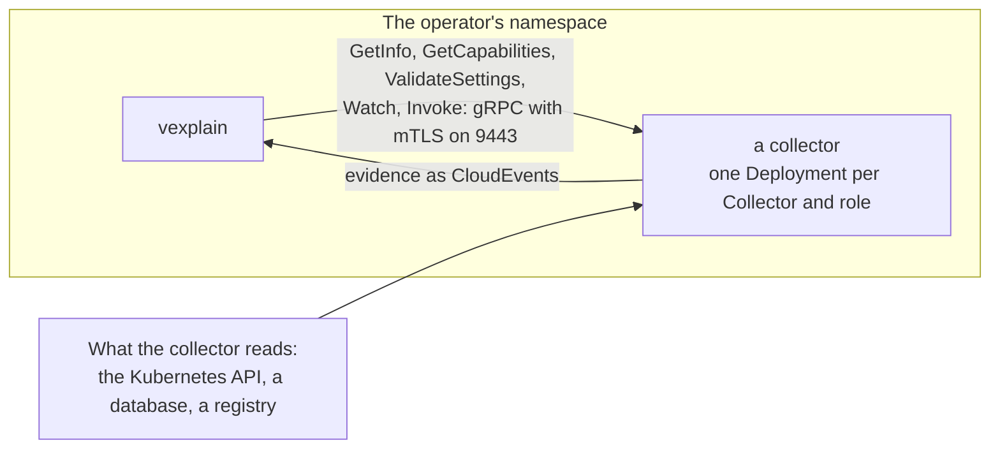
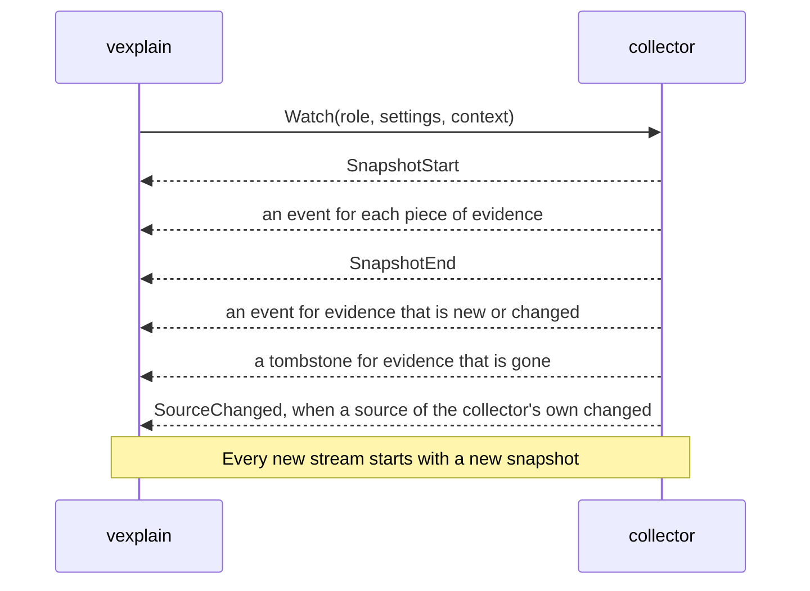

# How to write a collector

A collector is how evidence gets into vexplain. This guide explains how one works, and what you build to add your own: the API that it implements, the evidence it sends, the settings it takes, the image it ships as and the resources that install it.

The [design of collectors, evidence and rules](design/2026-10-31-collectors-evidence-rules.md) gives the reasons for each rule, and this guide links to its sections. The guide says what the contract is, and the design says why.

To start, copy the [template project](../templates/collector), a minimal collector with everything below in place: its README walks through the first hour.

> **Where this stands.** The SDK (`sdk/`), its conformance suite and the template exist. The `Collector` and `CollectorRuntimeConfig` resources, the deployer that reads them and the SDK's helpers for pods that a collector creates itself arrive with the rest of phase 2b. Their sections below describe the design (sections 5.2, 5.4, 5.8 and 5.9).

## What a collector is

**A collector is a gRPC server, shipped as an OCI image, that sends evidence to vexplain.**

- It implements one API, `vexplain.collector.v1alpha1`. Anyone may write a collector, in any language, and vexplain's own collectors use the same path ([0029](decisions/0029-collector-packages.md)).
- Evidence travels as [CloudEvents](https://cloudevents.io), and each collector brings its own types of it ([0032](decisions/0032-evidence-as-cloudevents.md)).
- A `Collector` resource installs the image, and installed means enabled. vexplain deploys it in its own namespace, calls it over mutual TLS and rotates its certificates.
- A collector takes care of what it needs, such as registry credentials, and says what it needs from the Kubernetes API. vexplain doesn't dictate how it works.



vexplain calls each collector in its own cluster. The spoke opens the connection to the hub, and the hub holds no credentials for a spoke. See [design 5.2 to 5.4](design/2026-10-31-collectors-evidence-rules.md#52-collectors-and-their-packages).

## The API

| Service | Call | Does |
|---|---|---|
| Identity | `GetInfo` | The collector's name, its version and the API versions that it speaks. It must list `v1alpha1`: vexplain uses the newest version that both sides know. |
| Identity | `GetCapabilities` | What the collector does: its roles, the types of evidence it produces with their scopes and schemas, the types it consumes, whether it watches, its operations, the schema of its settings and the Kubernetes permissions it needs. |
| Identity | `ValidateSettings` | The problems with settings, beyond what their schema finds. None means that they are valid. |
| Evidence | `Watch` | A stream of the collector's evidence: a full snapshot, and then each change. |
| Evidence | `Invoke` | Runs one operation for one subject, and answers with events, a failure with a reason, or both. |
| Health | the standard `grpc.health.v1` | `SERVING` or not. |

Every `Watch` and `Invoke` carries the collector's **settings** and vexplain's **context** for the cluster, so that a collector keeps no configuration state of its own. A change in either restarts the stream. The context holds:

| Field | Holds |
|---|---|
| `cluster` | The cluster's name. |
| `operator_namespace` | The namespace of vexplain's operator. |
| `own_pod_label` | The label that marks vexplain's own pods, such as its scan pods. It counts only in the operator's namespace. |
| `scope` | `OperatorConfig`'s `spec.scope`, as JSON: which pods vexplain analyses. |
| `owner_attribution` | `OperatorConfig`'s `spec.ownerAttribution`, as JSON: the labels and annotations that may be copied into evidence. |

### The stream of a Watch



- **A stream holds one snapshot.** It starts with `SnapshotStart`, sends an event for each piece of evidence that the collector has, and ends the snapshot with `SnapshotEnd` within a minute. Only a snapshot that ended is complete, so vexplain takes nothing of it before, and a stream that breaks in the middle leaves the last complete snapshot as it was.
- **Changes come after the snapshot:** an event for evidence that is new or changed, a tombstone for evidence of a type and a subject that is gone, and `SourceChanged` when a source of the collector's own changed, such as a vulnerability database. vexplain then invokes the collector's operations again, for the subjects that `SourceChanged` names, or for every subject when it names none.
- **Every new stream starts with a snapshot,** so that vexplain can reconnect at any time, as Envoy's state-of-the-world discovery and Kubernetes' list-and-watch do. A collector keeps no state per connection.
- **A `Watch` is for a role.** A collector that takes both roles gets one `Watch` for each.

### Failures

`Invoke` returns the events of its answer, or a **failure** with a reason: `Unauthorized`, `NotFound`, `TooLarge` and so on. A failure always has a reason, and a message that says more. vexplain records a failure for its subject, and never counts it against the collector's health. The reasons come from a vocabulary that vexplain defines and keeps open. It starts with the reasons of the image scans of phase 2a: `NotPullable`, `PullFailed`, `Unauthorized`, `NotFound`, `NoMatchingPlatform`, `TooLarge`, `CatalogFailed`, `TimedOut` and `Internal`.

A collector that can't answer for one subject says why with a failure, and keeps the gRPC error for what keeps it from answering at all.

### Limits

- A gRPC message is at most 16 MiB, both ways. vexplain compresses its calls with gzip, and a collector must accept that.
- vexplain's evidence store keeps a piece of evidence only up to 786432 bytes (768 KiB), compressed. Evidence over the cap fails as `TooLarge`, with no verdict, so bound the data of each type.
- Each type documents what its `data` means, in its schema.

## With the Go SDK

The Go SDK, `github.com/bedag/vexplain/sdk`, is a module of its own, so that a collector doesn't import the operator's dependencies. It implements the API, and you write what the collector does:

```go
// A collector describes itself with Info and Capabilities. One that streams evidence also implements
// Watcher, one with operations Invoker, and one that checks its settings beyond their schema
// SettingsValidator. The template has the whole of this.
type hello struct{}

func (h *hello) Info() collector.Info { return collector.Info{Name: "hello", Version: "0.1.0"} }

func (h *hello) Capabilities() collector.Capabilities {
	return collector.Capabilities{
		Roles:    []collector.Role{collector.RoleSpoke},
		Produces: []collector.EvidenceType{{Type: eventType, Scope: collector.ScopeSpoke, Schema: []byte(helloSchema)}},
		Watches:  true,
	}
}

func (h *hello) Watch(ctx context.Context, req collector.WatchRequest, sink collector.Sink) error {
	// SnapshotStart, an Event for each piece of evidence, SnapshotEnd, and then the changes.
}

func main() {
	// Serve runs until ctx ends, which the template's main ties to SIGTERM.
	err := collector.Serve(ctx, &hello{}, collector.OptionsFromEnv())
}
```

`Serve` runs two servers: the collector API and the standard health service over mutual TLS on port 9443, and `/healthz`, `/readyz` and `/metrics` in plain HTTP on port 8081. It holds the collector to the contract, so that vexplain never gets what breaks it:

- It refuses to start a collector whose capabilities contradict themselves, that doesn't implement what they say, or whose settings schema or operation parameter schema doesn't compile.
- It checks settings against their schema, and with `ValidateSettings`, before a `Watch` or an `Invoke` runs, and an operation's parameters against the operation's schema.
- It holds a stream to its order, and checks that each event is valid evidence of a type that the capabilities list. A call that breaks the contract ends with an error, and the SDK tells the collector why.
- It ends the calls that a stop cut short with `Unavailable`, so that an answer that was cut short never looks complete.

The SDK does **not** check an event's data against its type's schema. The conformance suite does (below).

The deployer sets the environment that `OptionsFromEnv` reads, and its defaults are what the deployer sets:

| Variable | Is | Default |
|---|---|---|
| `VEXPLAIN_LISTEN` | where the collector API is served | `:9443` |
| `VEXPLAIN_HEALTH_LISTEN` | where `/healthz`, `/readyz` and `/metrics` are served | `:8081` |
| `VEXPLAIN_TLS_DIR` | where `tls.crt`, `tls.key` and `ca.crt` are | `/run/vexplain/tls` |

`/readyz` answers 503 until the TLS files load, and the SDK loads them again within 30 seconds of a change, so that a renewed certificate is served well before the old one expires. The deployer also sets `VEXPLAIN_COLLECTOR_NAME` and `POD_NAMESPACE`, for the collector's own use. Metrics of a collector's own go in the registry that it passes in `Options.Registry`; they start with `vexplain_` and carry the label `cluster`.

## Evidence types and scopes

**A type** is the CloudEvents `type` of a kind of evidence, named in reverse-DNS by whoever defines it, with a version: `com.example.hello.v1alpha1`. The pattern is `^[a-z0-9-]+(\.[a-z0-9-]+)+\.v[0-9]+((alpha|beta)[0-9]+)?$`. A change that breaks the shape of the data needs a new version.

- **Each type has a JSON Schema** for its `data`, which the collector returns from `GetCapabilities`. The data is JSON, and the event's `datacontenttype` is `application/json`. Say in the schema what each field means, and what the `coverage` of the evidence counts: the people who write rules look it up there.
- **Each type has a scope,** as a CRD does:
  - `Hub` evidence goes to the hub, which collects it across clusters. Its subjects must be unique across clusters: an image digest is, and a virtual machine's subject includes its cluster.
  - `Spoke` evidence stays in its cluster. A collector whose spoke evidence matters at the hub also produces a `Hub` type that summarises it.
- **The core reads three types,** and no other. The SDK defines them, with their schemas (`evidence.Schema`) and Go types, and a collector that produces one sends its data in that shape:

  | Type | Subject | Scope | The core reads it for |
  |---|---|---|---|
  | `ch.bedag.vexplain.presence.v1alpha1` | an image | Spoke | What runs where: the container playbook's subjects, scans and reports |
  | `ch.bedag.vexplain.findings.v1alpha1` | a platform manifest, or a collector's own subject | Hub | The findings that playbooks assess: a CVE in a package, with its version, fix and exploitation |
  | `ch.bedag.vexplain.exposure.v1alpha1` | a workload | Spoke | Urgency |

- **Everything else is the collector's own type.** The core passes it on without reading it. Rules and playbooks that name the type read it, and the agent reaches it through its tools.

An event is built with `evidence.New(type, subject, data, options...)`: it sets the identifier, the time, the data's content type and the dataschema `urn:vexplain:schema:<type>`. The options set the source, which names the collector and its cluster or the hub (`/clusters/cluster-a/collectors/hello`), the time, the coverage and the platform. `evidence.Validate` is what the SDK and the conformance suite check an event with.

See [design 5.5](design/2026-10-31-collectors-evidence-rules.md#55-evidence-0032).

## Subjects

A **subject** says what a piece of evidence is about. It is a path with a prefix, and the prefix is its kind. The package `sdk/subject` builds and parses them.

| Subject | About | Built with |
|---|---|---|
| `image/sha256:<64 hex>` | a reported image digest, which can be an index | `subject.Image` |
| `manifest/sha256:<64 hex>` | the manifest of one platform of an image | `subject.Manifest` |
| `workload/<cluster>/<namespace>/<Kind>[.<group>]/<name>` | a workload, such as `workload/cluster-a/team-a/Deployment.apps/web` or `workload/cluster-a/team-a/Pod/web-0` | `subject.ForWorkload` |

- **A collector may add prefixes of its own,** such as `vm/<cluster>/<name>`. The core passes them on without interpreting them. Evidence of a `Hub` type needs subjects that are unique across clusters.
- **An event about a manifest carries `platform`** (below), so that the platforms of a digest can be listed without knowing the type. `evidence.Validate` refuses one without.
- A subject that doesn't parse makes the event invalid: a `Watch` that sends it ends with an error.

## Coverage and platform

Evidence can carry two **extension attributes**, besides the attributes that CloudEvents defines:

- **`coverage`** is a whole number from 0 to 100: how much of the subject the evidence covers. Each type documents what it counts. The scanner's, for example, is the share of an image's ELF files that packages own. The data says what the collector couldn't examine.
- **`platform`** is `os/arch` or `os/arch/variant`, such as `linux/amd64`: the platform that the evidence is about.

**vexplain shows and records coverage, and never interprets it.** How much is enough is the call of the rule that reads the evidence, and a rule settles a finding only when every input it names is present. So missing evidence never settles anything, and a collector never needs to hide what it couldn't see: it states it. Set the coverage with `evidence.WithCoverage` and the platform with `evidence.WithPlatform`.

## Settings

**Settings are the collector's own.** An admin writes them in `spec.settings` of the `Collector`, as an object of any shape. vexplain can't know a third party's settings, so it checks them against the schema that the collector returns from `GetCapabilities`, and with `ValidateSettings`, and reports `SettingsInvalid` when they fail. There is no admission webhook.

- **The schema stands alone.** It refers to nothing outside itself: vexplain compiles it from the capabilities, without the collector's files. A collector whose schema doesn't compile is `PackageInvalid`.
- **Without settings, the collector gets an empty object `{}`,** and a schema decides whether it needs any.
- **`ValidateSettings` is for what a schema can't check,** such as a combination of fields. It only sees settings that passed the schema. Return the problems as text, and none for valid settings.
- **Settings carry no secret values.** A `Collector`'s spec is readable by everyone who can read collectors. Credentials live in Secrets that the collector reads itself, with the permissions that it declares. Because of that, an error about settings can repeat a value: a schema error says what broke the schema, such as `at '/repeat': minimum: got 0, want 1`, and a `ValidateSettings` problem is the collector's own text. If a setting were a secret, its value would end up in `status` and in events.
- **A change in the settings restarts the stream.**

A collector that reads Secrets, such as registry pull secrets, reads them with `get` only, and keeps their values out of its logs, errors, metrics and evidence.

## Operations

An **operation** is work that a collector does on demand, for one subject, through `Invoke`. The matcher's `match`, which finds the vulnerabilities in an image's contents, is one.

- **Each operation declares** its name, its description, its role, the types it produces, the types it consumes and the JSON Schema of its parameters. The SDK checks the parameters against the schema, and an operation without one takes any JSON. The agent sees each operation as a tool, named after the `Collector` and the operation, with the parameter schema as the tool's input schema ([0031](decisions/0031-tools-from-collectors.md)). A collector's author gets agent support without extra work.
- **An operation consumes evidence.** When it consumes a type, vexplain gets that type first and passes the events as `Inputs`: the matcher consumes the scanner's image contents. Each input is valid evidence of a type that the operation consumes.
- **It answers with events of the types it produces, a failure, or both.** An empty answer is allowed: it says nothing about the subject.
- **An operation runs in a role** that the collector takes.

vexplain invokes operations for each subject of a playbook, when a collector signals a change in a source of its own, and when the agent calls a tool. See [design 5.6](design/2026-10-31-collectors-evidence-rules.md#56-evidence-on-demand).

## Packaging

- **A package is an OCI image.** One image holds one collector, and a collector may cover several sources. The installer references it by tag or by digest, and vexplain records the digest that runs.
- **It runs as non-root,** on a base such as distroless static, and writes nothing outside the volumes that its runtime config mounts: vexplain runs it with a read-only root filesystem.
- **It listens where `VEXPLAIN_LISTEN` and `VEXPLAIN_HEALTH_LISTEN` say,** by default on 9443 for the collector API with mutual TLS, and on 8081 for plain HTTP. It serves the certificate in `tls.crt` with its key, and requires a client certificate that the authority in `ca.crt` signed. vexplain's authority is a small one that the operator keeps in a Secret, and it rotates the certificates.
- **Its name and version** come from `GetInfo`. vexplain stores evidence at the version, so a new version replaces what an old one delivered.
- **The template builds all of this:** a `Dockerfile` on distroless static, as non-root, and a `Makefile` with `make docker-build`.

## The `Collector` resource

A `Collector` (`config.vexplain.bedag.ch/v1alpha1`, cluster-scoped) installs one collector, as a Crossplane `Provider` installs a provider. Installed means enabled.

```yaml
apiVersion: config.vexplain.bedag.ch/v1alpha1
kind: Collector
metadata:
  name: hello
spec:
  package: artifacts.example/collectors/hello:0.1.0
  runtimeConfigRef:
    name: default
  settings:
    greeting: Hello
```

| Field | Is |
|---|---|
| `spec.package` | The image. |
| `spec.runtimeConfigRef` | The `CollectorRuntimeConfig` to use. `default` if empty. |
| `spec.settings` | The collector's own settings, an object of any shape. |
| `status.packageDigest` | The digest that runs. |
| `status.version` | The version that `GetInfo` answered. |
| `status.capabilities` | What `GetCapabilities` answered, bounded in size. |
| `status.conditions` | `Ready`, with reasons such as `Healthy`, `CollectorFailing`, `NoData`, `PackageInvalid`, `IncompatibleAPI`, `SettingsInvalid`, `MissingPermissions` and `RuntimeConfigInvalid`. |
| `status.lastSuccessTime` | When the collector last delivered. |

- **Deleting a `Collector` removes it,** with its Deployment, its Service and its service account, and with the evidence that it delivered. There is no `state` field. A playbook that names a deleted collector isn't `Ready`, and the findings it covers are held open, never settled.
- **vexplain deploys one Deployment for each `Collector` and role,** in the operator's namespace, with a Service and a service account named `vexplain-collector-<name>`, a TLS Secret `vexplain-collector-<name>-tls`, and the label `vexplain.bedag.ch/collector: <name>`. The names stay when you upgrade, so that the service account keeps its bindings.
- **Upgrading means changing `spec.package`,** and changing it back is the rollback.
- **A collector's health gates new requests, not what it already delivered.** One that is unhealthy or incompatible gets no new requests, and its `Ready` condition says so. Its evidence stays until the collector replaces it. A failure about one subject, and a stream that breaks, are no health failures.
- **vexplain's install ships its own collectors** as `Collector` manifests. The operator creates none at run time, so a deleted built-in stays deleted.

See [design 5.2](design/2026-10-31-collectors-evidence-rules.md#52-collectors-and-their-packages) and [5.9](design/2026-10-31-collectors-evidence-rules.md#59-trust-and-permissions).

## RBAC

**A collector declares the Kubernetes permissions that it needs, and an admin grants them.**

- **`Capabilities.Permissions`** lists them as RBAC rules: API groups, resources and verbs, and whether they hold in the collector's own namespace only. The list is what the collector needs, and no more.
- **vexplain checks that its service account holds them,** with a `SubjectAccessReview` for each, and reports what is missing as `MissingPermissions`.
- **vexplain grants none.** Granting would need the `escalate` and `bind` permissions, which vexplain shouldn't hold. vexplain's install binds the roles of its own collectors, and the admin who installs another binds its roles to its service account:

```yaml
apiVersion: rbac.authorization.k8s.io/v1
kind: ClusterRole
metadata:
  name: vexplain-collector-hello
rules:
  - apiGroups: [""]
    resources: ["pods"]
    verbs: ["get", "list", "watch"]
---
apiVersion: rbac.authorization.k8s.io/v1
kind: ClusterRoleBinding
metadata:
  name: vexplain-collector-hello
roleRef:
  apiGroup: rbac.authorization.k8s.io
  kind: ClusterRole
  name: vexplain-collector-hello
subjects:
  - kind: ServiceAccount
    name: vexplain-collector-hello
    namespace: vexplain-system
```

- **vexplain's own collectors stay read-only towards workloads:** they get, list and watch, never write to analysed workloads and never exec into pods. Installing a third-party collector means trusting it, and its admin knows what it does.
- **The operator itself reads no pods, nodes, Secrets or service accounts** outside its namespace. The collectors that need them hold those permissions.

## The runtime config

A `CollectorRuntimeConfig` (`config.vexplain.bedag.ch/v1alpha1`, cluster-scoped) shapes the Deployment that a collector runs in, as Crossplane's `DeploymentRuntimeConfig` does ([0030](decisions/0030-collector-runtime-config.md)). A `Collector` names one in `spec.runtimeConfigRef`, and `default` applies when it names none: the operator creates it empty, and never overwrites it.

| Field | Shapes |
|---|---|
| `spec.deploymentTemplate` | The collector's Deployment. |
| `spec.serviceAccountTemplate` | The metadata of its service account, such as an annotation for a cloud identity. |

```yaml
apiVersion: config.vexplain.bedag.ch/v1alpha1
kind: CollectorRuntimeConfig
metadata:
  name: hello
spec:
  deploymentTemplate:
    spec:
      template:
        spec:
          nodeSelector:
            kubernetes.io/os: linux
          containers:
            - name: collector
              resources:
                limits:
                  memory: 256Mi
```

- **Templates are merged onto vexplain's defaults** as a strategic merge patch. The collector's container is named `collector`.
- **The defaults are hardened:** non-root with the `RuntimeDefault` seccomp profile, no privilege escalation, a read-only root filesystem, all capabilities dropped, and `imagePullPolicy: IfNotPresent`.
- **Everything can be changed,** and vexplain sets the contract's fields last: the image, the certificates, the ports and the contract's environment variables.
- **Write access to a `Collector` or a `CollectorRuntimeConfig` amounts to creating pods in vexplain's namespace,** which Kubernetes' RBAC good practices treat as access to every Secret and service account there. So it is only for people who are trusted with that namespace.
- **The pods that a collector creates itself,** such as scan Jobs, are not shaped by its runtime config. Its settings configure them, with the SDK's standard pod template, so that every collector that creates pods takes the same shape.

See [design 5.8](design/2026-10-31-collectors-evidence-rules.md#58-runtime-config-0030).

## Conformance

**The conformance suite runs a collector against the contract,** as CSI's `csi-sanity` does for storage drivers. Every collector of vexplain's own passes it in CI, and so should yours, before vexplain runs it. A version of the API reaches `v1` only together with the suite. The suite calls the collector over gRPC, as vexplain does, so it also tests collectors in other languages.

Serve the collector in a test, and run the suite against it:

```go
func TestConformance(t *testing.T) {
	conformance.Run(t, conformance.Target{
		Dial:            dialTheCollector,
		Settings:        json.RawMessage(`{"greeting": "Hello"}`),
		InvalidSettings: json.RawMessage(`{"greeting": ""}`),
		Context:         collector.Context{Cluster: "cluster-a"},
	})
}
```

The template's test serves its collector in the process of the test, on a `bufconn` listener, with `collector.Serve` and `Options.Insecure`, and `Dial` returns a connection to it. `Run` reports each check as a subtest of the `*testing.T` that it gets, named by its group and what it checks, such as `Watch/spoke/reaches SnapshotEnd in time`. `RunWith` takes any `Reporter`, the part of `testing.T` that the suite uses, which a test of the suite itself replaces with one that records.

| `Target` | Is |
|---|---|
| `Dial` | Connects to the collector. The suite closes the connection. |
| `Settings` | Valid settings, sent with every call. |
| `InvalidSettings` | Optional: settings that the collector must refuse. |
| `Context` | What vexplain tells the collector about its cluster. |
| `Invocations` | The operations to call, each with a subject, parameters and inputs: evidence of the types that the operation consumes. |
| `Client` | Optional: a Kubernetes client, which turns on the presence check. |

**What it checks:**

- `GetInfo` has a name, a version and `v1alpha1`, and `GetCapabilities` answers.
- Every schema in the capabilities compiles. Every type that the collector produces is reverse-DNS and versioned, and has a scope. Every operation produces only declared types, and the collector takes a role.
- The `Settings` pass the schema and `ValidateSettings`, and `InvalidSettings`, when set, don't.
- For a collector that watches, for each role: `Watch` starts with `SnapshotStart` and reaches `SnapshotEnd` within 60 seconds, with only events in between, and a second `Watch` starts with a snapshot again.
- Every event of a snapshot is valid evidence, of a declared type, and its `data` validates against the schema of its type.
- Each invocation, with its `Inputs`, returns valid events, of types that its operation produces, or a failure with a reason.

### The presence check

A collector that produces the presence type reads the pods of a cluster, and has to apply two things that vexplain tells it in its context: the **scope**, and the **label of vexplain's own pods**. The suite checks that it does, against a cluster for tests. It needs a Kubernetes client for that: `Target.Client`, a client of the cluster that the collector reads, such as an [envtest](https://book.kubebuilder.io/reference/envtest) API server or a kind cluster. A collector that produces the presence type and gets no client fails the check. Pass the client of a cluster for tests, and never of one that anyone uses: the suite creates namespaces and pods in it, and deletes the namespaces when it is done.

```go
env := &envtest.Environment{}
cfg, err := env.Start()
// ...
kubernetes, err := client.New(cfg, client.Options{})
// Start the collector with a client of the same cluster, and pass kubernetes as Target.Client.
```

The `scope` in the context is `OperatorConfig`'s `spec.scope`, as JSON. It has four optional label selectors:

```json
{
  "includeNamespaces": {"matchLabels": {"team": "a"}},
  "excludeNamespaces": {"matchExpressions": [{"key": "vexplain", "operator": "In", "values": ["off"]}]},
  "includePods": {"matchLabels": {"analyse": "true"}},
  "excludePods": {"matchExpressions": [{"key": "skip", "operator": "Exists"}]}
}
```

- A pod is in scope when its namespace passes the namespace selectors and the pod passes the pod selectors. An include selector that is absent or empty selects everything, and an exclude selector that is absent excludes nothing. **The exclude selector wins** over the include selector.
- **vexplain's own pods** carry the label that `own_pod_label` names, **in the operator's namespace.** The label counts only there: anyone who can create pods can set a label, so if it counted in every namespace, adding it would hide a workload from triage.

The suite sets a scope, an operator namespace and an own-pod label of its own, with names that are not vexplain's, so that a collector can't pass by having vexplain's label in its code. It creates four namespaces and eight pods and sets each pod's container image ID through the status subresource, since envtest runs no kubelet. Then it takes a snapshot, and checks that the collector:

- lists the pod that the scope selects;
- leaves out the pods that the scope excludes, by namespace and by pod, through the include selectors and the exclude selectors, and leaves them out of the workloads of an image that a pod in scope runs too;
- leaves out the pod that carries the own-pod label in the operator's namespace;
- lists a pod that carries the own-pod label in another namespace.

A collector that reads through a cache may not see a pod that was created just now, so the suite takes another snapshot until the pods that must be listed are, within 30 seconds. A pod that must be left out and is listed fails at once.

## Before you ship

- [ ] The type names are reverse-DNS and versioned, each type has a scope and a schema, and each schema says what the coverage counts.
- [ ] The settings have a schema that stands alone, and no setting is a secret.
- [ ] The permissions in `Capabilities` are what the collector needs, and no more.
- [ ] Evidence about a manifest carries `platform`, and `Hub` evidence has subjects that are unique across clusters.
- [ ] The conformance test passes, with invalid settings and an invocation of each operation.
- [ ] The image runs as non-root with a read-only root filesystem, and `GetInfo` reports its version.

## Where to go next

- The [template project](../templates/collector) and its README.
- The [design of collectors, evidence and rules](design/2026-10-31-collectors-evidence-rules.md), especially [5.2 to 5.5](design/2026-10-31-collectors-evidence-rules.md#52-collectors-and-their-packages), [5.8 to 5.9](design/2026-10-31-collectors-evidence-rules.md#58-runtime-config-0030) and [5.11](design/2026-10-31-collectors-evidence-rules.md#511-sdk-template-and-conformance).
- The decision records [0029](decisions/0029-collector-packages.md), [0030](decisions/0030-collector-runtime-config.md), [0031](decisions/0031-tools-from-collectors.md) and [0032](decisions/0032-evidence-as-cloudevents.md).
- The packages of the SDK: `sdk/collector` (the server), `sdk/evidence` (events, the core's types and their schemas), `sdk/subject` and `sdk/conformance`.
