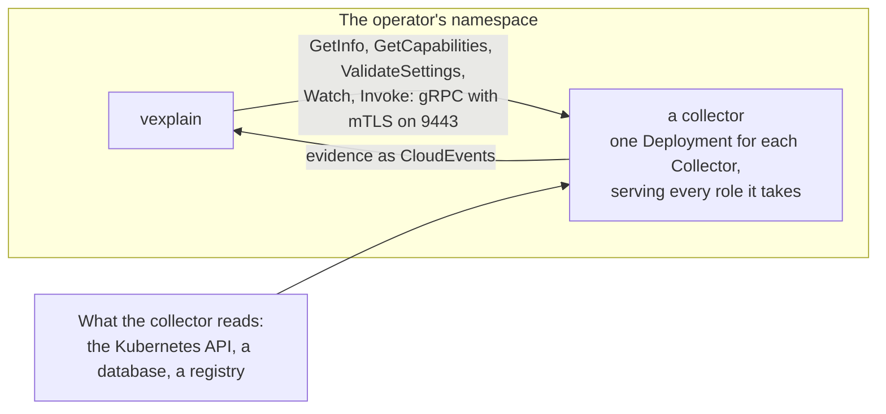
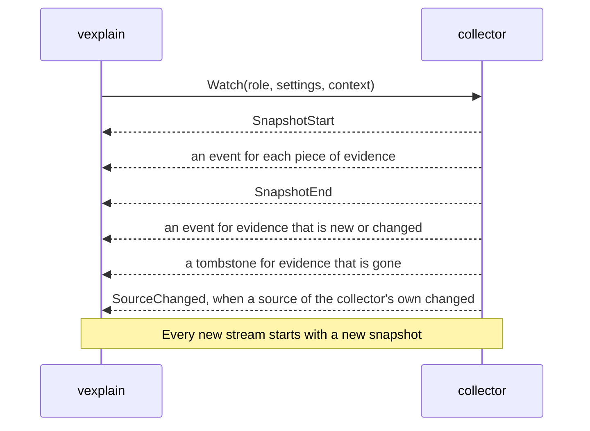

# How to write a collector

A collector is how evidence gets into vexplain. This guide explains how one works, and what you build to add your own: the API that it implements, the evidence it sends, the settings it takes, the image it ships as and the resources that install it.

The [design of collectors, evidence and rules](design/2026-10-31-collectors-evidence-rules.md) gives the reasons for each rule, and this guide links to its sections. The guide says what the contract is, and the design says why.

To start, copy the [template project](../templates/collector), a minimal collector with everything below in place: its README walks through the first hour.

> **Where this stands.** The SDK (`sdk/`), its conformance suite, the template, the `Collector` and `CollectorRuntimeConfig` resources, the deployer that reads them and the SDK's helpers for pods that a collector creates itself exist. vexplain's install ships four collectors of its own, in `config/collectors`: `workloads`, `scanner`, `vulnerabilities` and `network-reach`. The internal reach that `network-reach` reports reads only Kubernetes NetworkPolicies and Cilium's two policy kinds, so where another policy engine, such as admin network policies or another CNI's own kinds, allows more, a workload's reach may be wider than reported.

## What a collector is

**A collector is a gRPC server, shipped as an OCI image, that sends evidence to vexplain.**

- It implements one API, `vexplain.collector.v1alpha1`. Anyone may write a collector, in any language, and vexplain's own collectors use the same path ([0029](decisions/0029-collector-packages.md)).
- Evidence travels as [CloudEvents](https://cloudevents.io), and each collector brings its own types of it ([0032](decisions/0032-evidence-as-cloudevents.md)).
- A `Collector` resource installs the image, and installed means enabled. vexplain deploys it in its own namespace, calls it over mutual TLS and rotates its certificates.
- A collector takes care of what it needs, such as registry credentials, and says what it needs from the Kubernetes API. vexplain doesn't dictate how it works.



vexplain calls each collector in its own cluster. The spoke opens the connection to the hub, and the hub holds no credentials for a spoke. See [design 5.2 to 5.4](design/2026-10-31-collectors-evidence-rules.md#52-collectors-and-their-packages).

## The API

| Service | Call | Does |
|---|---|---|
| Identity | `GetInfo` | The collector's name, its version, the API versions that it speaks and the versions of its own sources. It must list `v1alpha1`: vexplain uses the newest version that both sides know. |
| Identity | `GetCapabilities` | What the collector does: its roles, the types of evidence it produces with their scopes and schemas, the types it consumes, whether it watches, its operations, its schedules, the schema of its settings and the Kubernetes permissions it needs. |
| Identity | `ValidateSettings` | The problems with settings, beyond what their schema finds. None means that they are valid. |
| Evidence | `Watch` | A stream of the collector's evidence: a full snapshot, and then each change. |
| Evidence | `Invoke` | Runs one operation for one subject, and answers with events, a failure with a reason, or both. |
| Evidence | `Fire` | Runs one of the collector's schedules now, and answers within 10 seconds. |
| Health | the standard `grpc.health.v1` | `SERVING` or not. |

Every `Watch`, `Invoke` and `Fire` carries the collector's **settings** and vexplain's **context** for the cluster, so that a collector keeps no configuration state of its own. A change in either restarts the stream. The context holds:

| Field | Holds |
|---|---|
| `cluster` | The cluster's name. |
| `operator_namespace` | The namespace of vexplain's operator. |
| `own_pod_label` | The label that marks vexplain's own pods, such as its scan pods. It counts only in the operator's namespace. |
| `scope` | `OperatorConfig`'s `spec.scope`, as JSON: which pods vexplain analyses. |
| `owner_attribution` | `OperatorConfig`'s `spec.ownerAttribution`, as JSON: the labels and annotations that may be copied into evidence. |

### The stream of a Watch



- **A stream holds one snapshot.** It starts with `SnapshotStart`, sends an event for each piece of evidence that the collector has, and ends the snapshot with `SnapshotEnd` within a minute. Only a snapshot that ended is complete, so vexplain takes nothing of it before, and a stream that breaks in the middle leaves the last complete snapshot as it was.
- **Changes come after the snapshot:** an event for evidence that is new or changed, a tombstone for evidence of a type and a subject that is gone, and `SourceChanged` when a source of the collector's own changed, such as a vulnerability database. vexplain then invokes the collector's operations again, for the subjects that `SourceChanged` names, or for every subject when it names none.
- **Every new stream starts with a snapshot,** so that vexplain can reconnect at any time, as Envoy's state-of-the-world discovery and Kubernetes' list-and-watch do. A collector keeps no state per connection.
- **A `Watch` is for a role.** A collector that takes both roles gets one `Watch` for each.

### Failures

`Invoke` returns the events of its answer, or a **failure** with a reason: `Unauthorized`, `NotFound`, `TooLarge` and so on. A failure always has a reason, and a message that says more. vexplain records a failure for its subject, and never counts it against the collector's health. The reasons come from a vocabulary that vexplain defines and keeps open. It starts with the reasons of the image scans of phase 2a: `NotPullable`, `PullFailed`, `Unauthorized`, `NotFound`, `NoMatchingPlatform`, `TooLarge`, `CatalogFailed`, `TimedOut` and `Internal`.

A collector that can't answer for one subject says why with a failure, and keeps the gRPC error for what keeps it from answering at all.

### Limits

- A gRPC message is at most 16 MiB, both ways. vexplain compresses its calls with gzip, and a collector must accept that.
- vexplain's evidence store keeps a piece of evidence only up to 786432 bytes (768 KiB), compressed. Evidence over the cap fails as `TooLarge`, with no verdict, so bound the data of each type.
- Each type documents what its `data` means, in its schema.
- **What a collector sends is bounded** ([design 5.9](design/2026-10-31-collectors-evidence-rules.md#59-trust-and-permissions)). A collector past a bound breaks the contract: vexplain ends the stream or the call, logs the collector and the bound, and counts it in `vexplain_collector_contract_breaks_total`, by the bound.

  | Bound | Is | Past it |
  |---|---|---|
  | `snapshot_time` | A snapshot ends within a minute of its `SnapshotStart`. | vexplain takes nothing of the snapshot, and opens the stream again after a pause. |
  | `snapshot_size` | The messages of a snapshot hold at most 64 MiB together. | The same. |
  | `answer_events` | An answer to `Invoke` holds at most 64 events, and fewer where the caller takes fewer: the hub takes one findings event from `match`. | vexplain reads no further, and takes none of the answer. An evidence request records the failure `Internal`. |
  | `answer_size` | The messages of an answer hold at most 128 MiB together: the scanner's answer about an image of 8 platforms holds a manifest's evidence in each of 8 messages of up to 16 MiB. | The same. |
  | `deadline` | An evidence request waits at most 103 hours for the answer: above the longest scan of the scanner, 6 hours, behind the scans of every other request that waits for one of its slots. | The request records the failure `TimedOut`. |

- **A `Watch` stays open after its snapshot,** until vexplain ends it. A stream that ends, breaks or breaks the contract opens again after a second, then after twice as long as the last time, and after a minute at most. Only a stream that stayed open for a minute past its snapshot starts the waits again from a second, so a `Watch` that returns after its snapshot is reopened ever more slowly, and never every second.

## With the Go SDK

The Go SDK, `github.com/bedag/vexplain/sdk`, is a module of its own, so that a collector doesn't import the operator's dependencies. It implements the API, and you write what the collector does:

```go
// A collector describes itself with Info and Capabilities. One that streams evidence also implements
// Watcher, one with operations Invoker, one with schedules Firer, one with sources of its own Sourcer,
// and one that checks its settings beyond their schema SettingsValidator. The template has the whole of this.
type hello struct{}

func (h *hello) Info() collector.Info { return collector.Info{Name: "hello", Version: "0.1.0"} }

func (h *hello) Capabilities() collector.Capabilities {
	return collector.Capabilities{
		Roles:    []collector.Role{collector.RoleSpoke},
		Produces: []collector.EvidenceType{{Type: eventType, Scope: collector.ScopeSpoke, Schema: []byte(helloSchema)}},
		Watches:  true,
	}
}

func (h *hello) Watch(ctx context.Context, req collector.WatchRequest, sink collector.Sink) error {
	// SnapshotStart, an Event for each piece of evidence, SnapshotEnd, and then the changes.
}

func main() {
	// Serve runs until ctx ends, which the template's main ties to SIGTERM.
	err := collector.Serve(ctx, &hello{}, collector.OptionsFromEnv())
}
```

`Serve` runs two servers: the collector API and the standard health service over mutual TLS on port 9443, and `/healthz`, `/readyz` and `/metrics` in plain HTTP on port 8081. It holds the collector to the contract, so that vexplain never gets what breaks it:

- It refuses to start a collector whose capabilities contradict themselves, that doesn't implement what they say, or whose settings schema or operation parameter schema doesn't compile. A collector with schedules must implement `Firer`, and one that implements `Firer` must declare schedules.
- It checks settings against their schema, and with `ValidateSettings`, before a `Watch`, an `Invoke` or a `Fire` runs, and an operation's parameters against the operation's schema.
- It answers `Fire` for a schedule that the collector didn't declare with `InvalidArgument`, and never calls the `Firer` for it.
- It holds a stream to its order, and checks that each event is valid evidence of a type that the capabilities list. A call that breaks the contract ends with an error, and the SDK tells the collector why.
- It ends the calls that a stop cut short with `Unavailable`, so that an answer that was cut short never looks complete.

The SDK does **not** check an event's data against its type's schema. The conformance suite does (below).

The deployer sets the environment that `OptionsFromEnv` reads, and its defaults are what the deployer sets:

| Variable | Is | Default |
|---|---|---|
| `VEXPLAIN_LISTEN` | where the collector API is served | `:9443` |
| `VEXPLAIN_HEALTH_LISTEN` | where `/healthz`, `/readyz` and `/metrics` are served | `:8081` |
| `VEXPLAIN_TLS_DIR` | where `tls.crt`, `tls.key` and `ca.crt` are | `/run/vexplain/tls` |

`/readyz` answers 503 until the TLS files load, and the SDK loads them again within 30 seconds of a change, so that a renewed certificate is served well before the old one expires. The deployer also sets `VEXPLAIN_COLLECTOR_NAME` and `POD_NAMESPACE`, for the collector's own use. Metrics of a collector's own go in the registry that it passes in `Options.Registry`; they start with `vexplain_` and carry the label `cluster`.

## Evidence types and scopes

**A type** is the CloudEvents `type` of a kind of evidence, named in reverse-DNS by whoever defines it, with a version: `com.example.hello.v1alpha1`. The pattern is `^[a-z0-9-]+(\.[a-z0-9-]+)+\.v[0-9]+((alpha|beta)[0-9]+)?$`, which the SDK exports as `evidence.TypePattern`, with `evidence.ValidType` to check a name against it. A change that breaks the shape of the data needs a new version.

- **Each type has a JSON Schema** for its `data`, which the collector returns from `GetCapabilities`. The data is JSON, and the event's `datacontenttype` is `application/json`. Say in the schema what each field means, and what the `coverage` of the evidence counts: the people who write rules look it up there.
- **Each type has a scope,** as a CRD does:
  - `Hub` evidence goes to the hub, which collects it across clusters. Its subjects must be unique across clusters: an image digest is, and a virtual machine's subject includes its cluster.
  - `Spoke` evidence stays in its cluster. A collector whose spoke evidence matters at the hub also produces a `Hub` type that summarises it.
- **The SDK defines four core types,** with their schemas (`evidence.Schema`) and Go types, and a collector that produces one sends its data in that shape. The core reads three of them, and no other type:

  | Type | Subject | Scope | The core reads it for |
  |---|---|---|---|
  | `ch.bedag.vexplain.presence.v1alpha1` | an image | Spoke | What runs where: the container playbook's subjects, scans and reports |
  | `ch.bedag.vexplain.findings.v1alpha1` | a platform manifest, or a collector's own subject | Hub | The findings that playbooks assess: a CVE in a package, with its version, fix and exploitation |
  | `ch.bedag.vexplain.exposure.v1alpha1` | a workload | Spoke | Urgency |
  | `ch.bedag.vexplain.sbom.v1alpha1` | a platform manifest | Hub | Nothing itself: it is the package inventory that any producer can write and any consumer can read, below |

- **Everything else is the collector's own type.** The core passes it on without reading it. Rules and playbooks that name the type read it, and the agent reaches it through its tools.
- **Playbooks name types, not collectors** ([0043](decisions/0043-playbook-matching.md)). Every `Collector` that produces a type counts for a playbook that names it, unless the playbook's entry pins its producers by `Collector` name, so a collector that produces a type joins the playbooks that read it without a change of theirs. The evidence of each producer is evaluated apart, and the most cautious outcome wins: your evidence can hold a finding open, but never settle it against another producer's.

An event is built with `evidence.New(type, subject, data, options...)`: it sets the identifier, the time, the data's content type and the dataschema `urn:vexplain:schema:<type>`. The options set the source, which names the collector and its cluster or the hub (`/clusters/cluster-a/collectors/hello`), the time, the coverage and the platform. `evidence.Validate` is what the SDK and the conformance suite check an event with.

See [design 5.5](design/2026-10-31-collectors-evidence-rules.md#55-evidence-0032).

### The sbom type

`ch.bedag.vexplain.sbom.v1alpha1` is a subject's package inventory, with the producer's SBOM document when it has one ([0044](decisions/0044-sbom-type.md)). The `scanner` produces it for each platform manifest of an image, beside its own `image-contents`, and the `vulnerabilities` collector consumes it. Any other producer, such as a scanner of virtual machines' disks, or SBOMs attached to images in a registry, can feed the same consumers. `evidence.SBOM` is its Go type.

- **An event of it is about a manifest,** with `platform`, and its scope is `Hub`. Its `coverage` is the producer's: the scanner's is the share of the image's ELF files that packages own, as for its `image-contents`.
- **Its data:**
  - `distro`: the distribution, in the words of os-release: `id`, and, where it has them, `version` (`VERSION_ID`), `codename` (`VERSION_CODENAME`) and `idLike` (`ID_LIKE`). A matcher picks the distribution's advisories by them: a derivative whose ID it doesn't know is the distribution that `idLike` names, and a release without a version, such as Debian's testing, is its codename. Leave it out when you found no distribution.
  - `packages`: each package with its `id`, `name`, `version`, `type`, `purl` and `cpes`, and an RPM's `modularityLabel`. `[]` when the subject has none, never `null`.
  - `producer`: its `name` and `version`, such as Syft at its version.
  - `failedCatalogers`: the catalogers of the producer that failed, whose packages the inventory may lack.
  - `document`: the producer's SBOM document. Its `format` is `syft-json`, `cyclonedx-json` or `spdx-json`, Syft's names of formats that Grype reads, and its `content` is the document itself, a JSON object. The scanner sends Syft's JSON without its file lists, as phase 2b did, and makes `packages` of the same document.
- **Each package has an ID of its own.** A match names its package by the ID, and rules join a finding to the package's other evidence by it, so an SBOM whose packages share an ID is no input to match.
- **Send your SBOM document when you have one.** `vulnerabilities` hands it to Grype as it is, so Grype matches all that the document holds, also what a later Grype reads more of. Keep `packages` beside it, each with the ID that the document gives it as Syft reads it: an artifact's `id` in Syft's JSON, a component's `bom-ref` in CycloneDX, and a package's `SPDXID` in SPDX, without its `SPDXRef-` prefix. A match names its package by that ID, and rules join a finding to the package by it. The rest of this list is what `vulnerabilities` reads when you send no document.
- **The type is Syft's,** such as `deb`, `rpm`, `apk`, `go-module` or `java-archive`, because the `vulnerabilities` collector hands the packages to Grype.
- **A package's purl names its source package and its distribution,** as Syft writes them, in the qualifiers `upstream` and `distro`, such as `pkg:deb/debian/libssl3@3.0.17-1~deb12u2?arch=amd64&distro=debian-12&upstream=openssl`. Debian, RPM-based and Alpine distributions track many vulnerabilities by the source package, such as `openssl` for `libssl3`, so a purl without `upstream` means missed vulnerabilities, which no coverage shows. Write `upstream` as Syft does:
  - a Debian package: the source package, and its version after `@` when the package's version differs from it;
  - an RPM: the name of its source RPM;
  - an Alpine package: its origin, when the origin is another package.

  A producer that has none of this writes the purl without the qualifier. Rewrite nothing that Syft wrote: the consumer reads the qualifiers as Grype's own purl input does.
- **An RPM's `modularityLabel` names its module stream,** as Syft reads it from the rpm database, such as `nodejs:20:8090020240101000000:a1b2c3d4`: `""` for an RPM of no module stream, and absent when you don't know, as Syft doesn't for an rpm file. No purl that Syft writes carries it. RPM-based distributions publish advisories per module stream, and a matcher applies those of every stream to an RPM without a label: on AlmaLinux, Grype drops a vulnerability that AlmaLinux says a release fixed, so one stream's fix would hide the vulnerability of another.

**How `vulnerabilities` reads it.** With a document, it hands Grype the document as it is, as phase 2b did with Syft's JSON: the matches are then the document's by construction, and stay so when a later Grype reads more of it. A document that Grype can't read fails the match, and the packages are no fallback for it: a document built from them would drop, without saying so, what only the producer's document holds.

Without a document, it hands Grype a document of Syft's JSON that it makes of the data: each package under its ID, with its name, version, type, purl and CPEs, and the source package of an OS package from the purl's `upstream`, where Grype reads it from a Syft document: a Debian package's `source` and `sourceVersion`, an RPM's `sourceRpm`, and an Alpine package's `originPackage`, which is the package itself when the purl names none. An RPM's metadata has its `modularityLabel` too. The distribution is the data's `distro`. For the fixtures, Grype then reads the same packages as from Syft's own JSON, and gives the same matches: the collector's tests hold its document to Syft's JSON of fixtures with a source package of each kind and an RPM of a module stream, through Grype's own package provider. A few rare inputs still match less than from Syft's full document, which [0044](decisions/0044-sbom-type.md) lists: a producer that sends its document avoids them. What else Syft's JSON has, Grype reads only to drop matches, such as those of a package whose files an OS package owns, or those of a Go program's own module, or the document has it already, as an RPM's version has its epoch: without it, Grype finds no fewer vulnerabilities.

## Subjects

A **subject** says what a piece of evidence is about. It is a path with a prefix, and the prefix is its kind. The package `sdk/subject` builds and parses them.

| Subject | About | Built with |
|---|---|---|
| `image/sha256:<64 hex>` | a reported image digest, which can be an index | `subject.Image` |
| `manifest/sha256:<64 hex>` | the manifest of one platform of an image | `subject.Manifest` |
| `workload/<cluster>/<namespace>/<Kind>[.<group>]/<name>` | a workload, such as `workload/cluster-a/team-a/Deployment.apps/web` or `workload/cluster-a/team-a/Pod/web-0` | `subject.ForWorkload` |

- **A collector may add prefixes of its own,** such as `vm/<cluster>/<name>`. The core passes them on without interpreting them. Evidence of a `Hub` type needs subjects that are unique across clusters.
- **An event about a manifest carries `platform`** (below), so that the platforms of a digest can be listed without knowing the type. `evidence.Validate` refuses one without.
- A subject that doesn't parse makes the event invalid: a `Watch` that sends it ends with an error.

## Coverage and platform

Evidence can carry two **extension attributes**, besides the attributes that CloudEvents defines:

- **`coverage`** is a whole number from 0 to 100: how much of the subject the evidence covers. Each type documents what it counts. The scanner's, for example, is the share of an image's ELF files that packages own. The data says what the collector couldn't examine.
- **`platform`** is `os/arch` or `os/arch/variant`, such as `linux/amd64`: the platform that the evidence is about.

**vexplain shows and records coverage, and never interprets it.** How much is enough is the call of the rule that reads the evidence, and a rule settles a finding only when every input it names is present. So missing evidence never settles anything, and a collector never needs to hide what it couldn't see: it states it. Set the coverage with `evidence.WithCoverage` and the platform with `evidence.WithPlatform`.

## Settings

**Settings are the collector's own.** An admin writes them in `spec.settings` of the `Collector`, as an object of any shape. vexplain can't know a third party's settings, so it checks them against the schema that the collector returns from `GetCapabilities`, and with `ValidateSettings`, and reports `SettingsInvalid` when they fail. There is no admission webhook.

- **The schema stands alone.** It refers to nothing outside itself: vexplain compiles it from the capabilities, without the collector's files. A collector whose schema doesn't compile is `PackageInvalid`.
- **Without settings, the collector gets an empty object `{}`,** and a schema decides whether it needs any.
- **`ValidateSettings` is for what a schema can't check,** such as a combination of fields. It only sees settings that passed the schema. Return the problems as text, and none for valid settings.
- **Settings carry no secret values.** A `Collector`'s spec is readable by everyone who can read collectors. Credentials live in Secrets that the collector reads itself, with the permissions that it declares. Because of that, an error about settings can repeat a value: a schema error says what broke the schema, such as `at '/repeat': minimum: got 0, want 1`, and a `ValidateSettings` problem is the collector's own text. If a setting were a secret, its value would end up in `status` and in events.
- **A change in the settings restarts the stream.**

A collector that reads Secrets, such as registry pull secrets, reads them with `get` only, and keeps their values out of its logs, errors, metrics and evidence.

## Operations

An **operation** is work that a collector does on demand, for one subject, through `Invoke`. The `vulnerabilities` collector's `match`, which finds the vulnerabilities in an image's contents, is one.

- **Each operation declares** its name, its description, its role, the types it produces, the types it consumes and the JSON Schema of its parameters. The SDK checks the parameters against the schema, and an operation without one takes any JSON. The agent sees each operation as a tool, named after the `Collector` and the operation, with the parameter schema as the tool's input schema ([0031](decisions/0031-tools-from-collectors.md)). A collector's author gets agent support without extra work.
- **An operation consumes evidence.** When it consumes a type, vexplain gets that type first and passes the events as `Inputs`: the `vulnerabilities` collector consumes the SBOM of a manifest, which the scanner delivers with the manifest's image contents. Each input is valid evidence of a type that the operation consumes.
- **It answers with events of the types it produces, a failure, or both.** An empty answer is allowed: it says nothing about the subject.
- **An operation runs in a role** that the collector takes.

vexplain invokes operations for each subject of a playbook, when a collector signals a change in a source of its own, and when the agent calls a tool. See [design 5.6](design/2026-10-31-collectors-evidence-rules.md#56-evidence-on-demand).

## Schedules and sources

A **schedule** is work that a collector does at times that its capabilities declare, such as a refresh of a vulnerability database. The collector declares each with a name and a five-field cron expression, in UTC. vexplain's operator keeps the clock, and calls `Fire` with the schedule's name when the expression says so.

- **`Fire` starts the work and returns within 10 seconds.** Work that takes longer runs in the background. A collector with schedules implements `Firer`, and its `Fire` gets the schedule's name, the settings and the context. A name that the collector didn't declare never reaches it: the SDK answers `InvalidArgument`.
- **A source is something of the collector's own that its evidence depends on,** such as a vulnerability database. A collector with sources implements `Sourcer`, and `GetInfo` reports each as a name, a version and the time its data was built. The operator calls `GetInfo` at every check, so a collector answers with the versions that it has at that moment. A change in a version tells vexplain that the evidence that depends on the source may have changed.
- **The status mirrors both.** `status.capabilities.schedules` lists the schedules, and `status.sources` the sources, each at most 8. The operator writes the sources only when they change.

The `vulnerabilities` collector is the built-in example of both. It declares the schedule `database`, every six hours, whose `Fire` starts an update of its Grype database in the background and returns, and does nothing while an update runs or with `databaseUpdates: Offline`. Its source `grype-db` reports the database's version and build time, so that the operator shows its age. The database lives on a volume claim at `/db`, so a restart loads it without a download. A collector learns its settings only from requests, so at start the collector loads what `/db` holds, and the first request that carries settings makes it seed `/db` from `seedDatabase`, or else update it online.

Conformance checks that each schedule has a name of its own and a cron expression, that `Fire` answers for each schedule within 10 seconds and refuses an unknown name with `InvalidArgument`, and that each source has a name and a version.

## Packaging

- **A package is an OCI image.** One image holds one collector, and a collector may cover several sources. The installer references it by tag or by digest, and vexplain records the digest that runs.
- **It runs as non-root,** on a base such as distroless static, and writes nothing outside the volumes that its runtime config mounts: vexplain runs it with a read-only root filesystem. vexplain's namespace enforces the restricted Pod Security Standard, so a pod that a runtime config weakens is refused.
- **It listens where `VEXPLAIN_LISTEN` and `VEXPLAIN_HEALTH_LISTEN` say,** by default on 9443 for the collector API with mutual TLS, and on 8081 for plain HTTP. It serves the certificate in `tls.crt` with its key, and requires a client certificate that the authority in `ca.crt` signed. vexplain's authority is a small one whose key exists only in the operator's memory, and it rotates the certificates: each start of the operator issues a new authority and new certificates, and the SDK's server loads its files again when they change. vexplain's install lets only the manager's pods connect to 9443, and any pod to 8081, and no pod to another port of a collector: a NetworkPolicy selects every pod with the label `vexplain.bedag.ch/collector`.
- **Its name and version** come from `GetInfo`. vexplain stores evidence at the version, so a new version replaces what an old one delivered.
- **Its evidence is listed with `kubectl get vexplain-data`,** with the images and the verdicts that it feeds: `Evidence` shows its source, type, coverage and age, so a collector that delivers nothing, or little, is visible without reading JSON.
- **The template builds all of this:** a `Dockerfile` on distroless static, as non-root, and a `Makefile` with `make docker-build`.

## The `Collector` resource

A `Collector` (`config.vexplain.bedag.ch/v1alpha1`, cluster-scoped) installs one collector, as a Crossplane `Provider` installs a provider. Installed means enabled.

```yaml
apiVersion: config.vexplain.bedag.ch/v1alpha1
kind: Collector
metadata:
  name: hello
spec:
  package: artifacts.example/collectors/hello:0.1.0
  runtimeConfigRef:
    name: default
  settings:
    greeting: Hello
```

| Field | Is |
|---|---|
| `spec.package` | The image. |
| `spec.runtimeConfigRef` | The `CollectorRuntimeConfig` to use. `default` if empty. |
| `spec.settings` | The collector's own settings, an object of any shape. |
| `status.packageDigest` | The digest that runs. |
| `status.version` | The version that `GetInfo` answered. |
| `status.capabilities` | What `GetCapabilities` answered, bounded in size, with the schedules. |
| `status.sources` | The sources that `GetInfo` reported, each with its version and build time. |
| `status.conditions` | `Ready`, with reasons such as `Healthy`, `CollectorFailing`, `NoData`, `PackageInvalid`, `IncompatibleAPI`, `SettingsInvalid`, `PermissionsNotAllowed`, `MissingPermissions` and `RuntimeConfigInvalid`. |
| `status.lastSuccessTime` | When the collector last delivered. |

- **Deleting a `Collector` removes it,** with its Deployment, its Service, its service account and what vexplain granted it, and with the evidence that it delivered. There is no `state` field. A playbook that pins the deleted collector, or needs a type that no other `Collector` produces, isn't `Ready`, and no finding is settled on the evidence that went.
- **vexplain deploys one Deployment for each `Collector`, which serves every role the collector takes,** in the operator's namespace, with a Service and a service account named `vexplain-collector-<name>`, a TLS Secret `vexplain-collector-<name>-tls`, and the label `vexplain.bedag.ch/collector: <name>`. The names stay when you upgrade, so that the service account keeps its bindings. Because the Service's name must be a DNS label of at most 63 characters, a `Collector`'s name has at most 44.
- **Upgrading means changing `spec.package`,** and changing it back is the rollback.
- **A collector's health gates new requests, not what it already delivered.** One that is unhealthy or incompatible gets no new requests, and its `Ready` condition says so. Its evidence stays until the collector replaces it. A failure about one subject, and a stream that breaks, are no health failures. A playbook needs a producer that can be used for its subjects, its findings and each piece of required evidence: while a type has none, the playbook isn't `Ready`, and asks for no evidence and no match.
- **vexplain's install ships its own collectors** as `Collector` manifests, in `config/collectors`, and the defaults of the ceilings cover what they declare. The operator creates none at run time, so a deleted built-in stays deleted.

See [design 5.2](design/2026-10-31-collectors-evidence-rules.md#52-collectors-and-their-packages) and [5.9](design/2026-10-31-collectors-evidence-rules.md#59-trust-and-permissions).

## RBAC

**A collector declares the Kubernetes permissions that it needs, and vexplain grants them, within limits that the admin sets** ([0041](decisions/0041-shipped-permissions.md)). In one sentence: *a collector gets what it declares if a ceiling allows it and the deny list doesn't forbid it.*

- **`Capabilities.Permissions`** lists them as RBAC rules: API groups, resources and verbs, and whether they hold in the collector's own namespace only. The list is what the collector needs, and no more.
- **vexplain grants them to the collector's service account,** the one that its Deployment runs as, which a runtime config may change:
  - a ClusterRole and a ClusterRoleBinding for what it needs in the whole cluster;
  - a Role and a RoleBinding in vexplain's namespace for what it needs there.

  All four are named `vexplain-collector-<name>`, carry the label `vexplain.bedag.ch/collector: <name>`, and are owned by the `Collector`, so they go with it. A rule that the collector no longer declares goes from them, and a role that would hold no rule goes with its binding.
- **vexplain then checks that the service account holds them,** with a `SubjectAccessReview` for each, a moment after it granted them, and reports what is missing as `MissingPermissions`: something besides RBAC may still refuse them, such as another authorizer.
- **A collector starts without its permissions** ([0041](decisions/0041-shipped-permissions.md)). vexplain learns them from `GetCapabilities`, so your collector answers `GetInfo` and `GetCapabilities` before anything is granted. It uses its permissions only for its work, which it gets once it is `Ready`. A read that is refused fails that piece of work, which is retried: it never stops the collector. A collector that needs a permission to start never starts, since vexplain can't grant what it hasn't read. The scanner, for instance, reads its own pod, whose image its scan Jobs run, only when its first scan needs it.

### The ceilings

The ceilings are the admin's hard limit. Each is an aggregated ClusterRole, whose rules the API server gathers from the ClusterRoles that carry its label, as Crossplane's `crossplane:allowed-provider-permissions` does.

| Ceiling | Covers | Label of the ClusterRoles that extend it |
|---|---|---|
| `vexplain-collector` | What a collector may get in the whole cluster. | `rbac.vexplain.bedag.ch/aggregate-to-collector: "true"` |
| `vexplain-collector-namespaced` | What a collector declares for its own namespace, vexplain's, such as the scanner's Jobs and their Secrets. | `rbac.vexplain.bedag.ch/aggregate-to-collector-namespaced: "true"` |

- **A rule for the collector's own namespace may fall under either ceiling,** and a rule for the whole cluster only under `vexplain-collector`.
- **vexplain's manager holds both ceilings,** `vexplain-collector` in the whole cluster, and `vexplain-collector-namespaced` in vexplain's namespace alone, through a RoleBinding, and it never holds the `escalate` or `bind` verbs of its own. Kubernetes lets someone create a role only when they hold its permissions, so the API server itself refuses a grant beyond the ceilings. A ClusterRole that extends a ceiling extends what the manager holds as well, so keep `escalate`, `bind` and `impersonate` out of every ceiling. vexplain checks first, as the API server's escalation check does: a star covers any API group, resource or verb, a subresource needs its own rule or `*/<subresource>`, and a rule that names some objects of a resource doesn't cover all of them.
- **The install's defaults,** `vexplain-collector-defaults` and `vexplain-collector-namespaced-defaults`, in `config/rbac/collector.yaml`, hold exactly what the built-in collectors declare, those on kinds that a cluster may not serve, such as the Gateway API's and Cilium's, included.
- **To install a collector that needs more,** add a ClusterRole that carries the label of the ceiling, with the rules that you allow. Name it anything but `vexplain-collector-<something>`, which vexplain's grants and the install use:

  ```yaml
  apiVersion: rbac.authorization.k8s.io/v1
  kind: ClusterRole
  metadata:
    name: hello-collector-ceiling
    labels:
      rbac.vexplain.bedag.ch/aggregate-to-collector: "true"
  rules:
    - apiGroups: [""]
      resources: ["configmaps"]
      verbs: ["get", "list", "watch"]
  ```

- **To narrow a ceiling,** change or delete a ClusterRole that extends it.

### The deny list

`OperatorConfig`'s `spec.collectors.deniedPermissions` lists the permissions that vexplain never grants a collector, whatever the ceilings allow. It is a second guard, and it wins, as an explicit deny does in AWS IAM.

```yaml
apiVersion: config.vexplain.bedag.ch/v1alpha1
kind: OperatorConfig
metadata:
  name: default
spec:
  collectors:
    deniedPermissions:
      - apiGroups: [""]
        resources: ["secrets"]
        verbs: ["list", "watch"]   # the default
```

- **The default is `list` and `watch` on Secrets,** because those reveal every Secret's contents (Kubernetes' RBAC good practices). The scanner's `get` on pull secrets keeps working.
- **A rule of the deny list refuses a declared rule when they share an API group, a resource and a verb,** a star standing for any, in a declared rule as in a rule of the list. An empty list denies nothing.

### When a rule isn't allowed

- **A collector that declares a rule outside the ceilings, or one that the deny list refuses, isn't `Ready`.** Its condition is `PermissionsNotAllowed`, which names each such rule and the guard that refuses it, `ceiling`, `namespaced ceiling` or `deny list`, and vexplain grants it none of its rules. A grant that the API server refuses gives the same reason, with the API server's message.
- **A grant holds only while every rule is allowed.** When you narrow a ceiling or extend the deny list, vexplain takes back the grant of a collector that now asks for too much at its next check of the collector, within 30 seconds, whether or not the collector answers. Once every rule is allowed again, it grants them again.

### The modes

`OperatorConfig`'s `spec.collectors.permissions` says what vexplain does with the permissions that a collector declares:

- **`Grant`, the default:** it grants them, as above.
- **`Check`:** it grants nothing, takes back what it granted before, and reports what the service account lacks as `MissingPermissions`, for a cluster whose RBAC is managed elsewhere. You bind the roles to the collector's service account yourself. Name them anything but `vexplain-collector-<name>`, which a later switch to `Grant` would take:

  ```yaml
  apiVersion: rbac.authorization.k8s.io/v1
  kind: ClusterRole
  metadata:
    name: hello-collector
  rules:
    - apiGroups: [""]
      resources: ["pods"]
      verbs: ["get", "list", "watch"]
  ---
  apiVersion: rbac.authorization.k8s.io/v1
  kind: ClusterRoleBinding
  metadata:
    name: hello-collector
  roleRef:
    apiGroup: rbac.authorization.k8s.io
    kind: ClusterRole
    name: hello-collector
  subjects:
    - kind: ServiceAccount
      name: vexplain-collector-hello
      namespace: vexplain-system
  ```

### Further rules

- **vexplain's own collectors stay read-only towards workloads:** they get, list and watch, never write to analysed workloads and never exec into pods. Installing a third-party collector means trusting it, and its admin knows what it does.
- **The operator itself reads no pods, nodes, Secrets or service accounts** outside its namespace. It holds the ceilings, which reach further, only because Kubernetes lets it grant no more than it holds. The collectors that need those permissions hold them.
- **A `Collector` can't be named `defaults`, `namespaced` or `namespaced-defaults`,** because its grants would take the names of the install's ceilings and defaults.
- **A grant that someone makes by hand,** outside vexplain, is the RBAC admin's business.

## The runtime config

A `CollectorRuntimeConfig` (`config.vexplain.bedag.ch/v1alpha1`, cluster-scoped) shapes the Deployment that a collector runs in, as Crossplane's `DeploymentRuntimeConfig` does ([0030](decisions/0030-collector-runtime-config.md)). A `Collector` names one in `spec.runtimeConfigRef`, and `default` applies when it names none: the operator creates it empty, and never overwrites it.

| Field | Shapes |
|---|---|
| `spec.deploymentTemplate` | The collector's Deployment. |
| `spec.serviceAccountTemplate` | The metadata of its service account, such as an annotation for a cloud identity. |

```yaml
apiVersion: config.vexplain.bedag.ch/v1alpha1
kind: CollectorRuntimeConfig
metadata:
  name: hello
spec:
  deploymentTemplate:
    spec:
      template:
        spec:
          nodeSelector:
            kubernetes.io/os: linux
          containers:
            - name: collector
              resources:
                limits:
                  memory: 256Mi
```

- **A collector's proxy is its runtime config's** ([0037](decisions/0037-collectors-proxy-from-runtime-config.md)). The operator passes none of its own environment to a collector, so a collector has no proxy unless its runtime config sets one. Set `HTTPS_PROXY`, `HTTP_PROXY` and `NO_PROXY` on the container `collector` in `default`, which every collector that names no runtime config uses, or in a collector's own runtime config. A variable may come from a Secret in vexplain's namespace, so that the credentials of a proxy URL stay out of the config:

  ```yaml
  apiVersion: config.vexplain.bedag.ch/v1alpha1
  kind: CollectorRuntimeConfig
  metadata:
    name: default
  spec:
    deploymentTemplate:
      spec:
        template:
          spec:
            containers:
              - name: collector
                env:
                  - name: HTTPS_PROXY
                    valueFrom:
                      secretKeyRef:
                        name: proxy-settings
                        key: https-proxy
                  - name: NO_PROXY
                    value: .svc,.cluster.local
  ```

- **Templates are merged onto vexplain's defaults** as a strategic merge patch. The collector's container is named `collector`.
- **The defaults are hardened:** non-root with the `RuntimeDefault` seccomp profile at the pod and at the container, no privilege escalation, a read-only root filesystem, all capabilities dropped, and `imagePullPolicy: IfNotPresent`. The container requests `cpu: 10m` and `memory: 64Mi`, and has no limits: a runtime config sets them. A runtime config that needs another seccomp profile sets it on the container `collector`, since a container's own profile wins over the pod's: one set only at the pod doesn't reach it.
- **Everything can be changed,** and vexplain sets the contract's fields last: the image, the certificates, the ports and the contract's environment variables.
- **Write access to a `Collector` or a `CollectorRuntimeConfig` amounts to creating pods in vexplain's namespace,** which Kubernetes' RBAC good practices treat as access to every Secret and service account there. So it is only for people who are trusted with that namespace.
- **The pods that a collector creates itself,** such as scan Jobs, are not shaped by its runtime config. Its settings configure them, with the SDK's standard pod template, `sdk/podtemplate`, so that every collector that creates pods takes the same shape. Its `env` gives the pods' container environment variables, such as a proxy: at most 32, each with a `value` or from a key of a Secret in the pod's namespace (`valueFrom.secretKeyRef`), and none that the collector sets itself, such as the location of the credentials ([0037](decisions/0037-collectors-proxy-from-runtime-config.md)). The scanner takes it as `scanPod.env`, which is the only source of a scan pod's environment beyond the scanner's own contract. A scan pod's proxy comes from there, and never from the scanner's own environment, so a scan pod has none unless `scanPod.env` sets one:

  ```yaml
  apiVersion: config.vexplain.bedag.ch/v1alpha1
  kind: Collector
  metadata:
    name: scanner
  spec:
    settings:
      scanPod:
        env:
          - name: HTTPS_PROXY
            valueFrom:
              secretKeyRef:
                name: proxy-settings
                key: https-proxy
  ```

  The scanner sets `DOCKER_CONFIG` on a scan pod itself, so `scanPod.env` can't set that name; any other name is free.

  A collector that runs a throwaway Job for a task, as the scanner does for each scan, builds it with `sdk/jobs`, which keeps the Job isolated ([0022](decisions/0022-scan-jobs-and-hub-matcher.md)) and reads the one line that its pod prints: its pod gets no access to the Kubernetes API, runs as a user without privilege, with a read-only root filesystem, and meets the restricted Pod Security Standard that vexplain's namespace enforces, and the only credentials that it gets are the task's, in a Secret that the Job owns.

### Placing pods on nodes

Each kind of pod takes its node placement from a different place:

| Pod | Where to set `nodeSelector` and `tolerations` |
|---|---|
| The manager | A kustomize patch of `config/manager/manager.yaml`, in the overlay of your install. |
| A collector | Its runtime config's `deploymentTemplate`, at `spec.template.spec`, as the example above shows for `nodeSelector`. |
| A scan pod of the scanner | The `Collector` `scanner`'s `settings.scanPod.nodeSelector` and `settings.scanPod.tolerations`. |

See [design 5.8](design/2026-10-31-collectors-evidence-rules.md#58-runtime-config-0030).

## Conformance

**The conformance suite runs a collector against the contract,** as CSI's `csi-sanity` does for storage drivers. Every collector of vexplain's own passes it in CI, and so should yours, before vexplain runs it. A version of the API reaches `v1` only together with the suite. The suite calls the collector over gRPC, as vexplain does, so it also tests collectors in other languages.

Serve the collector in a test, and run the suite against it:

```go
func TestConformance(t *testing.T) {
	conformance.Run(t, conformance.Target{
		Dial:            dialTheCollector,
		Settings:        json.RawMessage(`{"greeting": "Hello"}`),
		InvalidSettings: json.RawMessage(`{"greeting": ""}`),
		Context:         collector.Context{Cluster: "cluster-a"},
	})
}
```

The template's test serves its collector in the process of the test, on a `bufconn` listener, with `collector.Serve` and `Options.Insecure`, and `Dial` returns a connection to it. `Run` reports each check as a subtest of the `*testing.T` that it gets, named by its group and what it checks, such as `Watch/spoke/reaches SnapshotEnd in time`. `RunWith` takes any `Reporter`, the part of `testing.T` that the suite uses, which a test of the suite itself replaces with one that records.

| `Target` | Is |
|---|---|
| `Dial` | Connects to the collector. The suite closes the connection. |
| `Settings` | Valid settings, sent with every call. |
| `InvalidSettings` | Optional: settings that the collector must refuse. |
| `Context` | What vexplain tells the collector about its cluster. |
| `Invocations` | The operations to call, each with a subject, parameters and inputs: evidence of the types that the operation consumes. |
| `Client` | Optional: a Kubernetes client, which turns on the presence check. |

**What it checks:**

- `GetInfo` has a name, a version and `v1alpha1`, and `GetCapabilities` answers.
- Every schema in the capabilities compiles. Every type that the collector produces has a schema, matches `evidence.TypePattern`, so it is reverse-DNS and versioned, and has a scope. Every operation produces only declared types, and the collector takes a role.
- The `Settings` pass the schema and `ValidateSettings`, and `InvalidSettings`, when set, don't.
- For a collector that watches, for each role: `Watch` starts with `SnapshotStart` and reaches `SnapshotEnd` within 60 seconds, with only events in between, and a second `Watch` starts with a snapshot again.
- Every event of a snapshot is valid evidence, of a declared type, and its `data` validates against the schema of its type.
- Each invocation, with its `Inputs`, returns valid events, of types that its operation produces, or a failure with a reason.
- Each source that `GetInfo` reports has a name and a version.
- For a collector with schedules: each has a name of its own and a cron expression, `Fire` answers for each within 10 seconds, and `Fire` for a name that the collector didn't declare fails with `InvalidArgument`.

### The presence check

A collector that produces the presence type reads the pods of a cluster and the nodes they run on. It has to apply two things that vexplain tells it in its context, the **scope** and the **label of vexplain's own pods**, and to say on which node and platform each pod that it lists runs. The suite checks that it does, against a cluster for tests. It needs a Kubernetes client for that: `Target.Client`, a client of the cluster that the collector reads, such as an [envtest](https://book.kubebuilder.io/reference/envtest) API server or a kind cluster. A collector that produces the presence type and gets no client fails the check. Pass the client of a cluster for tests, and never of one that anyone uses: the suite creates nodes, namespaces and pods in it, and deletes them when it is done.

```go
env := &envtest.Environment{}
cfg, err := env.Start()
// ...
kubernetes, err := client.New(cfg, client.Options{})
// Start the collector with a client of the same cluster, and pass kubernetes as Target.Client.
```

The `scope` in the context is `OperatorConfig`'s `spec.scope`, as JSON. It has four optional label selectors:

```json
{
  "includeNamespaces": {"matchLabels": {"team": "a"}},
  "excludeNamespaces": {"matchExpressions": [{"key": "vexplain", "operator": "In", "values": ["off"]}]},
  "includePods": {"matchLabels": {"analyse": "true"}},
  "excludePods": {"matchExpressions": [{"key": "skip", "operator": "Exists"}]}
}
```

- A pod is in scope when its namespace passes the namespace selectors and the pod passes the pod selectors. An include selector that is absent or empty selects everything, and an exclude selector that is absent excludes nothing. **The exclude selector wins** over the include selector.
- **vexplain's own pods** carry the label that `own_pod_label` names, **in the operator's namespace.** The label counts only there: anyone who can create pods can set a label, so if it counted in every namespace, adding it would hide a workload from triage.

The suite sets a scope, an operator namespace and an own-pod label of its own, with names that are not vexplain's, so that a collector can't pass by having vexplain's label in its code. It creates two nodes, four namespaces and nine pods that run on the nodes, and sets each pod's container image ID through the status subresource, since envtest runs no kubelet. One node is `linux/amd64` and the other `linux/arm64`: they carry the labels `kubernetes.io/os: linux` and `kubernetes.io/arch: amd64` or `arm64`, which is where a collector reads the platform of a pod's node. Pods that must be listed run on each. Then the suite takes a snapshot, and checks that the collector:

- lists the pods that the scope selects;
- leaves out the pods that the scope excludes, by namespace and by pod, through the include selectors and the exclude selectors, and leaves them out of the workloads of an image that a pod in scope runs too;
- leaves out the pod that carries the own-pod label in the operator's namespace;
- lists a pod that carries the own-pod label in another namespace;
- lists a pod in the operator's namespace that doesn't carry the label: there, only a pod with the label is one of vexplain's own, and any other is a workload like the rest;
- gives, for each pod that it lists, the node that the pod itself runs on and that node's platform, `linux/amd64` or `linux/arm64`, in the `pods` of its workload: the hub uses the platforms of presence to notice an image that starts to run on a platform that it hasn't seen.

A collector that reads through a cache may not see a pod or its node that was created just now, so the suite takes another snapshot until the pods that must be listed are, with their nodes and platforms, within 30 seconds. A pod that must be left out and is listed fails at once.

## Before you ship

- [ ] The type names are reverse-DNS and versioned, each type has a scope and a schema, and each schema says what the coverage counts.
- [ ] The settings have a schema that stands alone, and no setting is a secret.
- [ ] The permissions in `Capabilities` are what the collector needs, and no more.
- [ ] Evidence about a manifest carries `platform`, and `Hub` evidence has subjects that are unique across clusters.
- [ ] The conformance test passes, with invalid settings and an invocation of each operation.
- [ ] The image runs as non-root with a read-only root filesystem, and `GetInfo` reports its version.

## Where to go next

- The [template project](../templates/collector) and its README.
- The [design of collectors, evidence and rules](design/2026-10-31-collectors-evidence-rules.md), especially [5.2 to 5.5](design/2026-10-31-collectors-evidence-rules.md#52-collectors-and-their-packages), [5.8 to 5.9](design/2026-10-31-collectors-evidence-rules.md#58-runtime-config-0030) and [5.11](design/2026-10-31-collectors-evidence-rules.md#511-sdk-template-and-conformance).
- The decision records [0029](decisions/0029-collector-packages.md), [0030](decisions/0030-collector-runtime-config.md), [0031](decisions/0031-tools-from-collectors.md) and [0032](decisions/0032-evidence-as-cloudevents.md).
- The packages of the SDK: `sdk/collector` (the server), `sdk/evidence` (events, the core's types and their schemas), `sdk/subject` and `sdk/conformance`.
