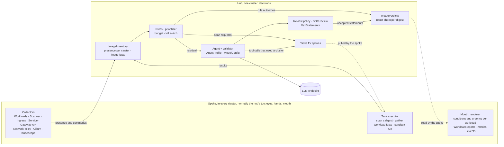
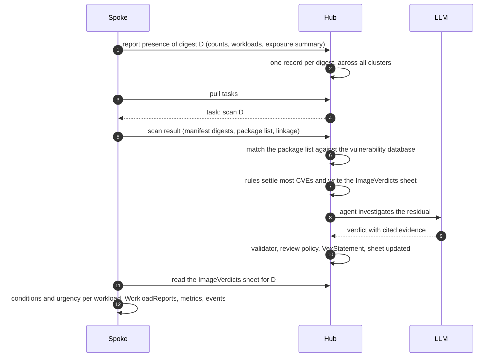

# vexplain — Design

- **Status:** revisions 7 to 11, from the owner's decisions of 2026-10-30: 0022 to 0027 and phase 2's scope (section 10). The owner confirmed revision 6 on 2026-10-30, and revision 5 on 2026-10-29, including the owner's amendments.
- **Date:** 2026-10-29
- **Author:** Joshua Leuenberger
- **Context:** built for real use on the Bedag Kubernetes platform, but nothing in the design is specific to Bedag.
- **Names:** project and repository `vexplain` (VEX + explain), module `github.com/bedag/vexplain`, API domain `vexplain.bedag.ch` (decision record 0018).
- **Decision records:** `docs/decisions/` (one short Markdown file per decision).

Statements marked **[call]** were proposed by the designer rather than asked for by the owner. The owner approved them together with the design, so they stand, but they are the first candidates to revisit. Everything else was decided by the owner.

---

## 1. Intent

When a widespread CVE appears, for example one in the Brotli compression library, scanners flag thousands of workloads as "potentially affected". Finding them is not the bottleneck. **Deciding, quickly and in a way you can defend, which ones actually need action** is. When that decision can't be made at scale, the fallback is to patch everything. That cost is what this project wants to cut.

The operator turns the flood of findings into a short, prioritized, explained worklist:

1. **Deterministic rules settle most findings.**
2. **An embedded LLM agent investigates only what is left**, within a budget.
3. **Every verdict is explained with cited evidence** and checked by a deterministic validator before it is accepted.

### The agent's role

The agent thinks like a **senior security engineer**, but its job is the legwork a junior would otherwise do:

- read the advisory
- check whether the vulnerable code is really there
- check whether it is linked and reachable
- check how the workload is configured and exposed
- write it up with evidence

It is read-only, uses a fixed toolset and a report template, and its reports are reviewed (section 6.9).

### Users

- **SOC (primary).** Works mainly in Grafana dashboards and reviews agent verdicts.
- **Namespace owners.** Whoever runs workloads in a namespace sees a report for those workloads as a resource in that namespace. The operator works purely per namespace: how a platform groups namespaces into teams, customers or projects doesn't matter to it, and no multi-tenancy tool is required. The end users of the services running there are not users of this system.
- **Operator admins.** Configure the operator per cluster: scope, collectors, review policy, budgets, sandbox.

Dashboards are expected to be the main interface for everyone with the permission.

---

## 2. Goals, non-goals, anti-goals

### Goals

- Running on several shared clusters, not only in dev. It starts on one cluster acting as hub and spoke at once.
- Assess the **exploitability** of known vulnerable components: "this CVE is in this component; are the conditions for exploitation met here?"
- Take into account how exposed a workload is.
- Investigate each image digest + CVE **once** across all clusters, to save tokens and avoid duplicate reviews.
- Produce for each case:
  - a verdict (affected / not affected / unclear)
  - contextual urgency (not the CVSS base score)
  - a justification with cited evidence
  - a recommended next step
- With no verdict, still say why and what evidence would settle the case.
- **Work without any external tool installed** (built-in base collectors), and get better with optional collectors. Kubescape support is part of v1 (section 7).
- Make data sources extendable: adding one in a year must not need a redesign. That includes collectors for other kinds of resources, such as virtual machines, which bring their own kind of assessment subject (sections 4.2, 6.2).
- Produce evaluation evidence (section 9).

### Non-goals (for now)

- **Not a scanner.** It embeds existing scanners (Syft/Grype) as a base collector and reads others (Kubescape, later Trivy), but it doesn't implement vulnerability matching itself.
- **Not a policy engine.** Kyverno stays the policy engine, including the audit of misconfigurations.
- **No writes to analysed workloads**, no `exec` into their pods, no automatic patching. The only things the operator creates are its own resources and, when enabled, sandbox pods in its own namespace (section 6.8).
- **Not for the end users** of the services being analysed.
- **Not tied to a tenancy model.** It works on namespaces and workloads, whatever they belong to.
- **Not tied to a registry or a platform.** It looks at what is actually running.
- **Later:**
  - identifying unknown binaries (`BinaryIdentification`)
  - runtime drift detection
- **Out of scope:** how a reviewer edits a resource (GitOps, kubectl, a UI).

### Anti-goals (failure even if it "works")

- An agent's mistaken "not affected" quietly suppresses a finding. False "not affected" is the dangerous error. "Not affected" needs strong, specific evidence, and anything weaker becomes "unclear" or "affected, low priority".
- The agent guesses when it hits a limit. Hitting a limit means "no verdict", with an explanation, never a guess.
- The same digest is investigated or reviewed again and again across clusters.
- A missing tool silently weakens verdicts. A missing kind of evidence must show up as "this can't be shown", not as "not affected".
- "0 CVEs" or "not in the SBOM" is trusted when the SBOM only saw part of the image.
- Metric cardinality explodes in Prometheus.
- The system adds to the SOC's load instead of reducing it.

---

## 3. Constraints

- **Framework:** Go, scaffolded and maintained with **kubebuilder** (controller-runtime, controller-gen, envtest), as a multi-group project.
- **API practices:** the Kubernetes API conventions, plus the team's internal API design guidelines built on them. The parts that apply are in section 6.1.
- **LLM:** an on-prem model behind an OpenAI-compatible HTTPS endpoint with API-key auth. Which model is a deployment choice: endpoint, model and key reference are configured in a `ModelConfig` resource, and the key itself lives in a Secret (section 6.6.2). Proxy settings stay process-wide environment variables (`HTTPS_PROXY`, `NO_PROXY`).
  - The model must support tool calls and structured JSON output.
  - Throughput and parallelism are unknown. They are learned while building: the operator records latency and tokens per call, and starts conservatively with 1–2 workers.
  - Namespace and workload names may be sent to the model, so no pseudonymization is needed. Secret values and env var values are still never sent.
- **Scale:** several thousand images, scans running around the clock, new CVEs published continuously. etcd copes badly with large objects (~1.5 MB per object) and frequent changes.
- **Image source:** the images running in the cluster, wherever they are pulled from (section 6.12).
- **Egress:** the LLM, advisory sources and the scanner's vulnerability database go through the existing proxy.
- **Read-only towards workloads.**

---

## 4. Approaches

### 4.1 Multi-cluster topology (decided: hub and spokes)

|       | Option                                                               | Pros                                                                                                                                 | Cons                                                                                                                            |
| ----- | -------------------------------------------------------------------- | ------------------------------------------------------------------------------------------------------------------------------------ | ------------------------------------------------------------------------------------------------------------------------------- |
| 1     | Every cluster runs everything, shares nothing                        | Simplest, no cross-cluster access                                                                                                    | Each digest is investigated and reviewed once per cluster; unreviewed verdicts never help other clusters                        |
| **2** | **Hub and spokes: one operator binary, two modes**                   | One investigation and one review per digest; LLM access in one place; matches the split between image-level and workload-level facts | Spokes need a scoped credential to the hub; if the hub is down, no new verdicts arrive (rules and cached verdicts keep working) |
| 3     | Every cluster investigates; VEX shared through registry attestations | No hub; a format other tools read                                                                                                    | Needs write access to registries; reviews must sync back; two clusters can investigate the same digest at once                  |

**Chosen: option 2.** The owner reached the same conclusion and ruled out the others. The hub's cluster normally runs both roles. It starts alone, and other clusters join as spokes later. The roles stay separate, so the hub can also run without a local spoke. What each role does is in section 5.1.

### 4.2 Data sources and extension (decided)

- **Everything the operator knows comes in through collectors.** Each collector wraps an existing tool or API instead of reimplementing it. Collectors are compiled in, and each is enabled and configured by an admin (section 6.3).
- **The base set needs no external tool:**
  - workloads, from Pods
  - exposure, from Kubernetes and Gateway API objects and network policies
  - image scanning and image analysis, from embedded Syft/Grype and Go standard tooling
- **Kubescape is an optional collector, and part of v1.** It's built after the built-in collectors are tested (section 7). As the first collector for a third-party source, it also proves how such a source plugs in. It adds runtime profiles: what a workload actually loads and executes. When it is on, its scans can replace the built-in scanner.
- **Collectors aren't limited to containers.** A later collector can bring other kinds of resources, such as virtual machines. These become new variants of the assessment subject (6.2), so rules, agent and reports don't need a redesign.
- **The agent has a base set of built-in tools**, and more can be plugged in as MCP servers without an operator release. Every tool declares the kind of evidence it produces. The validator lets only known kinds support "not affected"; unknown kinds can push only towards "affected" or "unclear".

Rejected: a hard Kubescape dependency (the operator must stand on its own). Rejected: compiling every agent tool in (every new tool would need a release).

### 4.3 Shared API and storage (decided: design for the switch, decide on real data)

- **Shared API across clusters:** the hub is a normal cluster with the operator's CRDs. Spokes use the hub's Kubernetes API with a narrowly scoped service account. That brings authentication, RBAC, watch, audit logging and `kubectl` for free.
- **Storage:** start with CRDs and keep them lean (summaries, verdicts, references). Bulky data lives in its **own API group**, and all access to it goes through a storage interface in the operator.
- **No early verdict on storage.** Neither kind nor a synthetic load can say whether CRDs hold up. That takes a real cluster over time: real scan churn, the rescans after each update of the vulnerability database, and the write rate across a normal week. So the design makes the switch cheap, and the decision waits for real data:
  - **One door:** only the storage interfaces (`inventory.Store`, and later one per bulky kind) read or write inventory objects. Controllers never touch the inventory API directly.
  - **Bulky data is derived data.** Everything in the `inventory` group can be rebuilt: presence from the spokes, facts from rescans. Switching backends therefore means rebuilding, not migrating. What can't be rebuilt, such as human reviews (`VexStatement`), is small and stays in CRDs in the `triage` group.
  - **No reliance on CRD-only behaviour for correctness.** CEL rules are guardrails; the storage interface validates the same rules itself, so they survive a backend that has no CEL.
  - **Stable group and version,** so an aggregated API server can take over the `inventory` group without clients noticing. That's how Kubescape stores its SBOMs.
  - **Measured from day one:** the operator exports object sizes and write rates (phase 1), next to the API server's and etcd's own metrics.
- **Triggers for the decision [call],** to be revisited once real numbers exist:
  - any inventory object above 512 KiB
  - a sustained write rate above 5 per second
  - inventory objects above 10% of etcd's database size

  The options at that point are an aggregated API server with its own database (Kubescape's route), or keeping the CRDs lean and moving the bulky payloads (SBOMs, CVE lists) to object storage referenced by digest.

---

## 5. Architecture overview

Solid arrows show data flowing; dotted arrows show what the spoke fetches. **The spoke opens every connection** (5.1).

### 5.1 Roles

Confirmed by the owner (0021). **The hub decides. Spokes are its eyes, hands and mouth: they observe, act on request, and say the results in their own cluster.** No spoke ever asks the hub a question. So a digest running in 100 clusters still means one scan, one rules pass and at most one investigation per CVE.

**Spoke, in every cluster, normally the hub's too: eyes, hands, mouth**
- **Eyes:** runs the collectors and reports what runs where. Per digest, that's its presence entry in `ImageInventory`: counts and workload references, plus from phase 2 an exposure summary and from phase 3 runtime observations. It reports everything in scope and doesn't filter or prioritise.
- **Hands:** runs the tasks the hub assigns:
  - scan a digest, in a Job per image (0022); the spoke holds the pull credentials, so the image never needs them anywhere else
  - gather facts about a workload for the agent's tools (configuration, Kubescape profiles)
  - start a sandbox run

  Results go back to the hub.
- **Mouth:** says the results in its own cluster. It reads the hub's result sheet (`ImageVerdicts`) for each digest it runs. Per workload, it checks the verdict's conditions, combines the verdict with local exposure into urgency, and writes `WorkloadReport`s, metrics and events. That's deterministic rendering, not decision-making.

**Hub, in one cluster: decisions**
- **Modes:** `Hub`, `Spoke` and `HubAndSpoke`.
  - The hub's cluster normally runs `HubAndSpoke`, because its own workloads need scanning too.
  - The roles stay strictly separate: hub code reaches spoke capabilities only through the interfaces it also uses for remote spokes, never through a local shortcut.
  - So switching the hub's cluster to `Hub` only is always possible.
- **One record per digest** across all clusters, whatever the number of clusters reporting it.
- **Image facts once per digest:** it asks one spoke that runs the digest to scan it.
- **Decisions:**
  - CVE matching, by one matcher that holds the vulnerability database and matches again whenever it updates (0022)
  - all rules: KEV, the load check, `govulncheck` (0027), completeness, and the next step that a fix allows (0024)
  - prioritisation, using the exposure every spoke reported; the highest exposure wins
  - budget and kill switch
  - agent, validator, review policy and `VexStatement`s
- **Result sheet:** it publishes `ImageVerdicts`, the per-digest sheet. For each CVE it holds the rule outcome or the accepted statement, with its conditions.

**Who connects to whom.**
- Spokes open every connection, to the hub's Kubernetes API, with a narrowly scoped service account. Through it they write their presence entries and task results, and read their tasks and the result sheets.
- The hub never holds credentials for a spoke.
- This is the pull model of Open Cluster Management, where the agent on each cluster pulls its work from the hub, and of Argo CD's agent mode. Both chose it for the same reason: a compromised hub can't reach into the clusters. It also suits clusters that can reach a central API through the proxy but can't be reached from outside.

**Both roles in one process.** In `HubAndSpoke`, hub and spoke run in the same process. They still talk only through the same Go interfaces: presence through `inventory.Store`, tasks through a spoke executor, results through `ImageVerdicts`. That's what keeps `Hub`-only possible. Multi-cluster (phase 6) puts a transport behind those interfaces for remote spokes; the flow stays the same.

---

## 6. Design

### 6.1 API design (kubebuilder)

**Groups and versions:**
- Following the kubebuilder sample pattern (`<group>.<domain>`) with the project's own domain `vexplain.bedag.ch`, not `platform.bedag.ch`.
- Three groups, split by who writes them, so RBAC can be granted per group and each group can be versioned on its own:
  - **`config.vexplain.bedag.ch`** (written by operator admins): `OperatorConfig`, `Collector`, `ModelConfig`, `AgentProfile`, `ToolServer`, `ReviewPolicy`.
  - **`triage.vexplain.bedag.ch`** (written by the operator; the SOC reviews `VexStatement`s; namespace owners read reports and create `SandboxRun`s): `Assessment`, `VexStatement`, `WorkloadReport`, `SandboxRun`.
  - **`inventory.vexplain.bedag.ch`** (written only by the operator; bulky): `ImageInventory`, `ImageVerdicts`. It can later be served by an aggregated API server.
- Everything starts at `v1alpha1`. The API version is independent of the operator's release version (SemVer).

**Practices adopted** (Kubernetes API conventions and "Changing the API", as summarised in the team's internal guidelines):
- **The generated schema is the contract.** Review the CRD schema after every type change, and run `kube-api-linter` in CI.
- **One controller per CRD, one owner per resource.** Several small resources that reference each other, not one big config object. This is why the configuration is split in section 6.2.
- **No foreign types embedded.** Kubescape, Syft, Grype and OpenVEX types are copied into our own types with only the fields we need.
- **Spec is declarative and status has its own subresource.** Users write `spec`, the controller writes `status`.
- **Conditions** use `metav1.Condition` with `observedGeneration`. They are set early, with `Unknown` if needed, and named as observed states (`Ready`, `Assessed`, `Accepted`).
- **Optional fields by default.** `OperatorConfig` with `spec: {}` must give a working base setup.
- **Fields arrive with the phase that uses them.** The resource table below shows the target. Each phase only adds the fields it needs, as optional fields, which keeps every addition non-breaking.
- **Enums instead of booleans, documented as open.** Unknown values are handled explicitly (for example a verdict, evidence kind or collector type the controller doesn't know).
- **Lists with keys** (`+listType=map`) instead of maps, **nesting** instead of prefixes, and **unions** with a `type` discriminator for variants (collector types).
- **Units in field names** (`timeoutSeconds`). **No floats in spec**: thresholds are whole numbers (`minCompletenessPercent`).
- **References** are named `…Ref` and point into the same namespace. Crossing namespaces needs consent from both sides. Cluster-scoped kinds may reference namespaced objects (Secrets, ConfigMaps) **only in the operator's namespace**.
- **Validation starts strict.** CEL handles cross-field rules, and fields that must never change get `oldSelf` rules from day one (an `Assessment`'s subject, a `SandboxRun`'s spec).
- **No conversion webhook** unless it can't be avoided.
- **A glossary** (section 6.13) keeps terms consistent across resources.
- **Troubleshooting takes one command:** `kubectl get` with print columns shows phase, verdict and reason.

### 6.2 Resources

| Kind             | Group     | Scope / where                                | Purpose                                                                                                                                                                                                                                                                                                                           |
| ---------------- | --------- | -------------------------------------------- | --------------------------------------------------------------------------------------------------------------------------------------------------------------------------------------------------------------------------------------------------------------------------------------------------------------------------------- |
| `OperatorConfig`   | config    | cluster-scoped, every cluster (singleton)    | Mode (`Hub`, `Spoke`, `HubAndSpoke`; the hub's cluster normally runs `HubAndSpoke`), **cluster name** (admin-set, used as the metrics label), hub connection, **scope** (include/exclude by namespace and pod label selectors), global daily budgets, kill switch, sandbox settings, **owner attribution** (allowlists of namespace and workload label and annotation keys; section 6.14) **[call]** |
| `AgentProfile`   | config    | cluster-scoped, hub; one named `default`, optional overrides | Per-run limits, allowed tools, source of the editable prompt guidance, `modelRef`. The `default` profile serves every assessment; an override claims specific assessment types and only sets what differs (section 6.6.1) |
| `ModelConfig`    | config    | cluster-scoped, hub                          | LLM provider, endpoint, model, API key `SecretRef`, request settings (section 6.6.2) **[call]**                                                                                                                                                                                                                                  |
| `Collector`      | config    | cluster-scoped, one per source               | Union by `type`, one dedicated collector per source: `Workloads`, `Scanner` (built-in Syft/Grype), `Kubescape`, `Ingress`, `Service`, `GatewayAPI`, `NetworkPolicy`, `CiliumPolicy`, … plus their settings and a `state` (`Enabled` / `Disabled`, from phase 2). Status shows health and when it last succeeded (section 6.3) **[call]** |
| `ToolServer`     | config    | cluster-scoped, hub                          | An MCP server the agent may use: endpoint, allowed tools, and the evidence kind each tool produces **[call]**                                                                                                                                                                                                                     |
| `ReviewPolicy`   | config    | cluster-scoped, hub                          | Auto-acceptance rules (section 6.9) **[call]**                                                                                                                                                                                                                                                                                    |
| `ImageInventory` | inventory | hub                                          | One per reported image digest. Per-cluster presence: counts, plus references to the workloads running it (the first 100 per cluster, sorted). Those references point to the workloads' `WorkloadReport`s (section 6.14). From phase 2 it also holds the image facts: per-platform manifest digests, a reference to each one's `ImagePackages`, completeness, unowned binaries, linkage, Go build info. CVE matches live in `ImageVerdicts` (0023). Bulky, so it sits behind the storage interface **[call]** |
| `ImagePackages`  | inventory | hub                                          | One per platform manifest digest: the package list a scan found, gzip-compressed and written once per scanner version, so the matcher can match it again after a database update (0023). Behind its own storage interface |
| `ImageVerdicts`  | inventory | hub, read by spokes                          | One per platform manifest digest (0025): the **result sheet** spokes render from. For each finding the hub's matcher found, a CVE in one package (0023, 0025), it holds the rule outcome (rule, reason) or the accepted `VexStatement`, with its conditions (section 5.1) |
| `Assessment`     | triage    | hub                                          | One per (type, digest, CVE); see below                                                                                                                                                                                                                                                                                            |
| `VexStatement`   | triage    | hub (source of truth)                        | Image digest + CVE → OpenVEX status, justification, conditions, origin (agent / human), review state, link to the `Assessment`. Spokes see accepted statements through the `ImageVerdicts` sheet |
| `WorkloadReport` | triage    | namespaced, spokes                           | Report per workload, in the workload's namespace: actionable CVEs with verdict, urgency (SSVC: Defer, Scheduled, Out-of-cycle or Immediate; 0024), next step, fixed version and review state, plus counts. Also carries the **owner attribution** (section 6.14), and one label per image digest it contains, so a single label query lists every workload running a digest. No evidence ledger, no detail about other namespaces |
| `SandboxRun`     | triage    | namespaced, any namespace                    | Requests a sandbox run for a workload **in the same namespace**. The sandbox pod itself runs in the operator's namespace (section 6.8)                                                                                                                                                                                            |

**`Assessment`:**
- **Spec:** type (`CVE` now, `BinaryIdentification` later; an open enum), subject, CVE, reason. Only the hub creates assessments (5.1).
- **Status:**
  - phase and conditions
  - input hash
  - verdict, VEX justification and conditions
  - evidence ledger and confidence
  - **no-verdict summary** (section 6.6)
  - model and prompt version/hash
  - tokens and duration
  - validation result

**Subject shape [call]:** `subject: {type: ContainerImage, containerImage: {digest: sha256:…, repository: …}}`. This is a union, so that other kinds of resources brought in by a later collector, such as a `VirtualMachine`, can be added as new variants. An assessment's subject is the **platform manifest digest** (what was actually scanned), not the reported digest an `ImageInventory` is keyed on (section 6.12), so two tags or indexes that point to the same manifest share one assessment.

### 6.3 Collectors

Each collector wraps an existing tool or API and writes its results in our own types. The rules and the agent only use what collectors deliver.

| Collector                                                                                      | Default                       | Wraps                                                                          | Delivers                                                                                                                                                                                                     |
| ---------------------------------------------------------------------------------------------- | ----------------------------- | ------------------------------------------------------------------------------ | ------------------------------------------------------------------------------------------------------------------------------------------------------------------------------------------------------------ |
| `Workloads`                                                                                    | on (required)                 | Kubernetes API (Pods, owners)                                                  | Reported digests from `imageID` in `status.containerStatuses` and `status.initContainerStatuses` (ephemeral debug containers are skipped), mapped to workload, namespace and owner; scope selectors applied. Every existing pod counts, whatever its phase, so CronJob images don't appear and disappear with each run |
| `Scanner` (built-in)                                                                           | on                            | Syft and `debug/elf` in a scan Job per image; Grype in one matcher at the hub (0022) | SBOM with file ownership, CVE matches, completeness, `DT_NEEDED` linkage, Go build info, symbol search on demand                                                                                             |
| `Govulncheck` | on, from the phase that builds it (0027) | `golang.org/x/vuln` in its own Job; Go's vulnerability database at the hub | Whether a Go binary contains the vulnerable functions of a Go CVE |
| `Kubescape`                                                                                    | off; part of v1, built in phase 3 | Kubescape's own resources                                                  | Vulnerability manifests, SBOMs, application profiles (loaded libraries, execs). When on, the admin can switch the built-in `Scanner` to *analysis only*: no CVE matching, but symbol and linkage checks stay |
| `Ingress`                                                                                      | on                            | `networking.k8s.io` Ingress, IngressClass                                      | External exposure through Ingress                                                                                                                                                                            |
| `Service`                                                                                      | on                            | Services of type LoadBalancer and NodePort                                     | External exposure through Services                                                                                                                                                                           |
| `GatewayAPI`                                                                                   | on if the Gateway API CRDs exist | HTTPRoute, TLSRoute, GRPCRoute, followed to their Gateways                  | External exposure through Gateway API                                                                                                                                                                        |
| `NetworkPolicy`                                                                                | on                            | `networking.k8s.io` NetworkPolicy                                              | Internal reach: namespace only, specific peers, several namespaces, whole cluster                                                                                                                            |
| `CiliumPolicy`                                                                                 | on if the Cilium CRDs exist   | CiliumNetworkPolicy, CiliumClusterwideNetworkPolicy                            | Internal reach under Cilium's own policy model, with its own settings                                                                                                                                        |

- **One collector per source.** Each source has its own settings, its own failure modes and its own optional dependency, so each gets its own `Collector`.
  - The three Gateway API route kinds stay together in `GatewayAPI`. They come from one installation and share the logic of following routes to their Gateways.
  - Cilium is separate from Kubernetes NetworkPolicy because its policy model and CRDs differ.
- **Which collectors exist by default.** The operator creates the default collectors at start for every API the cluster has (discovery). It never overwrites an existing one. An admin turns a collector off with `state: Disabled`, which survives restarts; deleting it wouldn't, because it would be recreated.
- **Missing evidence never becomes "not affected".** If a collector is off or unhealthy, the evidence kinds it would produce are simply missing. The validator then can't accept a "not affected" that would need them, so the result degrades to "unclear".

A later Trivy collector, proxy-log collector or Tetragon collector fits the same interface.

### 6.4 Exposure

- **External:** the workload is reachable through an Ingress, a LoadBalancer or NodePort Service, or an HTTPRoute, TLSRoute or GRPCRoute.
  - Not every one of these faces outside: some ingress classes, gateways and load balancers are internal only. Each exposure collector's settings say which count as external, for example by ingress class, gateway or load-balancer annotation.
  - The default treats all of them as external. That errs towards higher urgency, which is the safe side, and it never changes a verdict.
- **Internal reach** comes from network policies: same namespace only, specific peers, several namespaces, or whole cluster (no policy at all).
- **Indirect, one hop [call]:** the workload is reachable from an externally exposed workload. This matters for bugs triggered by attacker-controlled data, such as decompression in Brotli.
- **Exposure changes urgency, never the verdict.** "Not exposed" alone can never produce "not affected".
- **Exposure feeds SSVC's "system exposure" (0024) [call]:**
  - **open:** external
  - **controlled:** indirect (one hop), or reachable from beyond the namespace
  - **small:** reachable only from the namespace

  Urgency is SSVC's deployer outcome: Defer, Scheduled, Out-of-cycle or Immediate.
- The agent sees how a digest's instances are exposed across workloads, and can express exposure-dependent verdicts as conditions.

### 6.5 Rules and deterministic outcomes

All decisions are made on the hub (5.1). The spoke observes, executes and renders, and never filters, prioritises or asks.

**Spoke pipeline:**
1. **Observe:** collectors.
2. **Report:** per digest, the presence entry in `ImageInventory`. From phase 2 this includes instances per exposure level, and from phase 3 runtime observations, such as "library loaded in 0 of 12 observed instances".
3. **Execute** the hub's tasks: scans, workload facts for the agent, sandbox runs.
4. **Render (the mouth):** for each digest it runs, read the `ImageVerdicts` sheet. Per workload, check the conditions, compute urgency from the verdict and local exposure with SSVC's deployer tree (0024), and write `WorkloadReport`s, metrics and events.

**Hub pipeline:**
1. **Dedupe:** one `ImageInventory` per reported digest, however many clusters report it.
2. **Image facts:** ask one spoke that runs the digest to scan it, including resolving its platform manifest digests. The hub's matcher matches the package list the scan returns against the vulnerability database (0022).
3. **Rules** at image and CVE level (table below). Settled outcomes go into the `ImageVerdicts` sheet, each with its reason.
4. **Prioritise** the rest by SSVC urgency (0024), using the highest exposure any spoke reported. EPSS orders cases of equal urgency. All of it stays within the daily budget and honours the kill switch. Then create one `Assessment` per (manifest digest, CVE).
5. **Agent → validator → review policy → `VexStatement`.** Accepted statements are written into the `ImageVerdicts` sheet.

| Outcome                   | Examples                                                                                                                                                                                                                                                                               |
| ------------------------- | -------------------------------------------------------------------------------------------------------------------------------------------------------------------------------------------------------------------------------------------------------------------------------------- |
| Suppressed (with reason)  | Accepted `VexStatement` applies and its conditions hold. Each rule's verdict covers one finding, a CVE in one package (0025). The package database lists the package, but its files are gone from the final filesystem (0026). `govulncheck` shows the vulnerable symbols are absent from the Go binary (its own collector, 0027). **Nothing in the image can load the vulnerable library (0026):** no ELF file reaches it through `DT_NEEDED`, followed transitively (a binary → `libfreetype` → `libbrotlidec` counts as reaching it). No file contains its versioned, unversioned or bare name, which catches `dlopen("libbrotlidec.so.1")`, apart from the package's own files, the package databases and the linker cache. Nothing sets `LD_PRELOAD` or `LD_AUDIT`. This is the first rule to measure on Brotli (section 9) |
| Tracked, no investigation | On KEV → treated as affected without spending agent time (patching is cheaper than investigating), urgency from SSVC's deployer tree (0024). A fix never settles a verdict: it decides the next step, "update", whose urgency comes from the same tree                                                                                       |
| Needs assessment          | Component present and linked, no strong deterministic evidence either way, priority above threshold                                                                                                                                                                                    |
| Guard                     | Completeness below threshold, or drift suspected → an automatic "not affected" is blocked                                                                                                                                                                                              |

**Rule-settled results (accepted, 0010):**
- They create no `VexStatement` and need no per-finding review; the rules themselves are reviewed once, as code.
- Their outcomes go into the `ImageVerdicts` sheet, so every spoke renders from the same result.

### 6.6 The agent loop

- **Case file:** built deterministically from the `Assessment`, the `ImageInventory` and the spokes' workload summaries. It is everything already known.
- **Loop:** model call with tool specs → tool calls, `submit_verdict` or `submit_no_verdict`.
- **Evidence ledger:** each tool result is stored with an ID (`ev-1`, `ev-2`, …) and an evidence kind, truncated to a size limit.
- **Malformed tool calls:** a tool call whose arguments aren't valid JSON gets a tool error that quotes the raw text. In the replayed history, its arguments are replaced by `{}`, because some servers parse replayed arguments and reject the whole request. The phase-1 smoke test shows whether this endpoint does.
- **`submit_verdict`:**
  - OpenVEX status and justification
  - urgency rationale and next step
  - conditions (CEL over a defined workload-facts document **[call]**)
  - claims, each citing ledger IDs
- **`submit_no_verdict`:** the agent may give up on purpose. It must say why, what it established (citing evidence), and what evidence would settle the case.
- **Hard limits:** about 15 steps, a token budget, a total timeout, and per-tool timeouts.
  - When a limit trips, the operator makes **one final call without tools**, from a small reserved budget, asking for the no-verdict summary. That summary is stored in the status.
  - If even that fails, the status records which limit tripped.
  - In every case the outcome is "no verdict", and the case goes to a human.
- **Validator:** deterministic checks (section 6.7). It allows one repair attempt with the validator's feedback; after that, no verdict, with a summary.
- **System prompt and limits:** come from the `AgentProfile` (section 6.6.1).
- **Audit:** every tool call (tool, arguments, output hash, duration, evidence ID) is logged.

#### 6.6.1 `AgentProfile` and the editable prompt

The prompt should be editable without overloading `OperatorConfig` and without risking the loop's contract.

- **One default, optional overrides (owner's decision).** One profile per assessment type wouldn't be maintainable. So there is one `AgentProfile` named `default`, which serves every assessment, and the operator creates it at start with the embedded guidance. This follows Kubernetes' "default class" pattern, as with the default `StorageClass` or `IngressClass`. **[call]** for the mechanics below:
  - An override is another `AgentProfile` with `spec.assessmentTypes` (for example `[BinaryIdentification]`). Assessments of those types use it.
  - An override only sets what differs. Fields it leaves unset come from `default`. The effective profile is resolved when an assessment starts and is recorded in its status.
  - At most one override may claim a type. A second one reports `Ready=False`, reason `Conflict`, and is ignored.
  - Phase 4 needs only `default`.
- **A profile holds:**
  - per-run limits: `maxSteps`, `maxTokens`, `timeoutSeconds`, `toolTimeoutSeconds`, and the reserved budget for the no-verdict summary
  - which built-in tools and `ToolServer`s may be used
  - the source of the editable prompt part
  - `modelRef`: which `ModelConfig` to use (section 6.6.2)
- **The prompt has two layers:**
  - **Core (operator-owned, not editable):** role, tool contract, the `submit_verdict` / `submit_no_verdict` schema, evidence rules, the lopsided "not affected" rule. It is versioned and embedded in the binary, because the loop and the validator depend on it.
  - **Guidance (editable):** house knowledge, priorities, writing style, examples, the senior-engineer mindset in your own words. It is appended after the core and can't replace it.
- **Where the guidance comes from:** a union with `type: Embedded` (the default text shipped with the operator) or `type: ConfigMap` with `configMapRef: {name, key}`. The ConfigMap must be in the operator's namespace, so the cluster-scoped profile never reaches into other namespaces. The enum is documented as open, so an `Inline` variant could be added later.
  - **Why a ConfigMap:** long text is edited as a plain file in git and generated with kustomize's `configMapGenerator`. That avoids schema changes for prose and follows the usual Kubernetes pattern of a CR holding structured settings and referencing bulk text by name.
- **Safety:** the validator stays the guard whatever the guidance says.
- **Missing or invalid source:** the profile reports `Ready=False`, the assessments it serves wait, and an `AgentProfileInvalid` event is emitted. There is no silent fallback to the embedded text.
- **Traceability:** every `Assessment` records the core version and the guidance hash (and the ConfigMap's `resourceVersion`).
- **Changing the prompt doesn't re-run past assessments.** Run the replay harness before rolling out a new guidance.

#### 6.6.2 `ModelConfig` [call]

The LLM connection is its own concern: several profiles may share one model, and a profile may switch models without anything else changing. So it gets its own small resource instead of living inside `AgentProfile`, the same pattern kagent (`ModelConfig`) and k8sgpt (backend config) use.

- **`ModelConfig`** is cluster-scoped and lives on the hub. It holds:
  - `provider` as an open enum: `OpenAICompatible` now, others possible later
  - `endpoint` (base URL, **HTTPS only**, because the key travels with every request) and `model` (the model name the endpoint serves)
  - `apiKeySecretRef: {name, key}`. The Secret must be in the operator's namespace and carry the label `vexplain.bedag.ch/llm-api-key: "true"`. Unlabelled Secrets are never loaded. Otherwise anyone allowed to write `config.*` could point a `ModelConfig` at another Secret in that namespace, and an endpoint of their choosing, and have the operator send that Secret out as a bearer token.
  - request settings without floats: `requestTimeoutSeconds`, `maxConcurrentRequests`, `temperatureMilli` (e.g. `200` = 0.2)
- **`AgentProfile.spec.modelRef`** names the `ModelConfig` to use. Trying a new model means pointing the `default` profile, or one override, at a new `ModelConfig`.
- **The API key is read only to authenticate LLM calls.** It is never logged, stored elsewhere or put in a prompt.
- **Status:** the controller probes the endpoint and reports `Ready`, plus the last error and the observed latency. A `ModelConfig` that isn't ready pauses the profiles that use it and emits a `ModelUnavailable` event.
- **Traceability:** every `Assessment` records the `ModelConfig` name, endpoint and model.
- **No environment variables for the model.** The owner's earlier "set it through env vars" becomes "set it in one resource". Proxy settings stay as environment variables because they apply to the whole process (scanner database, advisories, LLM). For local development, the operator can create a default `ModelConfig` from `VEXPLAIN_LLM_*` variables at startup if none exists; that's a convenience, not a second source of truth.

#### 6.6.3 Tools

**Built-in tools (CVE type):**
- advisory lookup (OSV, GHSA, distro trackers through the proxy; which sources is left to the builder)
- SBOM query
- `govulncheck` on a binary
- symbol and linkage scan
- runtime profile summary (when Kubescape is on)
- exposure summary
- config read: container args, env var *names*, ConfigMap keys
- request a sandbox run (only if enabled)

**Where tools run:** tools that only need image facts or advisories run on the hub. Tools that need a cluster run as a task on the spoke that runs the workload (5.1), for example config read, runtime profiles and a sandbox run. In single-cluster mode both happen in the same process.

**Plug-in tools:** MCP servers registered as `ToolServer`s.

**Why our own `ToolServer` resource:** MCP already defines how tools are called, so the operator doesn't reinvent that. The resource only records what MCP doesn't: our trust decisions, meaning which tools of a server are allowed and which evidence kind each produces. kagent's `RemoteMCPServer` comes closest, but it would add a dependency and has no notion of evidence kinds.

### 6.7 Validator rules

- Every claim cites ledger IDs that exist.
- **Evidence required for "not affected"** (initial table; the builder refines it):

| OpenVEX justification                                                                   | Required evidence kinds                                                                                                                                |
| --------------------------------------------------------------------------------------- | ------------------------------------------------------------------------------------------------------------------------------------------------------ |
| `component_not_present`                                                                 | SBOM **and** a symbol scan with no static copy **and** completeness ≥ threshold                                                                        |
| `vulnerable_code_not_present`                                                           | `govulncheck` (Go) or a symbol scan showing the vulnerable functions absent, or a fixed version backed by an advisory and a version string             |
| `vulnerable_code_not_in_execute_path`                                                   | Static reachability evidence: a `govulncheck` call graph, or the load check from section 6.5 (no transitive `DT_NEEDED` path and no soname string). Runtime profile or sandbox evidence alone is **not** enough |
| `vulnerable_code_cannot_be_controlled_by_adversary`, `inline_mitigations_already_exist` | Advisory + config evidence + a condition. **Never auto-accepted [call]**                                                                               |

- **`fixed`** (the OpenVEX status for, e.g., a distro backport) silences a finding just like "not affected", so it gets the same strictness: it needs advisory or distro-tracker evidence that the installed version contains the fix, and the same review policy.
- **A symbol scan is only as good as the symbol tables it saw.** Distro and release binaries are usually stripped. The scan reports, per binary, whether it had symbols. For binaries without symbols it is inconclusive and can't support "no static copy". Unowned stripped binaries therefore keep completeness low, and the completeness guard holds.
- "Never loaded", whether from runtime profiles or sandbox runs, can support "affected" or lower urgency, never "not affected" on its own.
- Evidence kinds from `ToolServer`s can't support "not affected" unless the admin maps them to a known kind.
- If the completeness guard or the drift guard is set, "not affected" is rejected.

### 6.8 Sandbox runs (optional, on demand)

- **Triggering:**
  - Anyone allowed by RBAC creates a `SandboxRun` in a namespace. It references a workload **in that same namespace**, so nobody can sandbox an image from a namespace they can't access.
  - The admin can let the agent request runs automatically, for example for "unclear" cases. This is off by default.
  - Sandboxing as a whole is off by default.
- **Where it runs:** the sandbox pod runs in the **operator's namespace of the same cluster**, using the referenced workload's pull credentials (section 6.12). The result is attached as evidence to the `Assessment` for that digest.
- **Guardrails:**
  - no network, no service account token, no secrets
  - tight resource limits and a time limit; deleted afterwards
  - a sandboxed runtime class (gVisor/Kata) when available
  - `SandboxRun.spec` is immutable
- **Observing what loads:** e.g. `/proc/<pid>/maps` via a sidecar that shares the process namespace, or Kubescape. The mechanism is left to the builder.
- **Pull credentials.** A pod can only use `imagePullSecrets` from its own namespace, so the sandbox needs credentials in the operator's namespace. The admin chooses the source in the sandbox settings (owner's decision):
  - **`CopyFromWorkload`:** the operator copies the referenced workload's pull secrets into short-lived Secrets in its own namespace. Each copy is owned by the sandbox pod, so Kubernetes deletes it together with the pod. Copies carry their own label, so the LLM key cache never loads them.
  - **`AdminProvided`:** the admin puts pull Secrets into the operator's namespace and lists them in the sandbox settings, and every sandbox pod uses them.

  Rejected: pinning the sandbox to a node that already has the image (it would bypass the kubelet's credential check for pulled images), and running it in the workload's namespace.
- **Evidence weight:** "loaded" is strong evidence for "affected". "Not loaded" is weak, because the sandbox runs without real config or traffic.

### 6.9 Review policy and `VexStatement` lifecycle

States: `Proposed` (agent, unreviewed) → `Accepted` / `Rejected`. A statement becomes `Superseded` when its input hash changes.

- **Default:** every agent-made "not affected" or `fixed` needs a person to accept it. Until then it counts as "probably not affected, unreviewed": still visible and lower priority, but not suppressed.
- **Configurable auto-acceptance** in `ReviewPolicy`, for narrow classes. Example: severity below a threshold, not on KEV, not externally exposed, **and** strong evidence (the vulnerable symbols are absent, completeness is above threshold). The CVSS score may be one input to this gate, but it is not an input to urgency.
- **Auto-acceptance that depends on workload facts lapses by itself.** A statement is image-level, but exposure is per workload, and a new externally exposed instance can show up later. So an auto-acceptance that relied on "not externally exposed" is recorded as a condition on the statement. Spokes re-check that condition per workload, and the statement stops applying where it no longer holds.
- **Reviewing** means editing the `VexStatement` on the hub: setting the review state, reviewer and comment. How that edit is made is out of scope.
- Every review is a labelled data point. Per-class agreement rates are the evidence for switching on auto-acceptance for a class.
- Anyone who can read a namespace sees agent verdicts immediately in its `WorkloadReport`s, marked "agent verdict, not reviewed".

### 6.10 Outputs

- **Metrics** (Prometheus, every cluster). `cluster` is taken from `OperatorConfig.spec.clusterName`, set by the admin; the central metrics stack combines clusters.
  - Counts: `vexplain_findings{cluster, namespace, verdict, urgency, review_state}` and funnel stages `vexplain_funnel{cluster, stage}`.
  - Open cases only: `vexplain_open_case{cluster, namespace, workload, digest, cve, verdict, urgency} 1`. This is the filterable worklist. `digest` makes it possible to go from a `VexStatement` straight to the affected workloads.
  - Owners: `vexplain_namespace_owner_info{cluster, namespace, <allowlisted keys>} 1`, one series per namespace (section 6.14). Dashboards join it on `cluster, namespace`, the usual Prometheus pattern for info metrics. That keeps owner labels out of every other series.
  - Hub: assessments by outcome, validator rejections by rule, tokens, LLM latency, queue depth, budget used.
  - Collector health.
  - **No series per image × CVE for settled findings.**
- **Events** (Kubernetes Events on the object concerned):

| Event                 | When                                                                   | Emitted on, type        |
| --------------------- | ---------------------------------------------------------------------- | ----------------------- |
| `VerdictRejected`     | the validator rejected a verdict (after the repair attempt)            | `Assessment`, Warning   |
| `NoVerdict`           | a limit tripped or the agent gave up; carries the summary's first line | `Assessment`, Warning   |
| `BudgetExhausted`     | the daily assessment or token budget is used up                        | `OperatorConfig`, Warning |
| `KillSwitchActive`    | the agent is disabled                                                  | `OperatorConfig`, Warning |
| `VerdictProposed`     | an agent verdict awaits review                                         | `VexStatement`, Normal  |
| `CollectorUnhealthy`  | a collector failed                                                     | `Collector`, Warning    |
| `SandboxRunFailed`    | a sandbox run failed                                                   | `SandboxRun`, Warning   |
| `AgentProfileInvalid` | the guidance source is missing or invalid                              | `AgentProfile`, Warning |
| `ModelUnavailable`    | the LLM endpoint fails its probe or keeps returning errors              | `ModelConfig`, Warning  |

- **`WorkloadReport`** per workload in the workload's namespace.
- **Dashboards:**
  - a funnel per CVE
  - the open-case table
  - agent health: verdicts, no-verdicts, rejections, tokens, latency
  - collector health

### 6.11 Security and governance

- **RBAC:**
  - Spokes are read-only on workloads, networking and collector sources. They write only to their own kinds, and in the operator namespace to scan Jobs and sandbox pods, with their short-lived Secrets.
  - The spoke-to-hub service account may write its own presence entries and task results, and read its own tasks and the `ImageVerdicts` sheets. It can't create assessments or touch `VexStatement`s (5.1).
  - The hub holds no credentials for any spoke.
- **Secrets:**
  - Pull secrets are read only to authenticate image pulls (section 6.12). They are never logged, stored or sent to the LLM. The only exceptions to "stored" are a scan Job (0022) and a sandbox in `CopyFromWorkload` mode (section 6.8). Each gets a copy of the credentials it needs, which lives exactly as long as the Job or the sandbox pod.
  - From phase 2, reading pull secrets needs **`get` without `list`/`watch`** on Secrets and ServiceAccounts in all namespaces. The operator can fetch a Secret a pod names, but it can't enumerate Secrets. Kubescape and Trivy need the same privilege for the same reason.
  - The LLM API key is read from the Secret named in `ModelConfig`, only if that Secret is in the operator's namespace and carries the label `vexplain.bedag.ch/llm-api-key: "true"`, and only to authenticate LLM calls. HTTP error bodies never go into errors, because some gateways echo the key.
    - The label is defence in depth. Argo CD uses the same pattern: it only considers repository-credential Secrets labelled `argocd.argoproj.io/secret-type`.
    - It matters here because the operator's namespace will also hold copied pull secrets (sections 6.8 and 6.12). Without the label, whoever writes a `ModelConfig` could send a namespace owner's registry credentials to an endpoint of their choosing.
    - The Secret cache only loads labelled Secrets, and the controller checks the label again on what it reads.
  - The LLM client never follows a redirect, because Go keeps the `Authorization` header on a redirect from https to http on the same host.
  - The client sends the key only over https, or over plain http to a loopback host (`localhost` in exact lowercase, or a loopback IP) for tests and local development. Go never sends a request for these hosts to the proxy that the environment names, and a proxy would see the key in clear text. The client enforces this for every caller, not only for `ModelConfig`, whose schema allows https only.
  - Other Secret values and env var values are never read.
- **Redaction:** exec arguments in application profiles may contain secrets, so they are redacted before reaching the case file. How is left to the builder.
- Budgets, kill switch and per-tool timeouts as above. Every tool call is audit-logged.
- **The LLM may receive** namespace and workload names (confirmed by the owner).
- **Decision records** are kept in `docs/decisions/`.

### 6.12 Image identity and content

- **Identity [call]:** the `Workloads` collector reads `imageID` from the pod's container and init-container statuses. That is the digest the container runtime reports for what it actually started, and it reflects the current state even when a tag has moved. It comes in two kinds:
  - **Repository digest** (`repo@sha256:…`): the digest that was pulled. For a multi-arch image pulled by tag, that is the **index** digest, which covers several platforms.
  - **Image ID** (bare `sha256:…`): the image's config digest, reported when the runtime has no repository digest, for example for images loaded locally. A registry can't fetch it.

  `ImageInventory` is keyed on this **reported digest** and records which kind it is. From phase 2, the scanner resolves a repository digest plus the platforms of the nodes running it into **platform manifest digests**, and scans those. Image facts and assessments are keyed on the platform manifest digest. An image ID can't be pulled, so its content stays unknown, which counts as "can't be shown", never as "not affected".
- **Content:** fetched by digest. A digest is content-addressed, so `repo@sha256:…` returns exactly the running bytes and can't be stale.
  - The operator authenticates like the kubelet would: the pod's `imagePullSecrets` and its service account's pull secrets, through `go-containerregistry`'s `k8schain`. Admins can add credentials if needed. The scan Job that pulls the image gets the credentials for that one image in a short-lived Secret it owns (0022).
  - The operator doesn't care which registry it is. Each image is pulled once per digest and cached for analysis.
- **When Kubescape is on,** its SBOMs and vulnerability manifests are used instead of a fresh scan. The image is pulled only for checks Kubescape doesn't provide (symbol search, linkage, `govulncheck`).
- **Pull volume** is bounded by the number of distinct digests, not by the number of pods.

### 6.13 Glossary

| Term              | Meaning                                                                                              |
| ----------------- | ---------------------------------------------------------------------------------------------------- |
| Finding           | A scanner's claim that a CVE applies to a package in an image digest                                 |
| Workload          | The top-level owner of a set of pods: Deployment (via ReplicaSet), StatefulSet, DaemonSet, CronJob (via Job), Job, any other controller such as an Argo Rollout, or a bare pod |
| Reported digest   | The digest the container runtime reports in a pod's status: a repository digest (often a multi-arch index) or an image ID |
| Manifest digest   | The digest of one platform's image manifest; what gets scanned and assessed                          |
| Subject           | What an assessment is about; now always a container image digest                                     |
| Case / Assessment | One investigation of one CVE in one subject                                                          |
| Verdict           | The OpenVEX status of a case: `affected`, `not_affected`, `fixed`, `under_investigation` (shown as "unclear"). An open enum |
| No verdict        | The agent produced no accepted verdict; always comes with a summary                                  |
| Urgency           | SSVC's deployer outcome per workload (Defer, Scheduled, Out-of-cycle, Immediate), from exploitation (KEV), exposure, automatability and impact (0024). A fix decides the next step, not the urgency |
| Evidence          | A tool result in the ledger, with an ID and a kind                                                   |
| Condition         | A machine-checkable expression a verdict depends on, evaluated per workload                          |
| Exposure          | External reachability plus internal reach of a workload                                              |
| Completeness      | Share of ELF files in an image that the SBOM accounts for                                            |
| Collector         | A compiled-in adapter that brings one source of data into the operator                               |
| Owner attribution | The values of admin-allowlisted namespace and workload labels and annotations that tell whom to inform |

### 6.14 Owner attribution and back-tracking [call]

The SOC reviews a `VexStatement` (one digest, one CVE) on the hub and has to inform the owners of the affected workloads. How it gets from one to the other:

- **Hub, at a glance:** the digest's `ImageInventory` lists, per cluster, the workloads running it: kind, namespace and name, the first 100 sorted, plus the total count. Each reference is also the address of that workload's `WorkloadReport` on its cluster. In the owner's real export of one past CVE, no image ran in more than about 60 workloads of one cluster, so 100 covers it.
- **Spoke, complete:** every `WorkloadReport` carries one label per image digest it contains. The key is `digest.vexplain.bedag.ch/<first 63 hex characters of the digest>`, because a label name is limited to 63 characters. One query, `kubectl get workloadreports -A -l <digest label>`, therefore lists every affected workload, even when the hub's list was cut off at 100. This is the usual Kubernetes back-reference: children label themselves, and parents don't keep unbounded lists. Kubescape links its per-workload and per-image reports the same way.
- **Across clusters:** Grafana's open-case table filtered by `digest` and `cve`, joined with `vexplain_namespace_owner_info` (section 6.10), gives cluster, namespace, workload and owner in one view.
- **What "owner" means is configurable,** because there's no single standard label for it. `OperatorConfig.spec.ownerAttribution` lists:
  - `namespaceLabels`
  - `namespaceAnnotations`
  - `workloadLabels`

  Their values are copied into each `WorkloadReport` and into the owner info metric. This is the same mechanism kube-state-metrics uses with `--metric-labels-allowlist` and `--metric-annotations-allowlist`. Typical keys are a team or owner label, a contact annotation, and the recommended `app.kubernetes.io/part-of`. If kube-state-metrics already exports the allowlisted namespace labels, dashboards can join `kube_namespace_labels` instead.
- **Phases:** workload references arrive in phase 1. Owner attribution and the digest labels arrive with `WorkloadReport` in phase 2.

---

## 7. Phases [call]

- **v1 = phases 1–7.** Kubescape support and sandbox runs are part of v1 (owner's decisions).
- Phases 1–5 run on the hub's cluster alone, in `HubAndSpoke` mode. The roles are kept separate from phase 1 on (5.1).
- The storage decision isn't tied to a phase. It's made once a real test cluster has produced numbers (4.3).

1. **Foundations:**
   - kubebuilder scaffold with the `config` and `inventory` groups at `v1alpha1` (`triage` arrives in phase 2 with `WorkloadReport`)
   - `OperatorConfig`, `Collector`
   - `Workloads` collector and the lean `ImageInventory`, written through the presence interface the spoke role will use (5.1)
   - `ModelConfig` and the LLM client with proxy support. These are pulled forward so a smoke test proves that the model handles a two-turn tool-calling exchange before the agent is built on it.
   - Object sizes and write rates are measured from here on: an early indicator, not the storage decision (4.3).
2. **Built-in collectors and the deterministic layer,** in two parts (owner's decision, 2026-10-30):
   - **2a, the hub decides from scans.** It ends with the measured residual.
     - **First, phase 1's carried-forward prerequisites:** the inventory's status writer merges instead of rebuilding, and the writer of image facts never creates objects.
     - **The scan task path** from hub to spoke, behind the interface remote spokes will use (5.1).
     - **The whole built-in `Scanner` collector,** run as a Job per image (0022). It covers:
       - resolution to platform manifest digests
       - the SBOM with file ownership, and completeness
       - linkage and library names
       - Go build info: the module versions, which Grype matches. `govulncheck` becomes its own collector after 2a (0027).
     - **The hub's matcher** (0022) and `ImagePackages` (0023).
     - **The hub rules that settle verdicts,** and the `ImageVerdicts` sheet. The rules are the load check, the completeness guard, the package removed in a later layer (0026), and KEV. Each verdict covers one finding (0025).
     - **Measure the residual on Brotli** (section 9). This is the value measurement: residual size × human time per case.
   - **2b, exposure and the mouth:**
     - the dedicated exposure collectors: `Ingress`, `Service`, `GatewayAPI`, `NetworkPolicy`, `CiliumPolicy`
     - `Collector.state`, and default collectors chosen by API discovery
     - urgency from SSVC's deployer tree (0024)
     - spoke rendering: `WorkloadReport`, with owner attribution and digest labels, plus metrics and events
     - how mirror pods are attributed
     - when to build the `Govulncheck` collector (0027)
3. **Kubescape collector:**
   - the first collector for a third-party source, built after the built-in collectors are tested
   - proves how such a source plugs in, adds runtime profiles, and lets Kubescape's scans replace the built-in CVE matching
4. **Agent:**
   - loop, built-in tools, ledger, validator, no-verdict summary
   - the `default` `AgentProfile` with embedded and ConfigMap guidance; overrides come when a second assessment type needs them
   - `ReviewPolicy`, `VexStatement`
   - Replay harness: run the agent offline against saved case files, for evaluation and for regression whenever the prompt or model changes.
5. **Sandbox runs:**
   - `SandboxRun`, created in any namespace for a workload in that namespace
   - the sandbox pod runs in the operator's namespace as a spoke task, with the guardrails from 6.8
   - pull credentials: `CopyFromWorkload` or `AdminProvided`
   - optional runs requested by the agent for "unclear" cases
   - built after the agent, so the agent can use it, and before multi-cluster, so it rides the same task path as everything else
6. **Multi-cluster:**
   - modes `Hub`, `Spoke` and `HubAndSpoke`, with spoke-initiated connections (5.1)
   - task and result-sheet transport between hub and remote spokes
   - global budget
   - a test with the hub's cluster switched to `Hub` only, to keep that option honest
7. **Architecture documentation.** Once phases 1–6 have shown how things actually work, a set of diagrams in `docs/architecture/`:
   - how the CRDs reference and drive each other
   - what the hub does and what a spoke does, step by step
   - the agent loop with ledger, validator and review
   - how a collector is built and plugged in
   - the path of one finding, from a pod to a `WorkloadReport`
**After v1:** `ToolServer` (MCP plug-in tools), and further collectors, for example for virtual machines.

---

## 8. Left to the builder

- Exact CRD fields and print columns (within section 6.1).
- The CEL workload-facts document and the condition vocabulary.
- Concrete thresholds, budgets and size limits, as configurable defaults.
- Which advisory sources to use first, and how the matcher's Grype database is updated through the proxy.
- How the sandbox observes loaded libraries.
- The transport for tasks and result sheets between hub and spokes (phase 6). CRs on the hub, read with a spoke-specific label selector, are the obvious first choice.
- The Go interface boundary between hub logic and spoke capabilities (presence, task executor, renderer). It must keep `Hub`-only possible, and let phase 6 swap the transport, not the flow.

---

## 9. Evaluation

History offers no labels: when everything gets patched, nobody records which workloads were actually affected.

**Available data:** the owner's own export of one past CVE: a scan mapped to the running workloads, one row per workload and cluster. It is a starting point, not a gold standard, and it stays out of the repository, because it describes a real platform.

- **What it shows in general terms:**
  - an image typically runs in one cluster, but some run in dozens
  - within one cluster, no image ran in more than about 60 workloads
- **Every finding is a distro package:** Alpine `brotli-libs`, Debian `libbrotli1`, RHEL `libbrotli`/`brotli`. Some have no fix available yet. Statically linked copies are invisible to this kind of scan.
- **Deduplication alone** cuts the rows to about a third, before any rule runs.
- **The first rule to measure:** does any ELF in the image (binaries, Python/Node native extensions) link the vulnerable library?
- **The file lists tags, not digests.** Resolving them to the digests running at the time is the first data task. If those digests are gone, the evaluation uses current images plus planted test images.

**Evaluation sets:**
- **Labelled Brotli sample:** a few hundred findings, settled with hindsight using deterministic checks plus the owner's judgment.
- **Planted test images with known answers:**
  - a statically linked Brotli in a copied binary
  - a backported distro package
  - a `scratch` image
  - a Go binary with and without the vulnerable symbols, measured with the `Govulncheck` collector (0027)
  - an image where the library is installed but nothing links it
- **Live reviews:** every SOC accept or reject is a labelled data point.

**The first measurement, in phase 2a, runs on kind.** The operator scans inside the cluster, as designed.
- **The images:** public images from Docker Hub with and without the vulnerable library, plus the planted test images above. All of them are pinned by digest.
- **A local registry:** they're copied, with their digests unchanged, into a registry next to kind, so pods pull for real and the scanner can fetch them again. Images preloaded into kind lose their registry digest.
- **The CVE:** the Brotli CVE of the business case, which distros still list without a fix in places.
- **Known answers:** every image has one, so the run also checks that the rules never call an affected image "not affected".
  - They are worked out without the rule under test, from package versions and by inspecting the binaries.
  - The owner approves them before the run.
- **Blind spots:** a planted copy the scanner can't see counts as "not found", never as "not affected" (0025).
- **What it reports:** the residual at the verdict level. That is how many findings the rules settle and how many are left, labelled with severity and whether a fix exists (0024).
- **Time per case** comes from the owner, for the value figure. Like the export's absolute figures, that figure stays out of the repository.
- **Real workloads come later,** on a test cluster deployed through the CI pipeline.

**Headline metrics:**
- false "not affected" = 0 on the labelled set
- reduction ratio (flagged → assessed → actionable)
- share of past patches that could have been deferred with evidence that holds up
- precision of agent verdicts against human labels
- no-verdict rate, and how useful the no-verdict summaries are
- review time per case
- tokens and latency per assessment

**Related work to compare against:** "VEX-Bench: Benchmarking LLM Agents for Assessing Exploitability of Software Supply Chain Vulnerabilities" (arXiv 2609.08040) covers the same task. Check its scoring method before building the evaluation.

---

## 10. Change log

### Revision 11 (decisions 0025 to 0027, after a builder check of phase 2a)

Decided on 2026-10-30. 0025 and 0027 are the owner's decisions. 0026 holds designer's calls the owner saw without objection.

1. **A rule's verdict covers one finding (6.2, 6.5).** That is a CVE in one package of one image, the way OpenVEX scopes a statement to a subcomponent. `ImageVerdicts` is keyed on the platform manifest digest.
2. **The load check, exactly (6.5):**
   - It searches for the library's versioned, unversioned and bare names.
   - It skips the package's own files, the package databases and the linker cache.
   - `LD_PRELOAD` and `LD_AUDIT` block it.
   - "Removed in a later layer" means the files are gone but the database entry is left.
3. **`govulncheck` becomes its own collector (6.3, 7).** It is built after 2a, with Go's vulnerability database at the hub.
4. **The measurement (9):**
   - It uses the business case's Brotli CVE.
   - The owner approves the known answers before the run.
   - Blind spots count as "not found".
   - The time per case stays out of the repository.

### Revision 10 (owner's decisions on phase 2's scope)

Decided by the owner on 2026-10-30:

1. **Phase 2 in two parts (7).** 2a lets the hub decide from scans, and ends with the measured residual. 2b adds exposure, discovery, urgency and the reports. Neither exposure nor the reports change the residual, so 2a can prove the core claim first.
2. **The first measurement runs on kind (9).** It uses public and planted images from a local registry, each with a known answer, and the scanner works inside the cluster as designed.

### Revision 9 (owner's decision 0024)

Decided by the owner on 2026-10-30, from sample cases set against SSVC's deployer tree:

1. **Urgency is SSVC's deployer outcome (6.4, 6.5, 6.2).** Defer, Scheduled, Out-of-cycle or Immediate, from exploitation, system exposure, automatability and impact. The mapping of exposure and of the other inputs is a designer's call.
2. **A fix decides the next step, never the verdict (6.5).** The rule "fix available and the image is due for an update" is gone. A fix makes the next step "update", with its urgency from the tree.
3. **Prioritisation (6.5)** orders the residual by urgency, with EPSS for ties.

### Revision 8 (owner's decision 0023)

Decided by the owner on 2026-10-30, after comparing how Trivy Operator, Kyverno, Kubescape, Helm and Dependency-Track keep scan data:

1. **`ImagePackages` (6.2).** A new inventory kind keeps the package list of one platform manifest digest. It is gzip-compressed and written once, so the matcher can match it again after a database update.
2. **CVE matches live only in `ImageVerdicts` (6.2).** A database update rewrites only the sheets whose outcome changed, never `ImageInventory`.

### Revision 7 (owner's decision 0022)

Decided by the owner on 2026-10-30, after comparing how Trivy Operator and Kubescape scan:

1. **Scans run as a Job per image on the spoke (5.1, 6.3, 6.12).** A throwaway pod without access to the Kubernetes API pulls the image with short-lived credentials, and does everything that needs the image's files. This settles section 8's open choice between libraries and a Job.
2. **CVE matching runs once, at the hub (5.1, 6.5).** One matcher holds the vulnerability database and matches each image's package list. It matches again whenever the database updates, without pulling the image again.
3. **Copied pull credentials (6.11).** A scan Job's short-lived Secret is, like a sandbox's copy, an exception to "pull secrets are never stored".

### Revision 6 (phase 1 as built)

Confirmed by the owner on 2026-10-30. Phase 1 built two rules into the LLM client that the design didn't state:

1. **No redirects (6.11).** The LLM client never follows a redirect, because Go keeps the `Authorization` header on a redirect from https to http on the same host.
2. **Plain http only to a loopback host (6.11).** The client sends the key only over https, or over plain http to a loopback host (`localhost` in exact lowercase, or a loopback IP) for tests and local development. It enforces this for every caller, not only for `ModelConfig`, whose schema allows https only.

### Revision 5 amendments (owner, on confirming 0021)

1. **Sandbox runs are part of v1,** as phase 5 after the agent. Multi-cluster becomes phase 6 and architecture documentation phase 7. Only MCP plug-in tools and further collectors come after v1.
2. **The spoke's third job is called the "mouth":** it says the results in its own cluster.
3. **The hub's cluster normally runs both roles (`HubAndSpoke`), but the roles stay strictly separate:**
   - hub code uses only the interfaces it also uses for remote spokes
   - so `Hub` only is always possible
   - phase 6 tests it

### Revision 5 (owner's design review)

1. **Hub and spoke roles (5.1, 6.5, 6.11).**
   - The hub makes every decision. Spokes observe, execute the hub's tasks, and render results in their own cluster.
   - No spoke asks the hub a question, so 100 spokes running the same digest still cause one scan and one investigation per CVE.
   - Spokes open every connection, as in the pull model of Open Cluster Management and Argo CD's agent mode.
   - Scanning is a spoke task, which resolves the old open question about pull credentials in a multi-cluster setup.
   - `ImageVerdicts` becomes the per-digest result sheet spokes render from.
   - `Assessment` loses "requesting clusters".
2. **The architecture overview is in Mermaid,** plus a sequence diagram of one digest's path (5, 5.1).
3. **Storage (4.3):** there's no early verdict. The design makes the switch cheap: one door, derived data that can be rebuilt, no reliance on CEL, and a stable group. The decision waits for a real cluster, with triggers named in advance. This supersedes revision 4, item 9.
4. **Kubescape is part of v1,** in its own phase 3, after the built-in collectors are tested. It also proves how a third-party collector plugs in (4.2, 6.3, 7).
5. **Dedicated collectors per source (6.3, 6.4):**
   - `Ingress`, `Service`, `GatewayAPI`, `NetworkPolicy` and `CiliumPolicy` are separate collectors
   - default collectors are chosen by API discovery, and `state: Disabled` turns one off
   - each exposure collector's settings say which ingress classes, gateways and load balancers count as external
6. **`AgentProfile` (6.2, 6.6.1):** one `default` profile plus optional overrides that only set what differs (owner's decision). The mechanics are the designer's call.
7. **Phases (7):**
   - v1 = phases 1–6
   - Kubescape is phase 3, the agent phase 4, multi-cluster phase 5
   - the new phase 6 documents the architecture in diagrams
   - extensions come after v1
8. **Product context only (header, 2, 4.2, 6.2):** the course context and BedagCloud are removed. Collectors for other kinds of resources, such as virtual machines, are named as an extension point.

### Revision 4 (pre-implementation review)

1. **Load check made precise (6.5, 6.7).** "No ELF links the library" now means: no transitive `DT_NEEDED` path, and no soname string anywhere. Plain `DT_NEEDED` misses `dlopen` and indirect dependencies, and a false "not affected" from a rule hits every image at once.
2. **Stripped binaries (6.7).** A symbol scan on a binary without symbols is inconclusive and can't support "no static copy".
3. **`fixed` added as a verdict (6.7, 6.9, glossary).** It's the right OpenVEX status for backports, and it gets the same strictness and review as "not affected".
4. **Exposure-based auto-acceptance becomes a condition (6.9),** so it lapses when a newly exposed instance appears.
5. **Image identity clarified (6.2, 6.12, glossary).** The runtime reports a repository digest, often a multi-arch index, or an image ID. `ImageInventory` is keyed on the reported digest and records its kind. Scanning and assessments use platform manifest digests from phase 2.
6. **`ImageInventory` holds per-cluster presence (6.2, 6.14).** That's counts plus references to the first 100 workloads, so the SOC can trace back from the hub. Owner details stay in the spoke's `WorkloadReport`s, which also give the complete list via a digest label. Pod counts aren't stored, because autoscaling would turn every scale event into an etcd write.
7. **Pods count whatever their phase; ephemeral containers are skipped (6.3).** That stops CronJob images from flapping, and keeps `kubectl debug` images out of workload reports.
8. **Sandbox pull credentials (6.8):** the admin chooses `CopyFromWorkload` or `AdminProvided` (owner's decision). Node pinning and running the sandbox in the workload's namespace are rejected.
9. **Storage gate (4.3, 7).** Phase 1 only measures a baseline, because the bulky data (SBOM, CVE lists) arrives in phase 2, where the decision is made.
10. **Phase 1 (7)** now includes `ModelConfig`, the LLM client and a two-turn tool-calling smoke test, matching the plan.
11. **Smaller fixes:**
    - cluster-scoped references go only to the operator namespace (6.1)
    - the tools now have their own heading (6.6.3)
    - the events table header is fixed (6.10)
    - the evaluation figures are corrected (section 9)
12. **API key protection (6.6.2, 6.11):**
    - HTTPS-only endpoints
    - Secrets must carry the label `vexplain.bedag.ch/llm-api-key`, which stops config writers from sending other Secrets from the operator namespace out
    - error bodies are never passed on
13. **Malformed tool calls (6.6)** are answered with a tool error, and replayed with `{}` as arguments.
14. **The `triage` group arrives in phase 2 (7),** because `WorkloadReport` belongs to it.
15. **Nothing is dropped silently (plan, phase 1):**
    - an empty exclude selector is rejected, so it can't remove the whole cluster
    - containers whose `imageID` can't be parsed are counted in a metric and logged
16. **Owner attribution and back-tracking (6.14, owner's request):**
    - workload references on the hub
    - digest labels on `WorkloadReport`s
    - an allowlist of owner labels and annotations, using the kube-state-metrics mechanism
    - an owner info metric for Grafana joins, which replaces `metricsGroupLabel`
17. **Pull secrets (6.11):** from phase 2, the RBAC is `get`-only on Secrets and ServiceAccounts in all namespaces.

