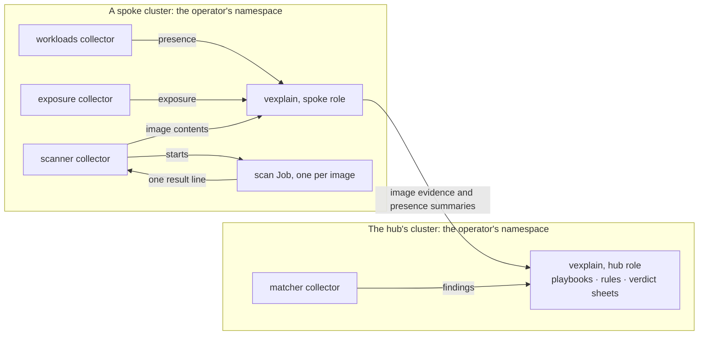

# vexplain — Collectors, evidence and rules

- **Status:** proposed on 2026-10-31, for the owner's review. The direction is the owner's (section 1).
- **Date:** 2026-10-31
- **Author:** Joshua Leuenberger
- **Extends:** the [design](2026-10-29-vexplain-design.md), from its revision 14. For collectors, evidence, playbooks, the deterministic rules and the agent's tools, this document is the source of truth. Where the design said otherwise, its sections carry a note that points here (section 10).
- **Decision records:** [0029](../decisions/0029-collector-packages.md), [0030](../decisions/0030-collector-runtime-config.md), [0031](../decisions/0031-tools-from-collectors.md), [0032](../decisions/0032-evidence-as-cloudevents.md), [0033](../decisions/0033-rules-in-cel.md) and [0034](../decisions/0034-playbooks.md).

Statements marked **[call]** are the designer's, not the owner's. They are the first candidates to revisit.

---

## 1. Intent

Everything vexplain knows comes in through collectors (design 4.2), and deterministic rules settle what the evidence makes highly likely (design 1). Until now, both were compiled into the operator (0007, design 6.5), and so was the flow around them, which knows only container images. A new source, a new rule or a new kind of subject needed Go code and an operator release.

The owner decided on 2026-10-31:
- **A collector is a package:** an OCI image that implements vexplain's gRPC API. A `Collector` resource installs it, as a Crossplane `Provider` installs a provider, and installed means enabled.
- **That holds for vexplain's own collectors too.** Each built-in collector is its own package, installed by default and kept separate, so that each can be maintained on its own. Whether they later move to projects of their own stays open.
- **Collectors take care of what they need,** such as registry credentials. vexplain doesn't dictate how a collector works. The admin who installs one knows what it does.
- **Collectors bring their own evidence types.** The core doesn't define or approve them. Each type explains what its data means, including what its coverage counts, and the people who write rules look that up.
- **Evidence travels as CloudEvents.** vexplain defines the common subjects, and collectors may add their own, such as virtual machines. Each evidence type declares whether its evidence is collected at the hub or stays on the spoke.
- **A playbook describes each use case,** as a Crossplane Composition does: what gets assessed, which collectors feed it, how their data is grouped per subject and workload, which rules run as its steps, and what goes to the agent. CVEs in container images are one playbook; virtual machines or databases would be others.
- **Rules are reusable steps written in CEL,** which playbooks reference, as Compositions reference functions. Today's flow becomes the default playbook, and today's rules its default steps, applied on install. An admin can leave them out.
- **The core keeps one guarantee.** A rule settles a finding only when every input it names is present, and the rule decides how much coverage is enough. Its verdict lays out what it rested on and what it couldn't check. Missing evidence never settles anything.
- **How a collector runs is configurable,** like Crossplane's runtime configuration. The scan pod's pull policy stays `IfNotPresent` by default, and can be changed.
- **The sandbox is a collector, and so is an MCP server,** which serves only the agent. `ToolServer` is dropped.
- **vexplain provides an SDK and a template project** for collector authors.
- **A collector runs at the hub, on the spokes, or both.**
- **Names follow existing standards** (section 5.1).
- **Storage:** development continues on 2a's CRD store, and 0004 is checked on a real cluster (section 8).

**Why:** a project that scales and lasts. A collector, a rule or a playbook can be fixed, released and owned on its own. Platforms where everything is a Kubernetes resource can bring sources that vexplain doesn't know: other kinds of subject, their own runtime agents, or exposure outside Kubernetes.

**Why now:** phase 2b builds five exposure collectors, and phase 3 builds Kubescape support. Built the old way, both would have to be rebuilt later. Kubernetes shows the cost: moving its in-tree volume plugins and cloud providers out to CSI and the cloud-controller-manager took years.

## 2. Goals, non-goals, anti-goals

### Goals
- One API for every collector. The built-ins use it too.
- No core code that knows a collector, its evidence types or a use case. Only the playbooks and rules that admins write name them.
- Collectors installed from OCI images, and shaped by a runtime config.
- Evidence in one standard format, CloudEvents, with a place to state how much it covered.
- Playbooks that let other kinds of subject, such as virtual machines or databases, be assessed without code.
- Rules as reusable steps that combine any collectors' evidence, under one guarantee kept by the core.
- An SDK, conformance tests and a template project for collector authors.

### Non-goals (for now)
- A package manager like Crossplane's (section 9).
- Packages for playbooks and rules, and rule logic in code. Both can come later without changing what exists (5.7).
- An index or marketplace of collectors.
- A compatibility promise before the API reaches `v1`.
- SDKs in languages other than Go. The API itself allows any language.

### Anti-goals (failure even if it "works")
- A rule that settles a finding on missing evidence, or without laying out what it couldn't check.
- A built-in collector, playbook or rule with a shortcut that others can't have.
- A hub that calls into a spoke, or holds credentials for one (0021).

## 3. Constraints

- **Hub and spokes (0021):** spokes open every connection, and the hub holds no credentials for a spoke.
- **Bulky data (0004):** read and written only through storage interfaces, within their size limits.
- **API practices:** design 6.1 and 0012.
- **Safety (AGENTS.md):** a missing or unhealthy collector must never move a verdict towards "not affected". vexplain's own collectors stay read-only towards workloads, and its scanner keeps 0022's isolation: image content from anywhere is parsed only in throwaway pods, with no API token and no LLM key.
- **Repository hygiene (AGENTS.md)** applies to the SDK, the template and the built-in collectors.

## 4. Approaches

The owner chose A on 2026-10-31.

| | Approach | Like | Gains | Costs |
|---|---|---|---|---|
| **A** | **Servers that vexplain deploys and calls over one versioned gRPC API** | Crossplane functions, CSI, Vault plugins, KEDA's external scalers | Typed and versioned, with streams. Evidence goes straight into vexplain's stores, so 0004's limits stay in vexplain's hands. Agent tools come for free | A protocol to own, version and test. Certificates and endpoints to manage. Authors need protobuf tooling |
| B | Controllers that write vexplain's CRDs, such as `Observation` and `CollectionRequest` | Crossplane providers, cert-manager's external issuers, `PolicyReport` | Plain Kubernetes, RBAC instead of certificates, durable while a collector is down | Every observation passes through etcd, which is 0004's main worry. Telling who wrote what needs admission policies. The API server becomes a message bus |
| C | Images that vexplain runs per request | The 2a scanner, Tekton tasks | The simplest contract and the strongest isolation | No fit for collectors that watch, or for quick agent queries. Crossplane's first functions ran a container per call, and Crossplane replaced them with gRPC servers |

Also rejected:
- **Built-ins compiled in, behind the same Go interface, with external plugins over gRPC,** as Vault does. The built-ins would never use the path that everyone else depends on.
- **MCP as the collector API.** MCP is built for interactive tool calls, not for streams of typed, versioned evidence of several megabytes. It stays for the agent (5.10).
- **Rules that only name logic compiled into the hub.** The logic would stay out of the resource, so rules couldn't be maintained on their own.
- **Rules alone, around a flow for container images built into the core.** Every other use case, such as virtual machines or databases, would need code.
- **in-toto attestations as the evidence format.** They fit this domain best, but every subject must have a digest, and workloads don't have one. Evidence about images can still be exported as in-toto attestations later, to sign it or attach it to the image.

## 5. Design

### 5.1 Names

| Name | Meaning | From |
|---|---|---|
| Collector | One source of evidence, in its own package | OpenTelemetry's collectors; GUAC, the OpenSSF graph of supply-chain metadata, which also calls its sources collectors |
| Package | The OCI image a collector ships as | Crossplane's packages |
| CloudEvent | The envelope every piece of evidence travels in | CNCF's CloudEvents spec |
| `type` | The type of a piece of evidence, named in reverse-DNS by whoever defines it, with a version | CloudEvents. in-toto calls the same idea `predicateType`. Not "kind", which clashes with Kubernetes' `kind` |
| `source` | The collector that produced the evidence, and its cluster | CloudEvents |
| `subject` | What the evidence is about | CloudEvents, in-toto and OCI |
| `data`, `dataschema` | The evidence itself, and the URI of its JSON Schema | CloudEvents |
| `coverage` | An optional, whole-number percentage of how much of the subject the evidence covers. Each type says what it counts, and the core never interprets it | A CloudEvents extension. CycloneDX's `compositions`, which state how complete an SBOM is, are the closest precedent. "Completeness" already names the share of owned ELF files (design 6.5) |
| Scope | Whether a type's evidence is collected at the hub or stays on the spoke | Kubernetes CRDs, which declare `Cluster` or `Namespaced` scope |
| Operation | Work that a collector does on demand, with a parameter schema | OpenAPI. The agent sees each operation as a tool, MCP's term |
| Role | Where a collector runs: spoke, hub or both | vexplain's roles (design 5.1). Open Cluster Management's add-ons split the same way |
| Identity service | How a collector describes itself: `GetInfo` and `GetCapabilities` | CSI's identity service |
| Runtime config | The templates that shape the Deployment a collector runs in | Crossplane's `DeploymentRuntimeConfig` |
| `Playbook` | A resource that describes one use case: its subjects, findings, evidence, steps, and what goes to the agent. Its ordered steps are its `pipeline` | SOAR tools' playbooks, which say for one type of case which sources to enrich it from, which checks to run and when to hand it to an analyst; CISA's Vulnerability Response Playbook. `pipeline` is the field that Crossplane's Compositions list their steps in |
| `Rule` | A reusable step that decides about one finding, in CEL. Playbooks reference rules, as Compositions reference functions | vexplain's own word (design 1 and 6.5, and the `rule` on every finding), as with Prometheus, Falco and Sigma rules |
| `Function` | Code for rule logic that CEL can't express, in a package of its own. Not now (5.7) | Crossplane's composition functions |

### 5.2 Collectors and their packages

- **A package is an OCI image,** referenced by tag or by digest. That's the installer's call. vexplain records the digest that actually runs.
- **One package holds one collector.** A collector may cover several sources. The exposure collector covers five, and its settings choose which.
- **A collector describes itself** through its identity service:
  - `GetInfo`: its name, its version and the API versions it speaks
  - `GetCapabilities`: its roles, the evidence types it produces with their schemas and scopes, the types it consumes, whether it watches, its operations with their parameter schemas, the schema of its settings, and the Kubernetes permissions it needs

**`Collector`** (config group, cluster-scoped) installs one collector. Installed means enabled.

| Field | Meaning |
|---|---|
| `spec.package` | The image |
| `spec.runtimeConfigRef` | The `CollectorRuntimeConfig` to use (5.8). `default` if empty |
| `spec.settings` | The collector's own settings, an embedded object |
| `spec.interface` | `Collector` by default, or `MCP` (5.10) |
| `spec.mcp` | For an MCP server: the allowed tools and their evidence types, and, for a server that runs elsewhere, its URL |
| `status.packageDigest` | The digest that runs |
| `status.capabilities` | What the identity service answered, bounded in size |
| `status.conditions` | `Ready`, with reasons such as `Healthy`, `CollectorFailing`, `NoData`, `PackageInvalid`, `IncompatibleAPI`, `SettingsInvalid`, `MissingPermissions` and `WrongRole` |
| `status.lastSuccessTime` | As now |

- **Deleting a `Collector` removes it.** There is no `state` field.
- **vexplain's install ships the built-in collectors** as `Collector` manifests, and later a Helm value can leave any of them out. The operator creates none at run time, so a deleted built-in stays deleted.
- **What a collector finds in the cluster is its own business.** For example, the exposure collector notices whether Gateway API or Cilium exist, which 0006 gave to discovery in the operator.
- **The Deployment and the service account are named after the `Collector`,** so an upgrade keeps the service account and its bindings. Upgrading means changing `spec.package`, and changing it back is the rollback.
- **Settings are the collector's own type.** That is a deliberate exception to "no foreign types" (design 6.1), because vexplain can't know a third party's settings. vexplain checks them against the collector's schema and with `ValidateSettings`, and reports `SettingsInvalid`, without an admission webhook. **[call]**
- **Roles:** vexplain runs a collector's spoke part in a cluster with the spoke role, and its hub part in the hub's cluster. In `HubAndSpoke` it runs both. A collector whose roles the cluster's mode can't run reports `WrongRole`.

### 5.3 The collector API

A gRPC API, `vexplain.collector.v1alpha1`. The SDK implements it, and a collector's author writes the handlers.

| Service | Call | Does |
|---|---|---|
| Identity | `GetInfo`, `GetCapabilities` | Describe the collector (5.2) |
| Identity | `ValidateSettings` | Checks the settings beyond what the schema can check |
| Evidence | `Watch` | Streams the collector's evidence: a full snapshot first, then each change. Removed evidence comes as a tombstone. Every new stream starts with a snapshot, so vexplain can reconnect at any time, as with Envoy's state-of-the-world discovery and Kubernetes' list-and-watch |
| Evidence | `Invoke` | Runs one operation for one subject: its parameters, the evidence of the types it consumes, the settings and the context. Returns CloudEvents, or a failure with a reason |
| Health | The standard gRPC health checking protocol | |

- **Every `Watch` and `Invoke` carries the settings and vexplain's context for the cluster,** so that a collector keeps no configuration state of its own. A change in either restarts the stream. **[call]** The context holds:
  - the scope of `OperatorConfig`
  - the allowlists of owner attribution (design 6.14)
  - the label that marks vexplain's own pods
- **Failure reasons** come from a vocabulary that vexplain defines and keeps open. It starts with 2a's scan failure reasons, such as `Unauthorized`, `NotFound` and `TooLarge`.
- **Running again:** a collector can say through its stream that a source of its own changed, such as the matcher's vulnerability database. vexplain then invokes its operations again, for the subjects it names or for all of them. That is how 0022's "match again after a database update" works, without a special case. **[call]**
- **Versioning:** a collector lists the API versions it speaks, and vexplain uses the newest one both know. `v1alpha1` makes no compatibility promise. A version reaches `v1` only together with the conformance tests (5.11).
- **Transport:** mTLS inside the cluster. vexplain keeps a small certificate authority in a Secret in its namespace, gives each collector's Deployment a server certificate and itself a client certificate, and rotates them, as Crossplane does for its functions.
- **Size:** each type bounds its `data`. Payloads are compressed, and 0004's limits apply to what is stored.

### 5.4 How a collector runs



Arrows show where data flows. vexplain calls each collector in its own cluster, and the spoke opens the connection to the hub (0021).

- **vexplain runs one Deployment per `Collector` and role,** in the operator's namespace, with the collector's service account, shaped by its runtime config (5.8).
- **What else a collector runs is its own business.** The scanner runs a throwaway Job per image, as the 2a operator does now, and the sandbox runs sandbox pods.
- **The SDK offers the 2a scan-Job pattern as a helper:** a throwaway pod with no API token, the pull credentials copied into a short-lived Secret, and one result line in its log. Nobody has to use it.
- **The pods a collector creates are configured through its settings.** The SDK defines a standard pod template for them, so that every collector that creates pods takes the same shape. The scan pod's pull policy and the sandbox's runtime class are set there.
- **Each collector costs one long-running pod per role,** plus whatever it starts itself.

### 5.5 Evidence (0032)

**Every piece of evidence is a CloudEvent:**

| Attribute | Holds |
|---|---|
| `id`, `specversion` | As CloudEvents requires |
| `source` | The collector, and its cluster or the hub, such as `/clusters/cluster-a/collectors/scanner` |
| `type` | The evidence type, such as `ch.bedag.vexplain.scanner.image-contents.v1alpha1` |
| `subject` | What it is about, as a path with a prefix. vexplain defines `image/…` for a reported digest, `manifest/…` for a platform manifest and `workload/…` for a workload. A collector may add its own, such as `vm/…`, and the core passes it on without interpreting it **[call]** |
| `time` | When the collector saw it |
| `datacontenttype`, `dataschema`, `data` | The evidence, its format, and the URI of its JSON Schema, which the collector also returns from `GetCapabilities` |
| `coverage` | An optional extension: a whole-number percentage of how much of the subject the evidence covers. Each type documents what it counts, and its `data` says what the collector couldn't examine. The core shows and records it, but never interprets it |

**Types:**
- **Collectors define their own types.** The core doesn't define, approve or read them, except for four it needs itself:

  | Type | Subject | Scope | The core reads it for |
  |---|---|---|---|
  | `ch.bedag.vexplain.presence.v1alpha1` | Workload | Spoke | What runs where: the container playbook's subjects, scans and reports |
  | `ch.bedag.vexplain.findings.v1alpha1` | Platform manifest, or a collector's own subject | Hub | The findings that playbooks assess: a CVE in a package, with its version, fix and exploitation |
  | `ch.bedag.vexplain.exposure.v1alpha1` | Workload | Spoke | Urgency (0024) |
  | `ch.bedag.vexplain.rule-result.v1alpha1` | Any | Hub | A rule's result, if a `Function` delivers it later (5.7) |

- **Everything else is a collector's own type,** such as the scanner's `ch.bedag.vexplain.scanner.image-contents.v1alpha1`, which carries 2a's scan result unchanged. The matcher and the default rules read it because they name it, not because the core knows it. Its `coverage` is 2a's completeness: the share of the image's ELF files that packages own.

**Presence takes over the operator's pod watch** **[call]**:
- **What it carries:** for each workload, the digests it runs, and for each digest the pods that run it, with their nodes, bounded as presence entries are (0019). It also carries the allowlisted labels and annotations of the workload and its namespace (design 6.14).
- **Scope, owner allowlists and vexplain's own pods:** the presence collector applies them, from the context of 5.3. The conformance tests check that it does.
- **The operator no longer reads pods, nodes, Secrets or service accounts** outside its namespace. The collectors that need them hold those permissions. The operator still reads the cluster's identity itself.

**Where evidence goes depends on its type's scope,** which the collector declares in `GetCapabilities`, as a CRD declares its scope **[call]**:
- **`Hub`:** the evidence goes to the hub, through the same interfaces as now (0021), and is collected there across clusters. Its subjects must be unique across clusters: an image digest is, and a virtual machine's subject includes its cluster.
- **`Spoke`:** the evidence stays in its cluster. The spoke summarises presence and exposure per digest in its presence entry, as design 5.1 already plans. A collector whose spoke evidence matters at the hub also produces a `Hub` type that summarises it.

**Storage:**
- One generic, compressed evidence store replaces `ImagePackages`. It is keyed on subject, type and source, and written once per collector version.
- Its interface is the contract. Its backend is 2a's: CRDs with 2a's size cap, and evidence over the cap fails as `TooLarge`, with no verdict, as now. 0004's trigger is checked on a real cluster (section 8).
- `ImageInventory.status.facts` still records, for each image, its manifests per platform, when they were scanned and any failure reason. vexplain writes these facts generically, from the evidence and the failures. They also record the coverage of each piece of image evidence, by source, so that reports can show it without knowing the type: for the scanner, the completeness that 0025 asks reports to show.

### 5.6 Evidence on demand

- **Watching collectors stream their evidence** all the time.
- **vexplain invokes operations** **[call]**:
  - **For each subject of a playbook,** it invokes the operations that produce what the playbook needs: its findings and its evidence. When an operation consumes a type, such as the matcher consuming the scanner's image contents, vexplain gets that type first.
  - **When a collector signals a change** in a source of its own, vexplain invokes its operations again (5.3).
  - **When the agent calls a tool** (5.10).
- **The hub asks spokes for evidence, not for collectors.**
  - 0021's tasks become requests for a type and a subject. `tasks.Executor.RequestScan` becomes this general request.
  - For an image, a request carries its reported digest, its repositories, and the pods that run it, from presence.
  - The hub sends it to a spoke that runs the digest. That spoke invokes every collector there that produces the type.
  - A collector that needs pull credentials reads them from those pods itself, as 2a's scan runner does.
- **A platform that starts running a digest after its scan** is requested on its own. The design note that the 2a plan carries forward for phase 2b decides when.
- **Each spoke reports its collectors to the hub,** with their types and operations, alongside its presence. Phase 6 decides where that report lives on the hub.

### 5.7 Playbooks and rules (0033, 0034)

**`Playbook`** (config group, cluster-scoped, at the hub) describes one use case, and the hub's admins write it. A playbook is to vexplain what a Composition is to Crossplane: the playbook describes the use case, and the rules in its pipeline do the work. Playbooks live at the hub because each subject gets one verdict across all clusters (0021, 0025). A playbook per namespace would mean a verdict per namespace, and owners settling their own findings.

| Field | Meaning |
|---|---|
| `spec.subjects` | Where its subjects come from: a `Collector` and a type. Each subject of that evidence is assessed |
| `spec.findings` | Where its findings come from: a `Collector` that produces the findings type |
| `spec.evidence` | The evidence it gathers for each subject, each with a name, a `Collector` and a type. It covers the subject itself and the workloads that run it, as presence links them |
| `spec.pipeline` | Its steps, in order. Each step references a `Rule` |
| `spec.agent` | What happens to the findings that no step settled: the `AgentProfile` to use, and which evidence goes into the case file |
| `status.conditions` | `Ready`: its collectors exist, and every step's rule gets the inputs it needs under the names it uses |

```yaml
kind: Playbook
metadata: {name: container-cves}
spec:
  subjects: {collector: workloads, type: ch.bedag.vexplain.presence.v1alpha1}
  findings: {collector: matcher}
  evidence:
  - {name: contents, collector: scanner,  type: ch.bedag.vexplain.scanner.image-contents.v1alpha1}
  - {name: exposure, collector: exposure, type: ch.bedag.vexplain.exposure.v1alpha1}
  pipeline:
  - rule: known-exploited
  - rule: completeness-guard
  - rule: removed-in-later-layer
  - rule: load-check
  agent: {profile: default, evidence: [contents, exposure]}
```

- **A playbook's subjects** are the subjects of the evidence that its subjects collector delivers. For the container playbook, those are the images in presence. The core reads only the subject identifiers. **[call]**
- **What a playbook produces:** for the container playbook, the `ImageVerdicts` sheets, and an `Assessment` for each finding that's left, which records its playbook. A playbook for another kind of subject needs a sheet for that subject, which is decided when the first one comes. **[call]**
- **The agent's profile:** a playbook names the profile it hands its leftover findings to. Profile overrides no longer claim assessment types (0016). **[call]**
- **The default playbook, `container-cves`,** is today's flow, as above:
  - its subjects come from `workloads` and its findings from `matcher`
  - its evidence comes from `scanner` and `exposure`
  - the four default rules are its steps
  - it hands its leftover findings to the `default` agent profile

  vexplain's install applies it with the default rules. Later, a Helm value can leave them out.
- **Another use case is another playbook.** A playbook for virtual machines would take its subjects and findings from other collectors, and reuse whichever rules fit.

**`Rule`** (config group, cluster-scoped, at the hub) is a reusable step: one decision about one finding, in CEL. Playbooks reference rules, so one rule can serve several playbooks, as one Crossplane function serves many Compositions.

| Field | Meaning |
|---|---|
| `spec.inputs` | The evidence the rule needs, each with a name and a type. A playbook that uses the rule supplies evidence under those names |
| `spec.match` | Optional CEL: the findings the rule applies to |
| `spec.condition` | CEL over the finding and the inputs. True means the rule applies |
| `spec.outcome` | What it concludes: `Tracked`; `NeedsAssessment`, which holds a finding open; `Suppressed`, with an OpenVEX status and justification; or `Hint`, which only adds a reason |
| `spec.reason` | CEL that gives the reason recorded with the outcome |
| `status.conditions` | `Ready`: the CEL compiles. Evaluation errors are counted here |

```yaml
kind: Rule
metadata: {name: removed-in-later-layer}
spec:
  inputs:
  - {name: contents, type: ch.bedag.vexplain.scanner.image-contents.v1alpha1}
  condition: |
    contents.data.packages.exists(p, p.id == finding.packageId
      && p.filesListed > 0 && p.filesPresent == 0)
  outcome: {result: Suppressed, status: not_affected, justification: component_not_present}
```

- **CEL** is what Kubernetes itself uses for this, in ValidatingAdmissionPolicy and CRD validation rules. A rule sees the finding, and for each input its `data`, `coverage`, `time` and `source`. Each evaluation has a cost limit. An error means that a rule which suppresses doesn't apply, and that a rule which holds or tracks fails closed, as below.
- **The guarantee the core keeps, whatever a rule says:**
  - A rule applies to a finding only when every input it names is present. How much coverage is enough is the rule's to decide, in CEL: its author looks up what each type's coverage counts.
  - Its verdict lays out what it rested on and what it couldn't check. For each input, the core records the source, the time and the coverage, if the evidence states one. The evidence's `data` holds the detail.
  - Missing evidence never settles anything.
  - **A rule that can't be evaluated fails closed.** **[call]**
    - It can't be evaluated for a finding when an input is missing, its CEL fails, or the rule isn't `Ready`.
    - If such a rule concludes `Tracked` or `NeedsAssessment`, no suppression applies to that finding. The finding stays `NeedsAssessment`, and the sheet says which rule couldn't be evaluated, and why.
    - If the rule's `match` fails, this holds for every finding of the subject.
    - So a new rule that holds findings open, and needs evidence from a collector that hasn't reported yet, holds them until it has.
- **When several steps apply to one finding,** the most cautious outcome wins, in 2a's order: `Tracked` first, then `NeedsAssessment`, and only then `Suppressed`. Hints add up. A finding that no step settles stays `NeedsAssessment`, and goes to the agent. The order of the steps doesn't change the result, so a later step can't undo an earlier step's hold.
- **The wiring is the trust.** A playbook uses only the collectors it names, so no separate policy decides which collectors count.
- **The default rules are today's four,** written in CEL:
  - Known exploited: `Tracked`. Whether known-exploited overrides the evidence or only raises urgency is phase 2b's question, as before.
  - The completeness guard: `NeedsAssessment` when the scanner's `coverage`, its completeness, is below 90%. As a step of its own, it holds findings open against every suppression rule, including those that admins add later. It moves here from `OperatorConfig.spec.rules.minCompletenessPercent`.
  - Removed in a later layer: `Suppressed`, `not_affected`, `component_not_present` (0026).
  - The load check: `Hint`, as 0028 decided.

  Phase 2b proves with the 2a measurement that all 15 cases keep their answers, with and without the known-exploited override.
- **0028's way back becomes a rule** that an admin adds to the container playbook. It combines the scanner's linkage evidence with runtime observations and the sandbox, which the playbook names as evidence, and decides in CEL how much coverage is enough.
- **Later, without changing what exists:**
  - A `Rule` may reference a `Function` package, for logic that CEL can't express, as Crossplane's Compositions reference functions.
  - Playbooks and rules may ship as OCI packages, as Crossplane's Configurations bundle Compositions and Falco ships its rules.
- **The agent's validator** (design 6.7) names its required evidence by type, as rules do. Phase 4 decides whether it reads that evidence through rules.

### 5.8 Runtime config (0030)

**`CollectorRuntimeConfig`** (config group, cluster-scoped) shapes the Deployment a collector runs in, as Crossplane's `DeploymentRuntimeConfig` does.

| Field | Shapes |
|---|---|
| `deploymentTemplate` | The collector's Deployment |
| `serviceAccountTemplate` | The metadata of its service account, such as an annotation for a cloud identity |

- **Templates are merged onto vexplain's defaults** as a strategic merge patch. The collector's container is named `collector`.
- **A `default` config applies** when a `Collector` names none. The operator creates it empty and never overwrites it.
- **The defaults are hardened:**
  - non-root, with the `RuntimeDefault` seccomp profile
  - no privilege escalation, a read-only root filesystem, and all capabilities dropped
  - `imagePullPolicy: IfNotPresent`
  - the collector's default resources
- **Everything can be changed.**
  - Writing a `Collector` or a `CollectorRuntimeConfig` amounts to creating pods in vexplain's namespace. Kubernetes' RBAC good practices treat that as access to every Secret and service account there.
  - So write access to both is only for people trusted with vexplain's namespace. vexplain's install and documentation say so.
  - Crossplane doesn't restrict `DeploymentRuntimeConfig` either.
- **vexplain sets the contract's fields last:** the image, the certificates, the port and the contract's environment variables.
- **The pods a collector creates itself** are configured through its settings, with the SDK's standard pod template (5.4).

### 5.9 Trust and permissions

- **Installing a collector means trusting it.** The admin who installs it knows what it does.
- **What settles a finding is decided by the playbooks and their rules,** which name exactly the collectors they read, under the core's guarantee (5.7).
- **Evidence that no playbook names still reaches the agent** through its tools. For the agent's validator it is external evidence: it can push only towards "affected" or "unclear", unless the admin maps it to a known type (0007, kept).
- **A collector's health gates new evidence, not what it already delivered.** **[call]**
  - Evidence stays valid until the collector replaces it, for example after an upgrade, or until its `Collector` is deleted, which removes its evidence. A playbook that names a deleted collector isn't `Ready`.
  - A collector that is unhealthy or incompatible gets no new requests, and its `Ready` condition says so. One failed request leaves stored evidence alone.
  - Evidence that was never delivered is missing, and missing evidence never settles anything (5.7, design 6.3).
- **Permissions:**
  - A collector lists the permissions it needs in `GetCapabilities`.
  - vexplain's install binds the built-in collectors' roles, and an admin binds those of other collectors. The `Collector` reports what's missing as `MissingPermissions`.
  - vexplain grants none. Granting would need the `escalate` and `bind` permissions, which vexplain shouldn't hold. **[call]**
  - vexplain's own collectors stay read-only towards workloads (AGENTS.md).
- **The operator's own permissions shrink.** Pull secrets and service accounts are read by the collectors that pull images, not by the operator.
- **Supply chain:** the cluster's admission policy checks signatures, such as Kyverno or sigstore's policy-controller. Tags or digests are the installer's call.

### 5.10 The agent's tools (0031)

- **The agent's tools are:**
  - **queries over stored evidence,** built into vexplain and generic over types: the SBOM, the exposure summary, a runtime profile
  - **the operations that collectors declare.** Each becomes a tool named after its `Collector` and operation, with the operation's parameter schema as the tool's input schema. A collector's author gets agent support without extra work.
- **What the agent starts with** is the case file that its playbook puts together (5.7). The tools are for what it wants to look up beyond that.
- **The built-in tools of 0007 map like this:**

  | Tool | Comes from |
  |---|---|
  | Advisory lookup | An operation of `advisories` |
  | SBOM query | An evidence query |
  | `govulncheck` on a binary | An operation of `govulncheck` |
  | Symbol and linkage scan | An operation of `scanner` |
  | Runtime profile summary | An evidence query |
  | Exposure summary | An evidence query |
  | Config read | An operation of `workloads` **[call]** |
  | Request a sandbox run | An operation of `sandbox`, only if it's installed |

- **An MCP server is a collector that serves only the agent.**
  - It is either a `Collector` with `interface: MCP` and a package that vexplain deploys, or a server that runs elsewhere, which its `Collector` names by URL. The credentials for a server elsewhere are in a labelled Secret in the operator's namespace, as 0017 requires for the LLM key.
  - Its `Collector` lists which of the server's tools are allowed, and which evidence type each produces. By default, that is external evidence.
  - Its tools run with arguments that a model picked, and return text that a model reads. So their output goes only into the agent's ledger, never to the rules.
- **`ToolServer` is dropped.** It was planned for after v1 and never built.

### 5.11 SDK, template and conformance

- **A Go SDK,** in this repository, as a Go module of its own, so that a collector doesn't import the operator's dependencies. It provides **[call]**:
  - the server, the identity service from Go declarations, snapshots and changes for `Watch`, and health
  - settings checked against their schema
  - CloudEvents, through the CloudEvents Go SDK
  - the scan-Job helper and the standard pod template (5.4)
- **Conformance tests,** in the SDK, run a collector against the contract, as CSI's `csi-sanity` does for storage drivers. Every built-in collector passes them in CI. For a presence collector, they also check that it applies the scope and skips vexplain's own pods.
- **A template project,** in this repository at first, like Crossplane's `function-template-go`: a minimal collector with its Dockerfile, its build, an e2e test on kind, and the conformance tests. **[call]**
- **The built-in collectors** live in this repository, each as its own Go module and OCI image, built and released with the operator. Whether they move out later stays open (owner).

### 5.12 The built-in collectors

| Collector | Roles | Runs | Produces | Operations | From |
|---|---|---|---|---|---|
| `workloads` | Spoke | Watches pods, and applies the scope and the owner allowlists | Presence | Config read (phase 4) | 2b, moved out of the operator |
| `scanner` | Spoke | Scan Jobs, with the pull credentials it reads itself | Its image contents: 2a's scan result | Scan; symbol search later | 2b, moved out of the operator |
| `matcher` | Hub | Holds Grype's database, and signals its updates | Findings, from the scanner's image contents | Match | 2b, from 2a's matcher |
| `exposure` | Spoke | Watches Ingress, Service, Gateway API, NetworkPolicy and Cilium, whichever exist | Exposure | | 2b |
| `govulncheck` | Both | Jobs at the spoke that extract symbol tables, which only its hub part reads; Go's database at the hub | Its reachability of Go CVEs | Check a binary | When 2b's plan says (0027) |
| `kubescape` | Spoke | Reads Kubescape's resources | Its runtime observations with a summary per image, and findings from Kubescape's matches. Phase 3 decides how its SBOMs map | | 3 |
| `advisories` | Hub | Reads advisory sources through the proxy | Its advisories | Look up an advisory | 4 |
| `sandbox` | Spoke | Sandbox pods, with 6.8's guardrails as defaults | Its runtime observations | Run a workload's image | 5 |

- **The default playbook and rules** of 5.7 are installed with the built-in collectors.
- **A spoke runs about six pods for all of this:** the operator, `workloads`, `exposure` and `scanner`, plus `govulncheck`, `kubescape` and `sandbox` when they're installed. The scan Jobs and sandbox pods come on top.

## 6. Phases [call]

- **Phase 2b starts with the platform:**
  - the collector API, the SDK, the conformance tests and the template
  - `Collector` as an installed package, `CollectorRuntimeConfig`, the deployer and the certificates
  - CloudEvents, the evidence store in place of `ImagePackages`, and evidence on demand in place of `RequestScan`
  - `Playbook` and `Rule` with CEL and the core's guarantee, the four default rules, and the default `container-cves` playbook
  - `workloads`, `scanner` and `matcher` moved into packages, with the 2a measurement run again to show that nothing changed
- **Then the rest of 2b,** with the exposure collector built as a package from the start.
- **Phase 3:** `kubescape` as a collector.
- **Phase 4:** the agent's tools from collectors, `advisories`, and the case file from the playbook.
- **Phase 5:** `sandbox` as a collector.
- **After v1:** MCP servers as collectors, in place of `ToolServer`. Packages for playbooks and rules, and `Function`s, if they're needed.

## 7. Left to the builder

- The protobuf messages, their field names and numbers, and each type's size limit.
- The CRD fields beyond sections 5.2 and 5.7, within design 6.1.
- How the certificates are issued and rotated.
- How a `GetCapabilities` answer is cached and refreshed.
- The names and labels of what vexplain creates for a collector.
- The CEL environment's exact variables, and its cost limit.
- The evidence store's object names and its size limits per type, within 0004.
- What the conformance tests check beyond the contract of 5.3 and 5.5.

## 8. To check on a real cluster

- **0004's first storage trigger.** Phase 2a's measurement put the largest test image's evidence at 147% of 0004's 512 KiB trigger, and at 98% of the 768 KiB that one object holds. The owner decided on 2026-10-31 that development continues on 2a's CRD store as if all is good, and that this is checked once vexplain runs on a real cluster.

## 9. Left out until there's a need

Crossplane's package manager does more. vexplain leaves these out:
- **Dependencies between packages** (Crossplane's `dependsOn`). Collectors don't call each other; evidence connects them.
- **Revision history and activation policies** (`ProviderRevision`). Changing `spec.package` is the upgrade.
- **CRDs installed from packages.** A collector's settings travel inside its `Collector` (5.2). Installing and upgrading CRDs is the largest part of Crossplane's package manager.
- **Signature checks by vexplain.** The cluster's admission policy checks them (5.9).
- **Packages for playbooks and rules, and `Function`s** (5.7).
- **An index of packages.**

## 10. What this changes

**In the design.** Revision 14 adds a note to each of these sections that points here:

| Design section | What changes | Now in |
|---|---|---|
| 4.2 Data sources and extension | Collectors are packages, not compiled in. MCP plug-ins are collectors | 5.2, 5.10 |
| 5 Architecture overview, 5.1 Roles | Spokes and the hub run collectors. Tasks become requests for evidence | 5.4, 5.6 |
| 6.1 API design | `Collector` installs a package; it is no longer a union by `type`. Its settings are the collector's own type | 5.2 |
| 6.2 Resources | `Collector` changes; `CollectorRuntimeConfig`, `Playbook` and `Rule` are new; `ToolServer` is dropped; an evidence store replaces `ImagePackages`; an `Assessment` records its playbook | 5.2, 5.5, 5.7, 5.8, 5.10 |
| 6.3 Collectors | The built-in collectors become packages | 5.12 |
| 6.5 Rules | The rules become `Rule`s in CEL, which the default playbook runs as its steps, under the core's guarantee | 5.7 |
| 6.6 The agent loop, 6.6.1 `AgentProfile` | A playbook decides what goes to the agent and names the profile. Overrides no longer claim assessment types | 5.7, 5.10 |
| 6.6.3 Tools | Tools come from collectors | 5.10 |
| 6.7 Validator rules | `ToolServer`s become MCP collectors, and evidence is named by type | 5.7, 5.9, 5.10 |
| 6.8 Sandbox runs | The sandbox is a collector that runs its own pods | 5.4, 5.12 |
| 6.11 Security and governance | Collectors' service accounts; pull secrets read by the collectors that pull images, not by the operator | 5.8, 5.9 |
| 6.12 Image identity and content | Scans run in the `scanner` collector, and Kubescape is a collector | 5.6, 5.12 |
| 6.13 Glossary | "Collector", and the new names | 5.1 |
| 6.14 Owner attribution | The `workloads` collector resolves it, with the allowlists that vexplain passes it | 5.5 |
| 7 Phases | Phase 2b starts with the platform, the playbook and the rules | 6 |
| 8 Left to the builder | The task executor becomes evidence on demand | 5.6 |

**In the decision records:**

| Record | What changes |
|---|---|
| 0007 | Superseded: its collectors by 0029, its tools by 0031, its evidence kinds by 0032 |
| 0002 | Kubescape becomes a collector (0029) |
| 0006 | The exposure collectors become one collector. Installed means enabled, so the defaults come with the install and `state: Disabled` is dropped. Finding which APIs exist moves into the collector (0029) |
| 0008 | The sandbox becomes a collector that runs its own pods (0029, 0030) |
| 0012 | `Collector` installs a package instead of being a union by `type`, and `ToolServer` is dropped (0029, 0031) |
| 0015 | `Collector` installs a package; `CollectorRuntimeConfig`, `Playbook` and `Rule` are new; `ToolServer` is dropped; `OperatorConfig`'s rules move into `Rule`s (0029 to 0031, 0033, 0034) |
| 0016 | A playbook names the profile it hands its leftover findings to; overrides no longer claim assessment types (0034) |
| 0020 | The `workloads` collector resolves owner attribution on the spoke, with the allowlists that vexplain passes it (0029) |
| 0021 | Spokes run collectors, and the hub asks for evidence of a type instead of assigning tasks (0029, 0032) |
| 0022 | The scan Job runs in the `scanner` collector, which reads pull secrets itself; the matcher becomes a hub collector (0029, 0030) |
| 0023 | Evidence is stored per subject, type and source, in one store (0032) |
| 0026 | The load check becomes a default `Rule`; what the scan records is unchanged (0033) |
| 0027 | `govulncheck` becomes a collector with a part in each role (0029) |
| 0028 | The way back becomes a `Rule` that an admin adds to the container playbook, with coverage from the evidence (0032, 0033) |

## 11. Change log

### Revision 1

The first version, from the owner's decisions of 2026-10-31.
