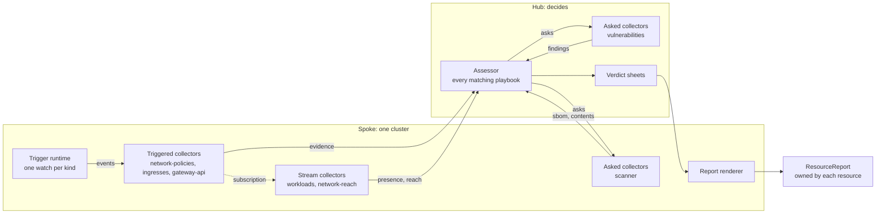

# vexplain — The collector model

- **Status:** accepted by the owner on 2026-11-08. The decisions are the owner's, from the phase 3 discussion of 2026-11-07 and 2026-11-08 (section 1).
- **Date:** 2026-11-08
- **Author:** Joshua Leuenberger
- **Extends:** the [design of collectors, evidence and rules](2026-10-31-collectors-evidence-rules.md), and the [main design](2026-10-29-vexplain-design.md) from its revision 15. This document is the source of truth for:
  - how collectors are triggered;
  - the permissions collectors get;
  - which subjects a playbook judges;
  - reports for any resource;
  - the roles of the built-in collectors.

  Where the earlier documents say otherwise, their sections carry a note that points here (section 10).
- **Decision records:** [0040](../decisions/0040-collector-triggers.md) to [0049](../decisions/0049-kubescape-after-the-agent.md).

Statements marked **[call]** are the designer's, not the owner's. They are the first candidates to revisit.

---

## 1. Intent

Phase 2b made collectors packages that speak one API. A first run on a real cluster, and a review of each collector, showed that the model around them was still built for one use case: CVEs in container images.
- A collector can't report on a ConfigMap.
- Two playbooks can't run side by side.
- Only workloads get a report.
- A collector's settings, triggers and permissions each work differently.

**The owner's vision (2026-11-07) is a building kit, not a CVE tool:**
- **A collector is its own Deployment.** It may do anything, and speaks only through evidence. Its author knows a resource's shortcomings best.
- **Rules evaluate, and playbooks make a use case of them.** CVEs in pods today. Later: RoleBindings that grant too much, NetworkPolicies that allow everything, long-lived wildcard certificates, ConfigMaps that hold secrets, CVEs in virtual machines.
- **Each resource gets a report that it owns.**
- **Collectors are like Crossplane's providers and functions:** one purpose each, usable alone, and more useful together.
  - They build on each other through types, never directly.
  - Any one can be left out, and the rest keeps working.
  - Central collectors are fine; cycles are not.
- **The platform configures collectors.**

**The owner decided, on 2026-11-07 and 2026-11-08:**
1. **Roles.** A collector only delivers data, never a verdict. Rules judge findings, and only findings. A finding is any item worth judging (5.1).
2. **Triggers.** Collectors declare their own triggers: events in the cluster, filtered with CEL, and schedules (5.2).
   - "Run now" belongs to collectors.
   - Playbooks run continuously and never need a manual run.
   - The agent gets a playbook's output only on demand (phase 4).
3. **Where watching lives:** model C. A trigger runtime in the spoke serves collectors whose evidence is about the object that changed. The others keep their own watch and stream (5.3, 0040).
4. **Permissions.** Collectors ship their own permissions. vexplain grants them under a ceiling that the admin extends, and a deny list that wins (5.4, 0041).
5. **Reports.** One report per resource, `ResourceReport`, whose results are actions (5.8, 0042).
6. **Judging stays on the hub,** for every resource (5.7, 0021).
7. **Playbooks** take a match by cluster and namespace, and the hub shows the fleet picture for each (5.6, 0043).
8. **Evidence `maxAge`** is set where evidence is produced (5.5, 0045).
9. **The collectors** (5.9):
   - presence names containers;
   - a neutral `sbom` type comes between scanners and the matcher (0044);
   - fix targets stay in the matcher, now named `vulnerabilities`, and exposure becomes `network-reach` (0046);
   - the scanner takes the sandbox's two modes for pull credentials (0047);
   - exposure gets platform settings, and is then split into family collectors, built and judged on a live run (0048);
   - govulncheck waits until the others are settled;
   - Kubescape moves after phase 4 (0049).

**Why:** vexplain should assess whatever a platform cares about, with collectors that third parties can write, and judgments that the platform's security engineer controls. Knowledge stays with the collector's author, and judgment with the admin.

**Why now:** phase 3 was to add Kubescape and govulncheck. Built on the old model, each new collector would multiply the old limits: one use case at a time, playbooks that stop when one collector is missing, reports for workloads only, and permissions granted by hand.

## 2. Goals, non-goals, anti-goals

### Goals
- **Any resource can be assessed:** collectors for any kind, playbooks for any use case, and a report for every resource.
- **Collectors stay loosely coupled.** They build on each other only through types. Any one can be left out, and the rest keeps working, erring towards caution.
- **Authors declare, and vexplain runs.** Triggers, permissions and schedules are declared, shown, and narrowed by the admin.
- **Collectors that judge one object at a time** can be written in any language, with no cluster rights of their own.
- **The platform's security engineer decides,** through rules and playbooks, per cluster and namespace.
- **A fleet view for each playbook,** on the hub.

### Non-goals (for now)
- **Exceptions that accept a finding on purpose.** They come in phase 4 or later, after real-world tests show what the handling needs (owner).
- **Scaling the trigger runtime beyond its first version.** The options are recorded with their signals (section 9).
- **govulncheck** (owner: once the other collectors are settled), and **human impact per cluster stage** (owner: deferred).
- **Uninstall improvements** (owner: not in phase 3).
- **SDKs in other languages than Go.** The thin contract for triggered collectors makes them cheap later.

### Anti-goals (failure even if it "works")
- **A false "not affected."** Stale or missing evidence must never settle a finding. A missing family collector must never narrow reach.
- **A collector that receives what the admin denied.**
- **Judging logic in two places.**
- **A report kind that only vexplain's own use cases can fill.**

## 3. Constraints

- **Hub and spokes (0021):** the hub decides; spokes observe, act on request and render; spokes open every connection.
- **Bulky data (0004):** read and written only through storage interfaces, within their size limits.
- **Safety (AGENTS.md):**
  - read-only towards workloads;
  - secret values are never logged, emitted or stored;
  - a false "not affected" is the worst error;
  - hitting a limit means "no verdict".
- **API practices:** design 6.1, 0012 and 0036. Fields are optional, validated with CEL, and come with the phase that uses them.
- **Repository hygiene (AGENTS.md).**

## 4. Approaches

### 4.1 Where watching lives (0040): the owner chose C on 2026-11-08

| | Approach | Like | Gains | Costs |
|---|---|---|---|---|
| A | Each collector watches, and the SDK does the work | controller-runtime predicates, Trivy Operator, Crossplane providers | No new platform part; each collector keeps its own access | Collectors not written in Go rebuild the runtime. Every collector holds cluster-wide read access, and the admin's filter is only honoured, not enforced. Watches, caches and LISTs multiply with the collectors. A CVE in the runtime means rebuilding every collector. |
| B | The spoke watches for every collector, and serves joins through `requires` | admission webhooks, Crossplane functions with WatchOperation, Kubewarden's context-aware policies | One model; one watch per kind | It needs `requires` and cache trimming, and rewrites exposure and workloads. Exposure's inputs can't be narrowed anyway, because a filter on them would understate exposure. The owner ruled it out. |
| **C** | **B for collectors whose evidence is about the object that changed; the stream for the rest** | Knative's ApiServerSource and ContainerSource; Argo Events' resource source and its generic gRPC source; Crossplane's functions next to its providers | Triggered collectors are thin, in any language, with no cluster rights; the filter is enforced; one watch per kind; a runtime CVE is patched once | Two models to document and test; the trigger runtime is a shared point of failure (5.3) |

Also rejected: **admission webhooks,** because an outage would slow or block deployments; vexplain stays out of the API server's request path.

### 4.2 The report's shape (0042): one kind for every resource

Trivy Operator has a kind per use case: `VulnerabilityReport`, `ConfigAuditReport`, `ExposedSecretReport`, `RbacAssessmentReport`. Each gets its own columns, but every new use case needs a new kind, which third-party collectors can't add.

One kind for every resource has the shape of OpenReports, and a collector author never defines a report kind. The owner chose it on 2026-11-08.

### 4.3 Where judging happens: on the hub

**Judging on the spoke where a resource lives,** as Open Cluster Management evaluates a hub's policies on each managed cluster, would:
- keep findings in their cluster;
- spare the hub's assessor.

But it puts judging logic in two places. The agent, which is reachable from the hub, would still need every unclear case. The owner kept 0021: the hub decides. Judging on the spokes is an option for later (section 9).

### 4.4 Fix targets (0046): in the matcher

**A separate `remediation` collector** would be reusable. But it adds a step to every chain, and it separates an ecosystem's version rules from the advisories they apply to.

Grype already orders versions by each ecosystem's rules (deb, rpm, apk, Go, Python, Maven and more), so the matcher can name the right target. The owner chose the matcher.

### 4.5 Exposure (0048): family collectors and evidence subscriptions

| | Approach | Gains | Costs |
|---|---|---|---|
| | One collector, as today | Built and tested | Its facts about policies and routes serve no other playbook |
| | Family collectors, with exposure keeping its own reading and sharing parsing code through the SDK | No new platform part | Two readers of the same kinds; reuse only through code |
| **Chosen** | **Family collectors, with `network-reach` building on their evidence through subscriptions** | Reuse through types, as the owner's principle asks. Each family serves its own playbooks too. | A new kind of trigger, and a join that depends on other collectors |

The owner chose to build it properly in phase 3, not as a throwaway spike, and to judge it on a live run (section 8).

## 5. Design



### 5.1 Roles

- **A collector delivers data:** facts about a resource, and findings as its author sees them. It never sets a verdict. Several collectors may add data about the same resource.
- **A finding is any item worth judging,** not only a suspected gap. A certificate collector reports every certificate with its names and its duration, and rules filter them down.
- **Rules judge findings, and only findings.** A rule confirms a finding, dismisses it, or keeps it open. A rule never finds a gap itself.
- **A playbook composes rules for one use case.**
- **Collectors build on each other only through types** (`produces` and `consumes`, and subscriptions in 5.2). There are no cycles. Central collectors are fine. A chain may grow with a complex use case, by this rule: a step is split out when it's reused or swapped on its own, and kept together when it always runs with its neighbour on the same data.

### 5.2 Triggers (0040)

**A collector is triggered in one of four ways:**
1. **Cluster events,** for collectors whose evidence is about the object that changed: certificates, ConfigMaps, virtual machines, RoleBindings. The author declares them in `GetCapabilities`, shaped like an admission webhook's rules: resources with operations, and CEL `matchConditions` over `object` and `oldObject`.
2. **Evidence on demand,** for collectors that build on others. This is unchanged from 2b (its section 5.6): the core works back from what a playbook needs, through `produces` and `consumes`, and asks each operation per subject.
3. **Schedules,** for sources outside the cluster, such as a vulnerability database. The author declares a cron default.
4. **Evidence subscriptions,** for collectors that build on another collector's streamed evidence (0048). The collector names the types it subscribes to, and the spoke forwards evidence of those types to it, as Knative's Triggers route CloudEvents by type.

```yaml
# declared by a certificate collector's author in GetCapabilities (field names [call])
triggers:
- name: certificates
  resources:
  - apiGroups: [cert-manager.io]
    resources: [certificates]
    operations: [CREATE, UPDATE]
  matchConditions:
  - name: spec-changed
    expression: oldObject == null || object.spec != oldObject.spec
---
# declared by the vulnerabilities collector's author
triggers:
- name: database
  schedule: "0 */6 * * *"
```

**What the admin can do on the `Collector`:**
- **Narrow triggers, never widen them,** with a namespace selector, an object selector and extra CEL. A `ValidatingAdmissionPolicyBinding` narrows its policy's `matchConstraints` the same way.
- **Change schedules.**
- `OperatorConfig`'s scope applies on top.

```yaml
apiVersion: config.vexplain.bedag.ch/v1alpha1
kind: Collector
metadata:
  name: certificates
spec:
  package: artifacts.example/vexplain/certificates:v0.1.0
  triggers:
  - name: certificates
    namespaceSelector:
      matchExpressions:
      - {key: kubernetes.io/metadata.name, operator: NotIn, values: [kube-system]}
```

**Run now** is an annotation on the `Collector`, as Flux's `reconcile.fluxcd.io/requestedAt`. A schedule fires at once, and an event trigger delivers every matching object again. The `Collector`'s status records the request it handled last. **[call]** for the annotation's name.

**Not admission webhooks:** vexplain stays out of the API server's request path.

**Parameters need nothing new.**
- `spec.settings` holds what the collector means, checked against the schema it declares.
- `CollectorRuntimeConfig` holds how its pod runs (args, environment, resources).
- Typed fields on the `Collector` are only for what vexplain enforces, such as triggers.

### 5.3 Where watching lives: triggers and the stream (0040)

**The rule for authors:** use triggers when your evidence is about the object that changed. Use the stream when one change alters evidence about other objects, as when a NetworkPolicy changes the reach of many workloads.

**The trigger runtime** runs on the spoke as its own Deployment, which may only list and watch (5.4).
- It watches each kind once, for every collector, and checks the author's filter and the admin's filter.
- **`OperatorConfig`'s scope bounds subjects, not inputs** **[call].**
  - By default, a trigger delivers only objects in scope.
  - A trigger whose objects also feed another collector's join declares that it wants every object. `network-policies`, `ingresses` and `gateway-api` do, because an object outside the scope can widen reach inside it: an exposed workload in an excluded namespace, or a Gateway in an excluded infrastructure namespace.
  - Evidence about an object outside the scope goes only to subscribers on the spoke. It is never stored, never sent to the hub and never judged.
  - The scope's namespace filter doesn't apply to cluster-scoped kinds.
  - Today's exposure collector already reads every namespace, and filters only what it reports.
- It calls the collector with the operation, `object` and `oldObject`, over the existing mTLS channel.
- A queue of object keys delivers the latest state of each object, with retries and back-off.
- It delivers every matching object again whenever a collector starts.
- Evidence about an object is dropped when the object goes away, so the collector needs no delete handling.
- Trigger health shows on the `Collector`'s status, such as "kind not served" or "not allowed".
- Kinds that appear later, such as a CRD installed after the collector, are handled once, by the runtime.

The first version stops there. The scaling measures are options, each with the signal that calls for it (section 9). This is the owner's rule for this project: the simplest version first, then a measure picked once a real problem has been analysed.

**The stream** is today's `Watch`. It serves collectors that join many kinds, which read the cluster with their own service account: `workloads` and `network-reach`. Any collector may stream. A triggered collector gets no API token.

### 5.4 Permissions (0041)

**Collectors ship their own permissions:** the `Permissions` they already declare in `GetCapabilities`. vexplain turns them into RBAC that the `Collector` owns:
- **For triggered kinds:** a ClusterRole, labelled to aggregate into the trigger runtime's role, the way Kyverno's controllers pick up labelled roles.
- **For what a collector reads itself,** such as a stream collector's kinds or the scanner's pull secrets: a ClusterRole bound to the collector's own service account, plus a Role for what it needs in its own namespace.

This reverses 2b's "vexplain grants none" (its section 5.9).

**The ceiling is the admin's hard limit.**
- It's a ClusterRole that the admin extends with labelled roles, as Crossplane does with `crossplane:allowed-provider-permissions`.
- vexplain grants through an identity that holds exactly the ceiling. Kubernetes lets someone create a role only when they hold all its permissions, or have the `escalate` verb, so the API server itself refuses a role beyond the ceiling.
- vexplain checks first. A collector that asks for more gets `Ready=False` with the reason `PermissionsNotAllowed`, which names the rules, and nothing is granted.

**A second ceiling covers a collector's own namespace** (owner, 2026-11-08).
- The ceiling, `vexplain-collector`, covers what a collector may get in the whole cluster, and vexplain holds it in the whole cluster.
- A second ceiling, `vexplain-collector-namespaced`, covers what a collector declares for its own namespace, such as the scanner's Jobs and their Secrets. vexplain holds it only in its own namespace, through a RoleBinding.
- A rule for a collector's own namespace may fall under either ceiling, and a rule for the whole cluster only under the first. The deny list applies to both.
- With a single ceiling, the scanner's `create` on Jobs and Secrets would be vexplain's in every namespace. Operator Lifecycle Manager splits a bundle's `permissions` from its `clusterPermissions` in the same way.

**A grant holds only while every declared rule is allowed** **[call].** When the admin narrows a ceiling or extends the deny list, vexplain takes back the grant of a collector that now asks for too much, and the collector reports `PermissionsNotAllowed`. Otherwise a new deny rule would never reach the collectors already running.

**The deny list is a second guard.**
- `OperatorConfig` lists permissions that vexplain never grants a collector, as RBAC rules with verbs, whatever the ceiling allows. Deny wins, as an explicit deny does in AWS IAM.
- **The default is list and watch on Secrets,** because those reveal every Secret's contents (Kubernetes' RBAC good practices). The scanner's `get` on pull secrets keeps working.
- **It acts at one decision point, the grant.** A collector only gets deliveries for the kinds in its own role, so deliveries follow from the grant. For admins it comes down to one sentence: *a collector gets what it declares if the ceiling allows it and the deny list doesn't forbid it.*
- The condition on the `Collector` names which guard refused.
- What the admin allows is their responsibility. A grant someone makes by hand, outside vexplain, is the RBAC admin's business.

```yaml
apiVersion: config.vexplain.bedag.ch/v1alpha1
kind: OperatorConfig
spec:
  collectors:
    deniedPermissions:               # field names [call]
    - apiGroups: [""]
      resources: [secrets]
      verbs: [list, watch]           # the default
```

**Further rules:**
- **`MissingPermissions` stays,** for an admin who grants by hand.
- **The granting identity runs inside the operator at first** **[call].** Crossplane runs the equivalent as its own Deployment (`crossplane-rbac-manager`), which is an option for later.
- **Evidence never carries secret values.** For a third-party collector that is a contract vexplain can test, not enforce: the SDK documents it, and the conformance suite feeds canary values and fails if they show up in evidence. Masking delivered Secret values is deferred (owner).

### 5.5 Evidence (0044, 0045)

**The neutral `sbom` type (0044)** is a core type, like `findings`.
- **What it holds:** a subject's package inventory, meaning the distribution, and each package with its ID, name, version, type, purl and CPEs. Plus a coverage field and the producer.
- **Who produces it:** the scanner, next to its own `image-contents`. That type keeps what only the scanner has: file ownership, ELF facts and coverage.
- **Who consumes it:** `vulnerabilities`, in place of `scanner.image-contents`. Rules that read the SBOM, such as `removed-in-later-layer`, take it as a second input.
- **What it opens up:** a VM disk scanner, or SBOMs attached to images in registries, can feed the same matcher.
- Anchore splits its tools the same way: Syft makes SBOMs, and Grype matches any SBOM.

**Findings carry a core envelope** **[call].** Collectors define their own findings types (0032), and each carries an envelope that the core reads:
- an ID, unique within the subject;
- a title;
- a default severity;
- optionally, a location in the resource (5.8).

The rest is the collector's data, which rules read through CEL.
- **The vulnerability type** (`ch.bedag.vexplain.findings.v1alpha1`) fills the envelope too. Its ID comes from the vulnerability and the package, and its location from presence, which now names containers (5.9). So 3a's change to the vulnerability type (aliases, fix targets, the envelope) is the generic version, not a step that 3b replaces.
- **A finding is the item the collector reports,** such as a whole certificate. A rule that confirms it may name a more specific location for its action, in CEL, such as the certificate's `spec.duration`. Otherwise the action takes the finding's location.

**`maxAge` (0045) is set where evidence is produced.**
- **The collector declares a default per type.** Its author knows whether the data can change under the same subject: a VM's disk can, an image's contents can't.
- **The admin overrides it on the `Collector`.** HTTP's `Cache-Control: max-age`, set by the server that produced a response, works the same way.
- **There's no default in `OperatorConfig`.** It would expire evidence that never changes, and re-scan every image on a timer.
- **A type without a `maxAge` doesn't expire.** Events, a new collector version or a source change refresh it, as today.
- **On expiry, the core asks again.** Until fresh evidence arrives, stale evidence never settles anything.
- No type of phase 3 needs a `maxAge`. The field comes with the first type that changes under its subject.

**Findings about a resource that lives in one cluster are Hub-scoped,** with subjects that are unique across clusters (5.7). Anything a rule reads must reach the hub.

**Bulky evidence** **[call].** Where evidence of several megabytes lives (images' SBOMs, later VMs', govulncheck's blobs) is a question for every collector, not for one. The proposal:
- keep 0004's storage interface and gate;
- keep each piece of evidence under the limit by splitting it, as the `sbom` split does for the scanner's `TooLarge`;
- measure the sizes on the re-run after phase 3a, and decide the backend then, as 0004 says: on real data.

### 5.6 Playbooks (0043)

**A playbook names types, not collectors.** Every producer of a type counts by default. An entry may pin its producers by collector name, as playbooks do today **[call]**.
- Findings from several producers are one finding when their subject and ID match.
- Evidence from several producers is evaluated once per producer, and the most cautious outcome wins, as it does between rules. So an extra producer can keep a finding open, but never settle it against another producer's evidence.
- `vulnerabilities` matches each producer's SBOM.
- Installing a collector means trusting it (the design of collectors, evidence and rules, 5.9), so any collector may produce any type.
- A second checker beside the matcher needs no playbook change.

**An evidence entry can be optional** **[call],** as a pod refers to a ConfigMap with `optional: true`.
- Without the entry's producer, the playbook stays Ready.
- A missing input follows the engine's rule for errors: a rule that settles doesn't apply, and a rule that holds or confirms keeps the finding open. So nothing settles or passes on missing evidence.
- Today one missing input stops every verdict of the playbook.

**A playbook has its own match.**
- **Clusters, by labels,** and **namespaces, by selectors.** So production can be held to stricter requirements than development. Precedents: Kyverno's per-policy match next to its global `resourceFilters`, Gatekeeper's per-constraint match next to its `Config` exclusions, and Open Cluster Management's Placement.
- **Cluster labels are set on the hub,** never reported by a spoke about itself, so a spoke can't choose the lenient playbook.
  - Until multi-cluster (phase 6), the one cluster's labels sit in `OperatorConfig`, next to `clusterName`.
  - Phase 6 moves them into the hub's record of each spoke **[call]**.
- **`OperatorConfig`'s scope stays,** as each cluster's collection boundary. A playbook can't judge what was never collected.

```yaml
apiVersion: config.vexplain.bedag.ch/v1alpha1
kind: Playbook
metadata:
  name: pod-cves-prod
spec:
  match:
    clusters: {matchLabels: {stage: prod}}
    namespaces:
      matchExpressions:
      - {key: kubernetes.io/metadata.name, operator: NotIn, values: [kube-system]}
  subjects: {type: ch.bedag.vexplain.presence.v1alpha1}
  findings: {type: ch.bedag.vexplain.findings.v1alpha1}
  evidence:
  - {name: contents, type: ch.bedag.vexplain.scanner.image-contents.v1alpha1}
  - {name: sbom, type: ch.bedag.vexplain.sbom.v1alpha1}
  pipeline:
  - rule: known-exploited
  - rule: removed-in-later-layer
```

**Several playbooks run at once.** This replaces "only the oldest presence playbook runs".
- Playbooks add up: every matching playbook's results land in the resource's report, each naming its playbook, as every matching Kyverno policy applies.
- A stricter variant of a use case comes with an exclusion in the default playbook, so nothing is judged twice.

**A playbook says how its findings start.**
- **Suspected gaps start open, failing closed:** a CVE stays open until a rule settles it.
- **An inventory starts passing,** such as every certificate: one that no rule confirms gets no action.
- A rule that errors still keeps a finding open, so failing closed holds in both cases.

**Actions come from each rule that confirms a finding** (5.8). A certificate that fails two requirements gets two actions.
- A rule that confirms a finding names:
  - its weakness, optionally with a CWE ID;
  - a step (`Update`, `Change`, `Mitigate` or `Investigate`);
  - a title in CEL;
  - a severity;
  - optionally, a location.
- A rule's `reason` stays as it is.
- **The findings type decides the treatment** **[call].** Findings of the vulnerability type keep the CVE treatment: one action per package and image, the core's step from the fix state (0024), and the playbook as the requirement. Every other findings type gets one action per confirming rule.
- **A finding of another type that stays open with no confirming rule** becomes an `Investigate` action, with the title and severity of its envelope **[call]**.
- **One vocabulary for every weakness** (owner, 2026-11-08). A misconfiguration is a weakness just as a vulnerability is, so every verdict takes one of OpenVEX's four statuses:
  - `Affected`: the resource has the weakness and it matters. The report shows an action.
  - `NotAffected`: the resource has the weakness on paper, but it doesn't apply. This needs a justification.
  - `UnderInvestigation`: still open. The report shows an `Investigate` action.
  - `Fixed`: the resource was changed.
- **A weakness is named the way a CVE ID names a vulnerability.** A resource without the weakness gets no statement at all, just as a package without a CVE gets none.
- **The justification depends on the kind of weakness.**
  - Vulnerabilities keep OpenVEX's five justifications.
  - Configuration weaknesses take the justifications of CycloneDX that fit configuration: `requires_configuration`, `requires_environment`, `protected_at_perimeter`, `protected_at_runtime` and `protected_by_mitigating_control`.
  - Example: an allow-all NetworkPolicy, in a namespace that an AdminNetworkPolicy closes off, is `NotAffected`, because a mitigating control protects it.
  - CycloneDX's VEX works the same way: an analysis takes a state and a justification, and its justifications cover controls and perimeters, not only code.

**The words come from the rule:** the platform's requirement, in the security engineer's words, filled in with the finding's data.
- A collector can ship suggested playbooks and rules, which the engineer adopts or edits. Falco plugins ship default rules the same way, and Kyverno has a policy library.
- In phase 3 they ship as manifests next to the collector, and the admin applies them **[call]**. Packages that carry them stay with 2b's "later, if needed".

**The fleet picture lives on the hub.**
- **The Playbook's status** holds subjects judged and failing, by step and severity, and the same figures per cluster, worst first and capped. OCM's Policy status lists compliance per cluster in the same way, and Gatekeeper's audit writes `totalViolations` and a capped list into each constraint's status.
- **The hub exports metrics per playbook and rule,** as Kyverno does with `kyverno_policy_results_total`.

### 5.7 Judging stays on the hub (0021)

- **Every resource is judged on the hub,** including resources that live in one cluster. This keeps 0021: the hub decides, and spokes are its eyes, hands and mouth. One component is in charge of judging, and the agent is reachable from the hub. The pattern is to collect locally, judge centrally and render locally, as Red Hat Advanced Cluster Security does with a Sensor per cluster and one Central.
- **A finding is judged once for each playbook that matches its subject,** and the hub keeps verdicts per subject and playbook **[call]**.
  - **Verdict sheets become one kind for every subject and playbook** (owner, 2026-11-08). Images are one case: a sheet per platform manifest and playbook.
  - Phase 4's agent still investigates a digest and a CVE once, and every playbook reads what it found.
- **Which playbooks match where** (owner, 2026-11-08):
  - **The hub matches clusters,** since it holds their labels, and judges a subject for every playbook whose clusters match.
  - **The spoke matches namespaces when it renders.** A resource's report shows only the playbooks whose namespace selector matches the resource's namespace. Namespace labels stay in the cluster; only the labels that owner attribution allows leave it, as today.
  - **The hub may judge an image for a playbook whose namespaces match none of its workloads.** That's wasted work, never a wrong report.
  - **For the fleet picture,** each spoke reports every playbook's counts for its cluster to the hub, through the inventory interface **[call]**.
  - **Precedent:** Open Cluster Management splits it the same way. A Placement picks clusters on the hub, and a policy's `namespaceSelector` is evaluated on each managed cluster.
- **The hub's data kinds are generalized; collectors don't add kinds of their own** (owner, 2026-11-08).
  - **Resources that live in one cluster need no inventory.** The evidence names them, and the trigger runtime drops it when they go. The verdict sheets, the `ResourceReport` and the playbook's fleet picture cover the rest.
  - **Only artifacts that run in many places keep an inventory,** such as images. `ImageInventory` becomes generic when the second artifact type arrives, such as VM disk images. Its subject is then a union of variants, as the main design plans for an assessment's subject.
  - **A collector describes its data** with evidence types and their schemas (0032).
  - **Why no kinds from collectors:** packages that install kinds would need the part of Crossplane's package manager that 2b left out (its section 9), and every use case would bring a kind of its own.
- **The spoke renders each resource's report from the sheets,** as it does for images today.
- **Data that must not leave a cluster:** findings are facts without secret values. A cluster whose findings must stay put runs its own hub (`HubAndSpoke`).

### 5.8 Reports (0042)

**One report kind for every resource:** `ResourceReport`, with a cluster-scoped twin, `ClusterResourceReport`.
- Kyverno pairs `PolicyReport` with `ClusterPolicyReport` the same way, and OpenReports `Report` with `ClusterReport`.
- One report per resource. It is owned by the resource, rendered on the spoke, and holds every matching playbook's results.
- `WorkloadReport` becomes a workload's `ResourceReport`. 0038's summary and 0039's columns carry over, made generic: steps and severities instead of updates and CVEs.
- A collector author never defines a report kind. They deliver findings about a resource, a playbook judges them, and the resource's report shows the outcome.

**Results are actions,** as 0038 decided for workloads. Every case ends as "this resource fails requirement R, and here is the improvement". Four steps cover them:
- **`Update`:** to a fixed version.
- **`Change`:** the resource itself.
- **`Mitigate`:** reduces the risk without fixing it.
- **`Investigate`:** decides whether a finding applies.

**Each action carries:**
- its step and title;
- its location;
- its severity, and for CVEs its urgency;
- its requirement (the playbook and rule);
- its reason;
- its findings (a count, and the first IDs);
- details as properties.

An action maps one to one onto an OpenReports result:
- the requirement becomes `policy` and `rule`;
- `Affected` becomes `fail`, and `UnderInvestigation` becomes `warn`;
- `NotAffected` and `Fixed` become `pass`, with the justification as the message.

The adapter still comes after v1 (0038).

**Every action names its location in the resource** **[call]:**
- a field path, such as `spec.template.spec.containers[web]`, `data.DB_PASSWORD`, `spec.ingress[0]` or `spec.duration`;
- items of a list that have names are named.

Kubescape's results name the failing path in the same way, and Polaris groups a workload's results per container. **Actions per container are then nothing special.** CVE actions merge only within one image: containers that run the same digest share one action that lists both locations, and containers with different images get their own actions. That removes phase 2b's cross-image merge.

```yaml
apiVersion: triage.vexplain.bedag.ch/v1alpha1
kind: ResourceReport
metadata:
  name: certificate-web-tls
  namespace: team-a
  ownerReferences:
  - {apiVersion: cert-manager.io/v1, kind: Certificate, name: web-tls, uid: "..."}
status:
  summary: {impacted: true, actions: 2, highestSeverity: medium}
  actions:
  - step: Change
    title: Shorten the duration to 90 days at most
    location: spec.duration
    severity: medium
    requirement: {playbook: certificates, rule: short-lived-certificates}
    reason: The certificate is valid for 365 days.
  - step: Change
    title: Replace the wildcard with the names it serves
    location: spec.dnsNames
    severity: medium
    requirement: {playbook: certificates, rule: no-wildcards}
    reason: It covers *.team-a.example.
```

**Exceptions,** which accept a finding on purpose, come in phase 4 or later, after real-world tests (owner). Kyverno's `PolicyException` is the precedent.

### 5.9 The collectors

| Collector | Was | How it's triggered | Produces | Consumes | Phase |
|---|---|---|---|---|---|
| `workloads` | | Stream | Presence, now with containers | | 3a |
| `scanner` | | Asked per image | `sbom`, `scanner.image-contents` | | 3a |
| `vulnerabilities` | `matcher` | Asked per subject; database on a schedule | Findings with aliases and fix targets | `sbom` | 3a |
| `network-reach` | `exposure` | Stream; from 3b also subscriptions | Exposure | from 3b: the family collectors' types | 3a, 3b |
| `network-policies` | | Triggered: NetworkPolicy, Cilium's policies | Facts and findings about each policy | | 3b |
| `ingresses` | | Triggered: Ingress | Facts and findings about each Ingress | | 3b |
| `gateway-api` | | Triggered: Gateways and routes | Facts and findings about each | | 3b |
| `govulncheck` | | Asked per image; database on a schedule | (revisited) | | later |
| `kubescape` | | | | | after phase 4 (0049) |

**`workloads`:**
- **Presence names the containers** that run each digest, per pod, with their kind (init, sidecar, regular). That's a new version of the presence type. Injected containers, such as a mesh proxy, show under their own name, with no admin list.
- **Images without a digest are kept as unscannable,** so the report says so instead of leaving the workload out.
- **Scale is measured on kind** with a synthetic load. Presence per pod, on triggers, is an option for later.

**`scanner`:**
- **Pull credentials take the sandbox's two modes** (design 6.8, 0047):
  - `CopyFromWorkload` is today's behaviour: the pod's and its service account's pull secrets, copied into a Secret that the scan Job owns (0022).
  - `AdminProvided` adds Secrets that the admin puts into the operator's namespace and lists in the scanner's settings. They are tried after the workload's.
- **Its own failures:**
  - a failure names the registry and the credentials tried;
  - a settings change asks again at once;
  - `TooLarge` is handled by splitting the evidence;
  - a failed language cataloger lowers coverage.
- **It gets metrics of its own,** and concurrency defaults aligned with what the spoke accepts.

**`vulnerabilities`** (renamed from `matcher`, 0046):
- **Fix targets:** it names an ecosystem-correct fix target per package, ordered with Grype's own version comparators. That also gives Go modules their targets, which 0038's narrow order leaves out.
- **Its findings carry aliases,** such as GO and GHSA IDs.
- **Database:** it refreshes on its declared schedule, with run now on its `Collector`. The database survives restarts, through a volume or the baked database as the default seed. Its version and age show on the `Collector`'s status and as a metric.

**`network-reach`** (renamed from `exposure`, 0046, 0048):
- **3a, new settings:**
  - `trustedPeers`, matching by namespace labels, pod labels and service accounts. It is empty by default, and listed in the evidence.
  - Separate settings for host network, host ports and NodePort Services.
- **3a, new in the evidence:** the peers that widened a workload's reach, and what it couldn't see.
- **3a, then a re-run** on a live cluster, before anything further is judged (owner).
- **3b:** it builds on the family collectors through subscriptions, and keeps reading pods, Services and EndpointSlices itself. Without a family collector, it assumes the widest reach, as `Unknown` does today.

**The family collectors** (3b, 0048): `network-policies` (NetworkPolicy and Cilium's), `ingresses` and `gateway-api`.
- They are triggered. Each reports facts about its own objects, for `network-reach` and for playbooks of their own.
- The first such playbook ships with them, such as one that flags NetworkPolicies that allow every source **[call]**.
- Upbound split its Crossplane provider for AWS into provider families in the same way.

**`govulncheck`** waits until the other collectors are settled (owner).
- Its prerequisites are recorded: the pull code in the SDK, aliases in findings, and optional playbook entries.
- So are its open questions:
  - symbol level only for now (the owner's leaning);
  - modules listed in `go.mod` too (the owner's leaning);
  - a shared type for code checkers, which is revisited then.

**`kubescape`** moves after the agent, phase 4 (0049).

### 5.10 SDK

- **For triggered collectors, a thin SDK:** the gRPC server, helpers to build evidence (including the location), a local runner that replays recorded events, and the conformance suite. Crossplane ships SDKs for its functions in Go and Python, because a thin contract makes other languages cheap.
- **For stream collectors,** Go helpers for informers, as today.
- **The conformance suite** also checks triggered collectors, and canary values for the "no secret values" contract (5.4).
- **The pull and credentials code** moves into the SDK when govulncheck comes.

### 5.11 Security, in short

- **Triggered collectors** get no API token, so they can't call the API server. vexplain builds no NetworkPolicy for that **[call]**; an admin can add egress policies of their own, through the pod labels of the runtime config. The collectors see only what was delivered: filtered, and only from then on.
- **The trigger runtime** is its own Deployment, which may only list and watch. Deliveries go over the existing mTLS channel, and vexplain logs each one: the collector, the kind and the object.
- **Grants stay within the ceiling and outside the deny list.** Kubernetes' escalation check backs the ceiling.
- **The audit log** of the API server names the trigger runtime, not the collector. If it must name the collector, the runtime can read as the collector by impersonating its service account, as Flux does with `serviceAccountName` (section 9).
- **A missing collector errs towards caution:** a missing input settles nothing, and a missing family collector widens reach.

## 6. Phases [call]

**Phase 3a: the model's core, today's collectors, and the exposure settings.**
- Permissions: shipped in the capabilities, granted under the ceiling and the deny list.
- Schedules, and run now.
- Playbooks: types instead of collectors, optional entries, the match, several at once, and the fleet picture.
- `ResourceReport` in place of `WorkloadReport`, with locations and actions per container. Presence names containers.
- The `sbom` type.
- `vulnerabilities`: fix targets, aliases, a database that survives restarts, and freshness.
- `scanner`: pull credentials, failures, `TooLarge`, coverage, metrics.
- `network-reach`: the settings, the peers that widened reach, and what it couldn't see.
- **Then a re-run on a live cluster.**

**Phase 3b: the first use case that isn't about images.**
- The trigger runtime, and evidence subscriptions.
- The family collectors, and `network-reach` on top of them.
- Findings about resources other than images: Hub-scoped, with verdict sheets for their subjects.
- Actions per confirming rule, and findings that start passing.
- `ClusterResourceReport`.
- The first playbook about policies or routes.
- **Then the next live run,** which judges the split.

**Later:** govulncheck, once the others are settled. Kubescape after phase 4. The options of section 9.

## 7. Left to the builder

- Protobuf messages, field names and CRD fields beyond the sketches.
- The trigger runtime's internals, such as its informer library and its queue.
- Label and annotation names: aggregation, the ceiling, run now.
- The new presence version's field names, and the `sbom` type's exact schema beyond its content (5.5).
- The verdict sheet's object names and keys for subjects other than images.
- `ResourceReport`'s columns, within 0039's rules, and the metric names per playbook.

## 8. To check on a real cluster

- **After 3a:**
  - whether `Small` exposure now appears, and what still widens reach;
  - reports with actions per container;
  - the scanner's credentials;
  - the database's persistence and freshness;
  - evidence sizes after the `sbom` split, against 0004's gate.
- **After 3b:**
  - `network-reach` on subscriptions: ordering, a missing family collector, data volume and timing;
  - the first playbook's reports about policies or routes;
  - the trigger runtime's memory and its load on the API server.

## 9. Options for later, with their signals

| Option | Signal | Precedent |
|---|---|---|
| Metadata-only caches for large kinds, then sharding the trigger runtime by kind | The runtime's memory grows too large | controller-runtime's `OnlyMetadata`; kube-state-metrics' shards; Flux's label selectors |
| A queue per collector, with bounded concurrency and fairness | One slow collector delays the others | Knative's Trigger delivery with retries and a dead-letter sink |
| A warm standby for the trigger runtime | A restart takes too long to resync | |
| Batched deliveries, or keeping the work on the stream | Many collectors on high-churn kinds | |
| The granting identity in its own Deployment | The operator's rights should shrink | `crossplane-rbac-manager` |
| Reading as the collector, by impersonation | The audit log must name the collector | Flux's `serviceAccountName`; AWS Lambda's execution role |
| Judging on the spokes | Spokes that must judge while cut off from the hub, or a hub that can't keep up | Open Cluster Management |
| Masking the values of delivered Secrets in evidence | An admin allows Secrets | GitHub Actions' masked secrets |
| A playbook that asks for fresher evidence than the default | Production needs stricter freshness than development | HTTP's request `max-age` |
| `requires`: related objects sent along with each delivery | Several triggered collectors need joins | Crossplane's required resources; Kubewarden's context-aware resources |
| Exceptions | Phase 4 or later, after real-world tests | Kyverno's `PolicyException` |
| Human impact per cluster stage | After the exposure re-run | SSVC |
| A shared type for code checkers | With govulncheck | OpenVEX's justifications |
| A layer cache for scans; scan concurrency per node | Scan time or registry load | |
| EPSS as a collector of its own, on a schedule | Triage needs it | |
| Reach per port; more policy engines (Calico, AdminNetworkPolicy) | The re-run shows the need | |
| Presence per pod, on triggers | Presence's size or rebuild time | |
| Image kinds out of the core: `ImageInventory` installed with the image use case, or made generic | vexplain ships without its own collectors, so a cluster that assesses no images shouldn't carry image kinds (owner, 2026-11-08) | |
| The hub's central view from the reports: a collector reads every cluster's `ResourceReport`s back to the hub, in place of per-artifact kinds such as `ImageInventory` and `ImageVerdicts`. Reports already sit on every resource, so this serves any kind a report refers to | The hub's central view is designed, together with the row above (owner, 2026-11-08) | Open Cluster Management's search collector, which indexes each managed cluster's resources on the hub; Kyverno's Policy Reporter, which gathers policy reports |

## 10. What this changes

**In the design of collectors, evidence and rules.** Each of these sections gets a note that points here:

| Section | What changes | Now in |
|---|---|---|
| 5.2 Collectors and their packages | The admin narrows triggers and changes schedules on the `Collector` | 5.2 |
| 5.3 The collector API | `GetCapabilities` declares triggers and subscriptions; an operation is also called for events | 5.2, 5.3 |
| 5.4 How a collector runs | The trigger runtime and the stream | 5.3 |
| 5.5 Evidence | The `sbom` core type, locations, `maxAge`, Hub-scoped findings about one-cluster resources | 5.5, 5.7 |
| 5.6 Evidence on demand | Schedules, run now and subscriptions join it | 5.2 |
| 5.7 Playbooks and rules | Types instead of collectors, optional entries, a match, several at once, how findings start, actions per rule, the fleet picture | 5.6 |
| 5.9 Trust and permissions | vexplain grants shipped permissions under a ceiling and a deny list | 5.4 |
| 5.11 SDK, template and conformance | A thin SDK for triggered collectors, a local runner, canary values | 5.10 |
| 5.12 The built-in collectors | Renames, family collectors, govulncheck later, Kubescape after phase 4 | 5.9 |
| 6 Phases | Phase 3 is the collector model | 6 |

**In the main design.** Revision 15 adds a note to each of these:

| Section | What changes | Now in |
|---|---|---|
| 6.2 Resources | `ResourceReport` and `ClusterResourceReport` replace `WorkloadReport` | 5.8 |
| 6.10 Outputs | One report per resource, actions with locations | 5.8 |
| 6.12 Image identity and content | The scanner's two modes for pull credentials | 5.9 |
| 7 Phases | Phase 3 is the collector model; Kubescape moves after phase 4 | 6 |

**In the decision records:**

| Record | What changes |
|---|---|
| 0002 | Kubescape moves after phase 4 (0049) |
| 0006 | Exposure is split into family collectors again, under `network-reach` (0048) |
| 0008 | The scanner takes the sandbox's two modes for pull credentials (0047) |
| 0009, 0038, 0039 | `ResourceReport` for every resource; actions per rule, with locations (0042) |
| 0021 | Confirmed for every resource: one-cluster resources are judged on the hub too (0042) |
| 0022 | The matcher becomes `vulnerabilities` and consumes the `sbom` type (0044, 0046) |
| 0024 | Fix targets follow each ecosystem's version order (0046) |
| 0025 | A verdict covers one finding of any subject (0042, 0043) |
| 0027 | govulncheck waits until the other collectors are settled |
| 0029 | Collectors declare triggers and ship permissions; vexplain grants them (0040, 0041) |
| 0032 | The `sbom` core type, `maxAge`, subscriptions (0044, 0045, 0048) |
| 0033 | A rule that confirms a finding names a step, a title and a severity (0043) |
| 0034 | Playbooks: types, optional entries, a match, several at once, how findings start, the fleet picture (0043) |

## 11. Change log

### Revision 1 (2026-11-08)

The collector model and the collector review of phase 3, from the owner's decisions of 2026-11-07 and 2026-11-08.

### Revision 2 (2026-11-08)

Section 9 notes the owner's idea of the hub's central view from the reports.

### Revision 3 (2026-11-08)

Section 5.4: a second ceiling for a collector's own namespace (owner), and a grant taken back when the rules no longer allow it.
