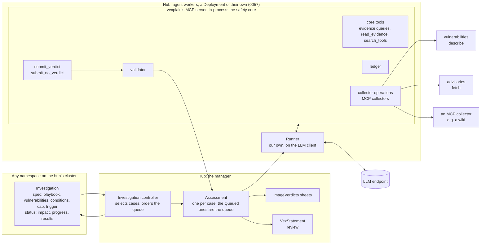

# vexplain — The agent on image cases (phase 4)

- **Status:** accepted by the owner on 2026-11-16. The decisions are the owner's, from the phase 4 discussion of 2026-11-16 (section 1), on top of 0050. Revision 2 (2026-11-20) moves the agent into its own workers (0057). Revision 3 (2026-11-22) notes the design of [entry points](2026-11-20-entry-points.md) (0058 and 0059): presence reaches the hub for each workload, with the labels that owner attribution allows, a case's exposure comes from exposure rules instead of ImageInventory's counts by exposure, and `runsIn` gains the exposure groups.
- **Date:** 2026-11-16
- **Author:** Joshua Leuenberger
- **Extends:** the [main design](2026-10-29-vexplain-design.md) from its revision 17, the [design of collectors, evidence and rules](2026-10-31-collectors-evidence-rules.md) and the [collector model](2026-11-08-collector-model.md). This document is the source of truth for:
  - how the SOC asks the agent to judge cases, and what it gets back;
  - cases and their verdicts;
  - the agent's tools, its loop and its context;
  - advisories.

  Where the earlier documents say otherwise, their sections carry a note that points here (section 10).
- **Decision records:** [0051](../decisions/0051-investigations.md) to [0056](../decisions/0056-phase-4-scope.md).

Statements marked **[call]** are the designer's, not the owner's. They are the first candidates to revisit.

---

## 1. Intent

0050 put the agent's work on cases before the generalization of phase 3b: one CVE in one image, judged once wherever it runs. This design says how the SOC uses the agent, and how the agent works.

**The SOC's job is the yardstick** (owner). A SOC is asked where the fleet is affected by a CVE: many clusters, later thousands of VMs, at today's pace of new CVEs. It needs, quickly:
- a first impression of the fleet's impact, and how large it is;
- where to start;
- whom to contact.

The deterministic layer already narrows the flood. The agent lessens the load further, where its verdict helps, and only there.

**The owner decided, on 2026-11-16:**
1. **The SOC asks; the agent doesn't work through every open finding.** An investigation runs on demand, on a schedule, or automatically when a CEL condition over a case matches. For CVEs, the SOC names the CVEs it cares about (5.3, 0051).
2. **The playbook says what may go to the agent; an `Investigation` runs it.** One kind holds the trigger. There is no separate rule kind (5.2, 5.3).
3. **An `Investigation` is a plain namespaced resource,** in any namespace, guarded by RBAC alone (5.3).
4. **Its status is the answer:** impact, progress, conclusions and where to start. No kind of its own for "where does CVE-X run", since that wouldn't fit other use cases (5.3).
5. **A cap counts cases,** and what the cap leaves is shown as skipped. There is no operator-wide daily budget (5.3, 0051).
6. **The agent integration can be switched off** as a whole (5.11).
7. **The safety core sits behind vexplain's own MCP server,** and the runner that drives the model can be replaced. Our own runner comes first, and kagent can be an optional runner later (4.2, 5.5, 0053).
8. **Core tools come from that server, in-process.** A collector's operation becomes a tool when the profile allows it. A collector isn't always a tool (5.7).
9. **Advisories:** the database `vulnerabilities` already holds answers first, through `describe`. A new `advisories` collector fetches the pages they link to, from allowlisted domains only. Lookups per source come later (4.3, 5.8, 0054).
10. **Context stays small, the way the industry does it:** tools found by search, bounded results kept whole in the ledger, and a check that the limits fit the model. Clearing old results comes later, if needed (4.5, 5.6, 0055).
11. **One existing MCP server is tested;** vexplain builds no MCP servers for company knowledge. Company knowledge is phase 5's design, and sandbox runs move later (5.9, 0056).
12. **Auto-acceptance waits** until review data shows which classes are safe. Every agent "not affected" waits for a person (5.10).
13. **Dashboards come after the agent,** several at once, built on real output (5.12).
14. **Symbol search** is looked at once the first integration runs (section 9).
15. **Exposure needs more work,** which goes into phase 3b's re-cut (section 9).

**After the builder check, on 2026-11-16, the owner decided:**

16. **The hub learns the owners per namespace, not per workload,** through owner attribution's allowlists, the pattern that already decides which labels leave a cluster (5.14).
17. **Phase 4's agent concludes "not affected" only where a fixed version shows it.** Later collectors and evidence widen what it can conclude (5.5).
18. **An MCP collector is a reference to a server,** with the tools that vexplain may call on it. Whoever deploys the server answers for its privileges, and vexplain doesn't judge what a tool does (5.9).
19. **The playbook's agent section names its CEL `matchConditions`,** as the `Investigation` does, and its evidence for the agent `evidence` (5.2).
20. **The model's smoke test runs when the build needs the model,** not before the plan. The owner gives the credentials then (6).
21. **CEL sees `finding`, `subject` and `impact`,** and evidence stays with the rules (5.3).
22. **A guard may hold against the agent too.** It is tried, and judged on the live run (5.5).
23. **The `Investigation` names its `vulnerabilities`,** which pick cases and aren't input for the agent. Whether that scales to other use cases is seen with phase 3b's second one (5.3, section 9).

**Why:** the owner wants vexplain built the way the industry works: known processes and patterns, made Kubernetes-native and agentic, not new ones.

## 2. Goals, non-goals, anti-goals

### Goals
- **The SOC gets a first answer for a CVE across the fleet,** without tokens, and the agent's verdicts on top where it asks for them.
- **Tokens are spent only where the SOC asks,** or where it set a standing condition.
- **Each case is judged once** and serves every investigation and playbook that meets it.
- **Every verdict is traceable:** a summary on the case, and the full reasoning and tool output behind it.
- **The agent's safety doesn't depend on the runner.**
- **Every tool takes one path,** whoever serves it.
- **The SOC still works without the agent** (0050).

### Non-goals (for now)
- **Auto-acceptance (`ReviewPolicy`).** It comes once per-class agreement rates exist (6.9 of the main design).
- **An operator-wide daily budget.** It needs counting across runs and days; the per-investigation cap and the switch cover phase 4.
- **Clearing old tool results,** symbol search, lookups per advisory source, sub-agents, and code execution with MCP (section 9).
- **MCP servers of our own for company knowledge.** Phase 5 designs company knowledge; phase 4 proves that an existing server works.
- **Sandbox runs.** They move after phase 5.
- **Better exposure.** It goes into phase 3b's re-cut, with what the research found (section 9).
- **The summary in Grafana as text.** It waits until the SOC has worked with the agent.

### Anti-goals (failure even if it "works")
- **A false "not affected".** It stays the worst error. Nothing in this design lets a runner, a fetched page or a foreign MCP server move a verdict towards it.
- **A guess at a limit.** Hitting a limit means "no verdict", with a summary (0014).
- **Tokens spent nobody asked for.**
- **More load for the SOC.** Every agent "not affected" needs a review, so investigations must stay targeted.
- **A fetch to a URL that the model wrote.**
- **A context window that overflows silently.**

## 3. Constraints

- **Hub and spokes (0021):** the hub decides. Investigations, cases and the agent live on the hub.
- **Bulky data (0004):** the ledger is read and written only through a storage interface.
- **Safety (AGENTS.md):** read-only towards workloads; secret values and environment values never reach the model; a false "not affected" is the worst error; a limit means "no verdict".
- **API practices:** main design 6.1, 0012 and 0036. Fields are optional unless a kind can't work without them, validated with CEL, and arrive with the phase that uses them.
- **The model:** on-prem, behind an OpenAI-compatible endpoint (0013). Features that a vendor's API offers on its server, such as tool search or context editing, are built into vexplain's loop.
- **Egress** goes through the proxy that each collector's runtime config sets (0037).
- **Repository hygiene (AGENTS.md).**

## 4. Approaches

### 4.1 Where the trigger lives (0051): one `Investigation` with a trigger

| | Approach | Like | Gains | Costs |
|---|---|---|---|---|
| | The trigger on the playbook | k8sgpt's `K8sGPT`, Splunk SOAR's playbook settings | One kind | Mixes the admin's definition with the SOC's runs; one mode per playbook |
| | A separate rule kind that creates runs | CronJob and Job; Microsoft Sentinel's and Cortex XSIAM's automation rules; Tekton Triggers; kagent's `Hook` | Each run has its own record | A kind more, for runs that have no outcome of their own: verdicts live in the cases |
| **Chosen** | **The playbook is the definition; one `Investigation` runs it, with a trigger: once, on a schedule, or continuously** | OASIS CACAO (a playbook has no trigger; the orchestrator runs it); Tekton's Pipeline and PipelineRun; Kyverno's background scans and k8sgpt, which keep their results current | The status always shows the current answer; one kind for the SOC | No record per run; an Event notes each run |

The owner chose the last on 2026-11-16, after asking whether the rule was needed at all: its runs have nothing to keep that the cases don't.

### 4.2 The agent loop (0053): the safety core behind vexplain's MCP server

| | Approach | Like | Gains | Costs |
|---|---|---|---|---|
| A | Our own loop on phase 1's LLM client | k8sgpt, HolmesGPT | The safety rules in our code; replay is simple; one dependency | We maintain the loop and build tool search |
| B | A Go agent framework: Google's ADK for Go, or CloudWeGo's Eino | | A ready loop, MCP tools, tracing | The safety rules stay ours, bent to its hooks; a large, fast-moving dependency inside a CVE tool; its model adapter replaces phase 1's hardened client (6.11) |
| C | kagent runs the loop: vexplain creates kagent `Agent`s and calls them over A2A | kagent (CNCF sandbox) | A Kubernetes-native agent runtime, with a UI and sessions | A hard dependency on another operator, which 4.2 of the main design rejects for Kubescape; the LLM key in another system; replay through its runtime |
| **Chosen** | **The safety core behind vexplain's own MCP server; A as the first runner, C as an optional runner later** | MCP gateways such as kagent's tool server; A2A for agents | Longevity through standard protocols at the boundary; the safety core never depends on the runner | Two layers to keep apart |

The owner asked whether choosing A for speed would cost longevity. The answer that the owner accepted: longevity comes from the boundary, not from the first runner.

### 4.3 Advisories (0054): the database first, then fetched pages

| | Approach | Gains | Costs |
|---|---|---|---|
| | An MCP fetch server, limited to allowlisted domains | Cheap; Anthropic's web fetch tool has `allowed_domains` | The model writes the URL. An allowed domain that hosts anyone's pages carries data out, as Claude Code's CVE-2026-54316 did, and links chained out of fetched pages bypass a "seen before" rule |
| | Lookups per source by CVE ID (OSV, distro trackers, Vulnrichment) | Structured; the tool builds the URL | A tool per source to build |
| **Chosen** | **`describe` on what the database of `vulnerabilities` holds, then a fetch of the pages its answers link to, checked twice; lookups per source later** | Offline answers first; the real advisory text behind the references | Two collectors take part |

### 4.4 When an investigation is worth it

Research of 2026-11-16, to ground the example condition that vexplain ships (5.3):
- **NIST SP 800-40r4:** a risk assessment per vulnerability isn't feasible. It names four cases: routine patching, emergency patching, emergency mitigation (no fix yet) and unpatchable assets. Analysis pays in the last two. SSVC's deployer guidance agrees: when a fix exists, apply it.
- **CISA's BOD 26-04 (2026-06-10)** replaced BOD 22-01. Its deadlines come from four SSVC-based inputs: publicly exposed, known exploited, automatable, and technical impact.
- **EPSS:** FIRST names no universal threshold. 0.1 is the common cut-off, at about 80 % coverage and 50 % efficiency in FIRST's study with Cyentia. FIRST warns against multiplying EPSS by CVSS, so vexplain uses Grype's raw EPSS, not its risk score.
- **NIST CSWP 41:** "EPSS should not be used alone".

### 4.5 Context (0055)

The industry keeps an agent's context small in four layers:
1. **Tool definitions:** a few core tools, the rest found by search. Anthropic's Tool Search Tool and Claude Code's deferred tools.
2. **Tool results:** bounded and paged. Anthropic's guide to writing tools for agents (pagination, filtering, truncation), and MCP's resource links.
3. **The conversation:** the oldest tool results cleared past a threshold. Anthropic's context editing.
4. **The hard limit:** stop. Here: "no verdict", with a summary.

The owner chose 1, 2 and 4 now, a check that the limits fit the model's window, and 3 only if the replay shows the need.

---

## 5. Design



### 5.1 Names

| Name | Means | Like |
|---|---|---|
| Case | One vulnerability in one subject: for images, one CVE in one platform manifest | Main design 6.13 |
| `Investigation` | A request to judge a playbook's cases, once, on a schedule or continuously; its status is the answer | A Tekton PipelineRun; CACAO's "investigation" playbook type |
| `Assessment` | One case's record: the agent's verdict, summary, claims and the reference to its ledger | Defender's and Google's triage agents attach their verdict to the alert; k8sgpt's `Result` |
| Runner | What drives the model for one case | |
| vexplain's MCP server | The safety core: the tools, the ledger, the submit tools and the validator | kagent's tool server |
| Ledger | Every tool call of a case, with its output, by ID (`ev-1`, `ev-2`) | Main design 6.6 |

### 5.2 The playbook's agent section

A playbook says which of its cases may go to the agent, and with what. It holds no trigger.

```yaml
apiVersion: config.vexplain.bedag.ch/v1alpha1
kind: Playbook
metadata: {name: container-cves}
spec:
  # subjects, findings, evidence and pipeline: unchanged
  agent:
    profileRef: {name: default}
    evidence: [contents, sbom]            # names from spec.evidence
    matchConditions:                      # optional; all must hold
    - name: unsettled
      expression: finding.status == "UnderInvestigation"
```

- **`profileRef`** names the `AgentProfile` (0016, 0034).
- **`evidence`** names the playbook's evidence entries that the agent gets with each case, its case file, as 0034 planned. The field is named after where the entries come from (owner).
- **The case file always says where the subject runs,** from the hub's inventory (5.14): the clusters, the namespaces, and the workloads by exposure. Presence and exposure evidence stay on the spokes, so the hub's inventory is what it knows. Owner values stay out of it, since annotations can hold contact data, which never reaches the model (main design 6.14) **[call]**.
- **`matchConditions`** are named CEL expressions over the case (5.3), all of which must hold, as the `Investigation`'s are (owner). They decide which findings may reach the agent at all.
  - Without them, every finding of the playbook may go, as ValidatingAdmissionPolicy matches everything without `matchConditions`. An admin may send settled findings too, as the owner asked on 2026-10-31.
  - The playbook that vexplain ships sends the findings that no rule settled, as above **[call]**.
- **A playbook without `agent`** sends nothing. Investigations that name it report `Ready=False`, with the reason `AgentNotAllowed` **[call]**.

### 5.3 `Investigation` (0051)

(*Amended on 2026-11-20:* see [phase 4's fixes](2026-11-20-phase4-live-fixes.md), 2.5 and 2.6. Later that day `maxCases` and `verdictMaxAgeSeconds` moved under `spec.agent`, beside the new `judgePolicy` and `guidance`: see [an investigation's guidance](2026-11-20-investigation-guidance.md), section 3.)

Namespaced, in the `triage` group, in any namespace of the hub's cluster. Whoever may create one in a namespace may spend tokens and read what it finds there, so RBAC alone decides (5.13).

```yaml
apiVersion: triage.vexplain.bedag.ch/v1alpha1
kind: Investigation
metadata: {name: cve-2026-0001, namespace: soc}
spec:
  playbookRef: {name: container-cves}
  vulnerabilities: [CVE-2026-0001]      # optional; matched against IDs and aliases
  matchConditions:                      # optional; all must hold, as in ValidatingAdmissionPolicy
  - name: urgent-or-no-fix
    expression: impact.highestUrgency in ["Immediate", "OutOfCycle"] || finding.fixState != "fixed"
  trigger: {type: Once}                 # Once | Schedule | Continuous
  state: Enabled                        # Enabled | Disabled
  agent:
    maxCases: 50                        # required
status:
  observedGeneration: 1
  conditions:
  - {type: Reconciling, status: "True", reason: Judging, message: 9 of 14 cases have a verdict}
  startTime: 2026-11-16T09:00:00Z
  impact: {subjects: 14, resources: 41, namespaces: 9, clusters: 3, urgentResources: 8}
  cases: {total: 14, queued: 3, inProgress: 1, judged: 6, reused: 3, skipped: 1}
  summary: {fail: 4, pass: 3, warn: 1, error: 1, skip: 5}
  results:
  - subject: registry.example/team-a/web@sha256:6f1c…
    result: fail
    status: Affected
    review: Proposed
    step: Mitigate
    severity: high
    urgency: Immediate
    reason: Links libbrotlidec and decodes br request bodies; behind an Ingress.
    resources: 3
    owners: [{namespace: team-a, values: [{key: team, value: team-a}]}]
  omitted: 0
```

**Spec, with standard keys:**
- **`playbookRef`:** one playbook, whose `agent` section decides what may go (5.2).
- **`vulnerabilities`:** the vulnerabilities that the SOC asks about, by name, as OpenVEX names a vulnerability (owner, 2026-11-16). It picks cases; it isn't input for the agent. Each case carries its own `vulnerabilityID` and aliases, which the agent uses in its tool calls, so two investigations that name one CVE differently share one case and one verdict.
  - Each is matched against a finding's `vulnerabilityID` and its `aliases`, as the sheets name them, so a GHSA ID finds its CVE, and a CVE finds a finding that a distribution keys by its own advisory.
  - At most 100 **[call]**.
  - Several, because one incident often has several IDs: ingress-nginx's IngressNightmare advisory of March 2025 named several CVEs, and a Go module's advisory may have only a GHSA ID.
  - The same field serves every subject whose findings are vulnerabilities, such as VM disk images later.
  - For findings of other types, such as configuration weaknesses (collector model 5.6), the field may carry a weakness's name, as OpenVEX and CycloneDX name any weakness a vulnerability. That's decided with their findings types, in phase 3b's re-cut. Until then, `matchConditions` select them.
- **`matchConditions`:** named CEL expressions over the case (below), all of which must hold, as in ValidatingAdmissionPolicy. At most 16 **[call]**.
- **Neither one given** selects every case that the playbook lets go, most urgent first, up to the cap.
- **`maxCases`:** the cap, required, from 1 to 1000 **[call]**. It counts the cases the agent judges in a run, not the reused ones. Of 200 eligible cases and a cap of 50, the 50 most urgent are judged, and the other 150 show as `skip`, with "over the cap" as the reason. Raising the cap judges the next ones and reuses the rest. For a continuous investigation, the cap counts every case it ever judged; at the cap it stops, and says so, until it is raised **[call]**.
- **`trigger`:** a union by `type` (6.1):
  - `Once`, the default: it runs when created, and again only when its spec changes.
  - `Schedule`, with `schedule`, a five-field cron in UTC, as collectors' schedules are. A tick while a run is still going is skipped, as CronJob's `Forbid` does, and an Event says so **[call]**.
  - `Continuous`: it judges each eligible case that newly matches, as the sheets change.
- **`state`:** `Enabled` or `Disabled`, as `Collector.state` (CronJob's `suspend`). A disabled investigation judges nothing new and keeps its status current **[call]**.
- **`verdictMaxAgeSeconds`:** optional. A verdict older than this is judged again when this investigation selects its case, as Argo's memoization takes a `maxAge`. Without it, a verdict stays fresh until its inputs change (5.4) **[call]**.

**The case, as CEL sees it** (owner, 2026-11-16): top-level variables, each named for what it holds, as vexplain's rules see `finding` and one variable per input (0033), and as Kubernetes' CEL sees `object`, `request` and `namespaceObject`. The playbook's and the investigation's `matchConditions` see the same ones.

| Variable | Holds | From |
|---|---|---|
| `finding` | The finding as its sheet holds it after the playbook's rules: every field that a rule sees, such as `vulnerabilityID`, `aliases`, `severity`, `knownExploited`, `fixState` and `epssPermille`, plus the rules' `status` and the `rule` that set it | The sheet |
| `subject` | The subject: for images, its manifest digest and repositories | The sheet |
| `impact` | Where the subject runs: `clusters`, `namespaces`, `resources`, `highestExposure` and `highestUrgency` | The hub's inventory (5.14) |

- **`impact` is always there,** since every subject the hub judges runs somewhere it knows. It isn't evidence of the playbook.
- **Evidence isn't a variable here.** Rules read evidence, and conditions select on what the rules concluded. Selecting cases then never loads bulky evidence, and one place interprets it. A condition on a fact of the evidence is a rule's job, whose status or note the condition reads **[call]**.
- **`finding.epssPermille`** is EPSS in per mille, since the API holds no floats (6.1). It's new in the `vulnerabilities` findings (5.8).
- **`impact.highestUrgency`** is computed on the hub with the spokes' table (0024), per namespace, from the workloads by exposure (5.14).

**The example vexplain ships,** disabled, from the research in 4.4: `(finding.knownExploited || (has(finding.epssPermille) && finding.epssPermille >= 100)) && impact.highestExposure == "Open" && finding.fixState != "fixed"`, which is SP 800-40's emergency mitigation. Vulnrichment's "automatable" may join it later (section 9) **[call]**.

(*Amended on 2026-11-16, while planning:* `finding` is the finding as rules see it, `evidence.Match`, plus the sheet's `status`, `rule`, `justification` and `epssPermille`. So `knownExploited` is a boolean, as in the rules, and the example above reads it so.) (*Amended on 2026-11-16, while building:* `fixState` keeps the source's spellings, such as `fixed` and `not-fixed`, and `epssPermille` is absent for a finding without EPSS, so the example tests it with `has()`.)

**Status, in the industry's shapes:**
- **Conditions** as 0036 requires, never a phase field (Kubernetes API conventions):
  - `Ready` once the current run has finished, or while a scheduled or continuous investigation waits.
  - `Reconciling` while cases are judged.
  - `Stalled` when the investigation can't run: an unknown playbook, a playbook without `agent`, a CEL error, or the agent switched off (`AgentDisabled`, 5.11). The cap reached reads `Ready` with the reason `CapReached`, as a Job reports `BackoffLimitExceeded`.
- **Times,** as a Job and a CronJob have them: `startTime`, `completionTime` and `lastScheduleTime`.
- **`impact`:** where the selected findings are open, without tokens, from the sheets and the hub's inventory (5.14). It counts subjects, resources, namespaces, clusters, and the resources whose urgency is `Immediate` or `OutOfCycle`, which are the actions the SOC chases (main design 6.10) **[call]**.
- **`cases`:** the progress: in scope, queued, in progress, judged in this run, reused, and skipped.
- **`summary`:** OpenReports' counts over the cases, which the reports already map to (0042):
  - `fail`: `Affected`;
  - `pass`: `NotAffected` or `Fixed`;
  - `warn`: still `UnderInvestigation`;
  - `error`: no verdict;
  - `skip`: not judged, over the cap or not eligible.
- **`results`:** where to start, not every case. OpenReports' name, each in 0042's action shape. They come most urgent first, at most 20, and `omitted` counts the rest, as Gatekeeper's audit keeps `totalViolations` and the first 20 violations in a constraint's status **[call]**. Each result names:
  - its subject, OpenReports result, OpenVEX status and review state;
  - its step, severity and urgency;
  - its `reason`: the first sentence of the case's summary, at most 256 characters **[call]**;
  - how many resources run it;
  - its owners: the allowlisted owner values of the first 5 namespaces (5.14) **[call]**.
- **No references to every case.** The status would grow with the cases, and the `Assessment`s can't carry owner references to the investigation: they're shared between investigations and cluster-scoped. So the children label themselves, as the main design does for workload reports (6.14): each `Assessment` is named and labelled after its vulnerability and its subject, and `kubectl get assessments -l <the vulnerability's label>` lists every case of a CVE **[call]**.

**Order:** the cases go most urgent first, then known exploited, then by EPSS, then by how many resources run them. That's a sort by tiers, not a score, as main design 6.6 says (0024, 0050) **[call]**.

**Events** on the investigation: a run started and finished, a tick skipped, the cap reached.

(*Amended on 2026-11-17, while building:*
- **The cap counts hand-offs, not cases.** `status.cases.charged` counts each case that the investigation handed to the agent's queue in the run, and in the life of a `Continuous` investigation; a run's start sets it to 0. A case that another investigation queued first isn't charged here. A stale case judged again is charged again, and so is a case that left the queue `Withdrawn` and is selected later. A reconcile that fails after the queue took cases keeps their charges. `judged`, `queued` and `inProgress` only report.
- **The reasons:** `Ready` is `True` with `Judged` once every selected case is judged, reused or skipped, or `CapReached`. A case that no investigation wants any more leaves the queue unjudged, and its `Assessment` is `Ready=False` with the reason `Withdrawn`.
- **A condition that fails on a case,** such as one on EPSS for a finding without it, skips the case, and `Ready`'s message says how many cases it skipped, and names the first error.
- **Every investigation is reconciled again within 5 minutes,** so that its impact follows the inventory, which no watch brings. A `Once` run that is over shows its impact again, and queues nothing.
- **A result keeps the sheet's status, step and result,** and shows the agent's fresh verdict in `verdict` and its statement's review in `review` beside them. The sheet holds the agent's `Affected` or `UnderInvestigation`, and its `NotAffected` or `Fixed` only once a person accepted the statement, so an unreviewed "not affected" never reads as `pass`. The example above shows `review: Proposed` beside an `Affected` status; in the build, `review` goes with a `NotAffected` or `Fixed` verdict.)

### 5.4 Cases and `Assessment` (0052)

(*Amended on 2026-11-20:* see [phase 4's fixes](2026-11-20-phase4-live-fixes.md), 3.1 to 3.3.)

- **The hub creates Assessments, never a person.** When an investigation selects a case without a fresh verdict, the hub creates the case's `Assessment` and queues it. A fresh one is reused. A PipelineRun creates its TaskRuns in the same way.
- **One per case, cluster-scoped, on the hub** **[call]:** one vulnerability in one platform manifest (main design 6.2). Every investigation and every playbook that meets the case reads the same one (collector model 5.7).
- **Their number is bounded by the caps.** An investigation that names three CVEs in 14 images has at most 42 cases, and it judges at most `maxCases` of them. Two investigations that select one case share its `Assessment`, and a CVE's aliases are the same case. So there are never more `Assessment`s than the cases that investigations judged.
- **Its spec is immutable,** as a Job's pod template is: the API server refuses a change (`self == oldSelf`). The spec names the case, and a different case is a different `Assessment` **[call]**.
- **A case covers every finding of its vulnerability in the subject,** such as one CVE in two packages. Its verdict holds for all of them. "Not affected" needs evidence for each package, so the most cautious package decides, as between rules (0033) **[call]**.
- **Fresh until its inputs change** **[call]:**
  - **What makes it stale,** through `inputHash`: the case's findings, by ID and package (name, version, type), and the *data* of the case file's evidence. A scanner release that finds the same facts changes nothing.
  - **What doesn't:**
    - EPSS, CVSS, the known-exploited flag, the database's version and a fix that appears. They change urgency, order and the next step, never whether the subject is affected.
    - A new prompt or model (6.6.1 of the main design).
  - **The next step follows the fix state.** An agent's `Affected` with "mitigate" turns into "update" when a fix appears, as 0024 decides for every finding, without a new judgement.
  - **When a verdict turns stale:**
    - its `VexStatement` turns `Superseded` (6.9 of the main design);
    - an accepted one stops settling its finding, which opens again, so a statement never stands on facts that moved;
    - the next investigation that selects the case judges it again.
- **One queue on the hub,** in the order of 5.3. A case that two investigations want is judged once. Within a tier, investigations that run `Once` go first, since a person asked for them **[call]**. The workers are `ModelConfig.maxConcurrentRequests`.

  (*Amended on 2026-11-20, 0057:*
  - The queue is the `Queued` `Assessment`s, in an order that the hub writes in their status.
  - Agent workers in their own Deployment claim them: one status update moves a case to `Judging`, names the worker and sets a lease, and the object's `resourceVersion` lets one claim win.
  - The sweep returns a case whose lease ran out to `Queued`.
  - `maxConcurrentRequests` stays the endpoint's limit across all workers.)

```yaml
apiVersion: triage.vexplain.bedag.ch/v1alpha1
kind: Assessment
metadata:
  name: cve-2026-0001-6f1c…
  labels: {vexplain.bedag.ch/vulnerability: CVE-2026-0001, vexplain.bedag.ch/digest: 6f1c…}
spec:                                    # immutable
  subject: {type: ContainerImage, containerImage: {digest: "sha256:6f1c…"}}
  vulnerabilityID: CVE-2026-0001
status:
  conditions: [...]                      # Ready, Reconciling, Stalled
  verdict:
    status: Affected
    step: Mitigate
    summary: >-
      The app server links libbrotlidec (ev-2) and accepts Content-Encoding: br
      on requests (ev-4). The workload is behind an Ingress (ev-6). No fixed
      libbrotli1 exists yet; turning off br decoding mitigates it (ev-5).
    claims: [{text: "...", evidence: [ev-2, ev-4]}]
  noVerdict: {}                          # instead of verdict: why, what was established, what would settle it
  validation: {result: Passed, repairs: 0}
  inputHash: "sha256:…"
  ledgerRef: {...}                       # the full reasoning and tool output
  runner: {type: Builtin}
  model: {modelConfig: default, model: …, promptCore: v1, guidanceHash: …}
  usage: {steps: 9, promptTokens: 28000, completionTokens: 3200, durationSeconds: 140}
  playbooks: [container-cves]
  judgedAt: 2026-11-16T09:12:00Z
```

- **The summary is a few sentences,** on the case, as Defender's and Google's triage agents attach their rationale to the alert. At most 2 KiB **[call]**.
- **The ledger is its own kind, readable with `kubectl`** **[call]:** one per case, in the `inventory` group, behind its storage interface (0004). Each entry holds the tool, its arguments, its duration, what the model was shown, and a reference to the full output. A reviewer checks the claims' `ev-` IDs there.
  - Its size is bounded: `maxSteps` entries, each at most `toolResultMaxTokens`.
  - **Full outputs** are in the evidence store already, for evidence queries, or are stored there, compressed, for `describe` answers and fetched pages. `read_evidence` pages through them.
  - **Ledgers and evidence may outgrow etcd.** The `inventory` group is kept stable so that an aggregated API server with its own database can serve it later, without clients noticing, as Kubescape serves its SBOMs (main design 4.3). The owner expects that move. It's decided on the live run's sizes and write rates (sections 8 and 9).
- **One playbook's case file, every playbook's verdict** **[call]:**
  - the case file comes from the playbook of the investigation that selected the case;
  - another playbook's investigation reuses a fresh verdict;
  - the verdict shows in every sheet of the subject, since a case is about the subject, not the playbook (collector model 5.7).
- **Cleaning up:** a case's `Assessment` and ledger go with its subject's sheets. `VexStatement`s stay, since reviews can't be rebuilt (main design 4.3) **[call]**.
- **Main design 6.2's status fields stay:** the no-verdict summary, the validation result, the model and prompt, tokens and duration.

(*Amended on 2026-11-17, while building:*
- **A statement per verdict.** Each verdict that silences a finding gets a `VexStatement` of its own, named after the `Assessment` and the first 10 hex characters of the SHA-256 of its `inputHash`, status and justification. A superseded statement stays, with its review, and the hub deletes none, so every review stays a data point. The plan's one statement per `Assessment` is superseded. The same verdict on the same inputs maps to the earlier statement.
- **`inputHash` rests on facts only,** as "a scanner release that finds the same facts changes nothing" says: the findings by vulnerability ID and package name, version and type, without the package's ID; of an SBOM, its distribution, its packages by name, version, type and purl, sorted, and the catalogers that failed; of the scanner's image contents, its data without a producer, descriptor or source; and of any other type, its whole data. The investigation and the agent's writer hash with the same function. The plan's "data of the evidence" is superseded.
- **Retries and retirement.** A request that fails for the endpoint's sake hands the case back to the queue with nothing written, tried again after 10 seconds, doubled for each failure, at most 10 minutes: no answer, a timeout, HTTP 429 or a server error, and 401, 403 and 404, which the `ModelConfig`'s probe reports. Another 4xx is the request's own, and ends the case without a verdict, `ModelError`. An attempt that may have spent tokens counts: a request of it completed, or its first request timed out, got a 2xx that isn't a chat completion or broke off, or got a gateway's 504. So does an outcome that the API server refuses to write. The fifth such failure since the case came into the queue ends it without a verdict, `ModelError`; a wait for another reason doesn't start the count again.
- **Retired cases.** A case that leaves the queue unjudged is `Withdrawn`, and a sweep, 90 seconds after the start and then every 10 minutes, withdraws every `Queued` or `Judging` `Assessment` that the queue doesn't hold, as after a crash. A case is judged on the newest findings that an investigation handed over, and one whose `Assessment` holds the outcome of its current inputs already isn't judged again.
- **A sheet that can't be written is deleted** when it settles a finding through an accepted statement, or leaves findings out: when its evidence can't be read or decoded, its rules can't be evaluated, or the API server refuses the write for another reason than a conflict. A settled finding never stands on inputs that can't be read; the next reconcile writes the sheet again.)

### 5.5 The safety core: vexplain's MCP server (0053)

The safety rules sit in one place that every runner has to pass through.

- **An MCP server inside the manager,** served in-process through the official Go SDK's in-memory transport. There's nothing to deploy. kagent serves its own built-in tools from its own MCP server in the same way. (*Amended on 2026-11-20, 0057:* the server and the runner run in the agent workers, a Deployment apart from the manager, still in-process. The workers have an image of their own (`cmd/agent`), built from the same commit and tag as the manager's.)
- **One session per case.** It knows the case, its case file and its playbook.
- **Every tool call passes through it, and it writes the ledger itself.** A runner never reports tool output. So the validator checks claims against what vexplain recorded, whoever ran the loop.
- **It serves:**
  - the core tools (5.7);
  - `search_tools`, which finds the other tools (5.6);
  - the operations of collectors and the tools of MCP collectors that the profile allows, forwarded to them, as an MCP gateway does;
  - `submit_verdict` and `submit_no_verdict`, as main design 6.6 defines them.
- **`submit_verdict` runs the validator** (6.7 of the main design). A rejection comes back as the tool's result, with the validator's feedback. That's the one repair attempt; a second rejection ends the case with no verdict and a summary.
- **The validator's table is part of the core:** operator-owned, embedded with the core prompt, and not editable, as 6.6.1 of the main design says of the evidence rules. This answers the rules design's question (5.7): the validator doesn't read its evidence through rules.
- **What phase 4 can accept as "not affected"** (owner, 2026-11-16): only `VulnerableCodeNotPresent` and `Fixed`, resting on `describe`'s fixed version for the subject's distribution or ecosystem and on the installed version in the SBOM. That covers a distribution's backport.
  - Main design 6.7's other justifications need evidence that comes later: a symbol scan, govulncheck, a config read, runtime evidence, or a verdict's conditions.
  - Until then, those cases end as `Affected`, `UnderInvestigation` or with no verdict, with their reasons. The agent's value in phase 4 is confirming what is affected and how urgently, setting the next step, and explaining what stays unclear.
  - Verdict conditions, the CEL over a workload's facts that spokes check (6.6 of the main design), come with the config read.
  - Better collectors and evidence widen this later (owner).
- **A guard can hold against the agent too** **[call]**, tried in phase 4 and judged on the live run (owner, 2026-11-16). A rule that holds a finding open today stops only other rules from settling it. Guards hold for two different reasons, so a rule says whom it holds against, in `spec.outcome.holdAgainst`: `Rules`, the default, or `All`.
  - **`completeness-guard` holds because the evidence may be incomplete.** In an image with unowned binaries or a failed cataloger, a static copy of a vulnerable library may sit where the SBOM can't see it. An agent's "fixed, the package has the backport" would rest on the same incomplete SBOM. So it ships with `All`, and the validator rejects an agent's `NotAffected` or `Fixed` on the findings it holds (6.7 of the main design).
  - **`known-exploited` holds because no automation should dismiss a known-exploited CVE.** The evidence isn't in doubt. So it keeps `Rules`: the agent may still show, with evidence, that a known-exploited CVE doesn't affect an image, and a person reviews it (0035).
- **Trust stays per tool, not per protocol.** The core tools and vexplain's collectors' operations declare known evidence types. A foreign MCP server's output is external evidence: it can push only towards "affected" or "unclear" (0031).
- **Later,** the same server can be exposed so that other assistants and runners can use it (section 9).

(*Amended on 2026-11-17, while building:* the validator checks more than the table above says, all on the side of "unclear":
- **`describe`'s Yes counts only for the package as the case has it:** the answer echoes the package that it was asked about, and its name, version, type and distribution must be the case's, and its purl the SBOM's, exactly.
- **Every package needs a Yes from some provider and a No from none.**
- **A No always counts:** in the shape of `describe`'s answer, cited or not, of any trust, in records of any vulnerability, with or without the purl, and in an output of several answers.
- **A guard that can't run,** a rule that is missing or not `Ready`, holds its finding against the agent too.
- **The core prompt says so,** in its version `v3`.)

### 5.6 The runner and its context (0053, 0055)

**Our own runner first,** on phase 1's client (`internal/llm`), with its hardening: https only, no redirects, and the key read only to authenticate. For one case it:
1. sends the core prompt and the profile's guidance (6.6.1 of the main design), and the case file;
2. offers the core tools and `search_tools`;
3. passes each tool call to vexplain's MCP server, and the result back to the model;
4. stops at `submit_verdict` or `submit_no_verdict`, or at a limit;
5. at a limit, makes one final call without tools, from the reserved budget, and passes the summary to `submit_no_verdict`. If that fails too, the case records which limit tripped (0014).

The limits come from the `AgentProfile`: `maxSteps`, `maxTokens`, `timeoutSeconds`, `toolTimeoutSeconds` and the reserved budget (0016).

**Context, in three layers now** (4.5):
1. **Tools are found by search.** The runner starts with the core tools and `search_tools`. A search returns the names, descriptions and schemas that match, and the runner adds them to its next calls, as Anthropic's Tool Search Tool and Claude Code's deferred tools do. An OpenAI-compatible endpoint takes the tool list with every request, so "loading" a tool means listing it from then on.
2. **Results are bounded and paged.** Every tool result goes whole into the ledger. The model sees at most the profile's `toolResultMaxTokens` **[call]**, with its ledger ID and how to read on through `read_evidence`.
3. **The limits fit the model.** `ModelConfig` states the model's context window, as `contextWindowTokens`. The default profile isn't `Ready` (reason `ExceedsContextWindow`) when the prompt, the case file's cap, `maxSteps` results at their cap and the reserved budget could pass it. Without a stated window it isn't `Ready` either, with the reason `ContextWindowUnknown` **[call]**.

Clearing old results is layer 3 of 4.5, and comes only if the replay shows cases ending with "no verdict: context limit" (section 9).

**The runner can be replaced.** A runner needs only the model, the session on vexplain's MCP server, and the limits. A kagent runner later would create a kagent `Agent` with vexplain's MCP server as its tool, and call it over A2A, only where kagent is installed.
- **What stays in vexplain:** the ledger, the validator and the rule that "not affected" needs strong evidence.
- **What moves to such a runner:** the token limits, the final summary, the LLM key, and replay. vexplain still sets a deadline per case, and without a summary the outcome is "no verdict", naming the limit.

The case records which runner judged it.

### 5.7 Tools

(*Amended on 2026-11-20:* see [phase 4's fixes](2026-11-20-phase4-live-fixes.md), 2.3.)

| Tool | From | Phase 4 |
|---|---|---|
| Evidence queries over the case file's evidence: the SBOM, the image's contents (linkage, library names), exposure, where the subject runs | vexplain's MCP server | Yes |
| `read_evidence`: the next page of a ledger entry | vexplain's MCP server | Yes |
| `search_tools` | vexplain's MCP server | Yes |
| `describe` (by vulnerability ID): what the vulnerability database says | `vulnerabilities` | Yes |
| `fetch`: a page that an earlier trusted result linked to | `advisories` | Yes |
| The tools of one existing MCP server, such as a wiki's or a CMDB's | An MCP collector (0031) | Yes, tested |
| Lookups per advisory source | `advisories` | Later |
| Symbol search in a binary | `scanner` | Later |
| A sandbox run | `sandbox` | After phase 5 |

- **A collector's operation becomes a tool only when the profile allows it,** by collector and operation **[call]**. A collector isn't always a tool. `scan`, for example, isn't one.
- **Every operation's tool takes its parameter schema** (0031), and its output goes into the ledger.
- **Main design 6.6.3's "config read"** (args, environment variable names, ConfigMap keys) waits until a case needs it. The case file's evidence covers phase 4 **[call]**.

### 5.8 Advisories (0054)

(*Amended on 2026-11-20:* see [phase 4's fixes](2026-11-20-phase4-live-fixes.md), 2.1 and 2.2.)

**`vulnerabilities` answers from its database.** A new operation, `describe`, takes a vulnerability ID or an alias and returns what Grype's database holds for it, from every provider: the description, CVSS, the fixed versions per distribution and ecosystem, the known-exploited entry, EPSS, and the references. It needs no egress when it's called.
- **Its findings gain EPSS,** as `epssPermille` with its date, for `matchConditions` (5.3). Grype's database carries it since its schema v6.
- **`describe` belongs to vulnerabilities,** not to every use case. A playbook for network policies or RBAC brings its own collectors' operations, and its profile offers only those (5.7), so its agent never sees `describe`. Whether vulnerability-shaped names confuse the agent in such use cases is watched when the second one arrives (owner; section 9).

**`advisories` is a new collector, in the hub's role.** It owns what goes to the internet when the agent asks. In phase 4 that's one operation, `fetch`:
- **Two checks, by two components:**
  1. **vexplain's MCP server forwards a URL only if it came out of a trusted result in this case:** the references from `describe`, and later the lookups. Never a URL that the model wrote, one found in a fetched page, or one from a foreign MCP server. This closes what a domain allowlist alone leaves open: an allowed domain that hosts anyone's pages.
  2. **The collector checks every request, and every redirect hop, before it connects:** https only, a host on the allowlist in its settings, a capped size and a timeout. It turns the page into text.
- **Its settings:** the allowed domains, and the size and time limits. vexplain ships a short default list of public advisory hosts **[call]**.
- **A fetched page is external evidence.** It explains, and can push towards "affected" or "unclear". `Fixed` and `NotAffected` rest on known evidence types, such as `describe`'s fixed versions (6.7 of the main design) **[call]**.
- **An air-gapped cluster runs without `advisories`,** and the agent works from the database alone.
- **Later:** lookups by vulnerability ID per source, such as OSV, the distros' trackers and Vulnrichment. Each one builds its URL itself.

(*Amended on 2026-11-17, while building:*
- **`describe` answers per vulnerability ID.** It finds the records of the ID and of the IDs that they name, and each provider's answer rests on its records of one of them, which it names. The validator takes a Yes only from records of the case's vulnerability or one of its aliases, so a fix of a sibling vulnerability never settles the case.
- **`describe` reads a row as Grype does, but cautiously:** every namespace of a provider that speaks for the release is judged together, and a `No` wins. A range without a constraint holds every version when it names no fix, or when no range of its row has a constraint, as Grype reads it. A row that mixes such a range naming a fix with constrained ranges is `Unknown`.
- **The trusted reference itself is forwarded.** vexplain's MCP server compares the model's URL with the trusted references, ignoring the ASCII case of the scheme and the host and the fragment, and forwards the reference as the trusted answer wrote it, never the model's string. A host that differs beyond ASCII case is refused. An operation counts as a fetch by the type of evidence that it produces, whatever its collector's name.)

(*Amended on 2026-11-17, after the first live case:*
- **`describe` searches without Grype's limit.** Grype stops at 5000 rows and fails, and a vulnerability that many packages embed has more. Both searches run with `--limit 0`, and no row is dropped before `describe` judges it.
- **`describe` accepts Go's standard library as Syft writes it:** the name `stdlib`, the version `go1.27.1` and the purl `pkg:golang/stdlib@1.27.1`. The asked version is the purl's with `go` before it, and it stays the package's version. Every other package is as strict as before.)

### 5.9 MCP collectors (0031, 0056)

**An MCP collector is a reference to a server that runs elsewhere** (owner, 2026-11-16): a `Collector` with the server's URL, the headers it needs, taken from a Secret, and the server's tools that vexplain may call.

```yaml
kind: Collector
metadata: {name: wiki}
spec:
  mcp:                                 # in place of package: exactly one of the two [call]
    url: https://wiki-mcp.example/mcp
    headersFrom: [{secretRef: {name: wiki-mcp}}]
    tools: [search, get_page]          # required: what vexplain may ever call
```

- **Whoever deploys the server answers for its privileges,** as whoever installs a collector does (rules design, 5.9). vexplain doesn't judge what a tool does.
- **The `Collector` lists the tools that vexplain may call,** as 0031 decided (owner, 2026-11-16). A call to any other tool is refused, whatever the profile says. The list is required **[call]**:
  - vexplain calls tools unattended, with arguments that a model picked from text anyone can write;
  - wiki and CMDB servers usually serve create, update and delete tools too, which the deployer often can't remove from a server they didn't write, and a service account's token may allow them.

  Docker's MCP Gateway lets its user pick a server's tools in the same way, and kagent's `Agent` names the `toolNames` it may use.
- **The profile picks the collectors** an agent uses, as for any collector's operations (5.7), and may narrow them to named tools.
- **Its output is external evidence,** always, in phase 4. The validator decides that, with no setting: it can push only towards "affected" or "unclear" (0031).
- **This refines 0031** in one point: the list names tools without their evidence types. Mapping a tool's output to a known type comes when a server produces evidence worth it.
- **Transport** **[call]:** MCP's Streamable HTTP, its current standard. A server that speaks only stdio runs behind a proxy, which its deployer sets up. 0031's other variant, a package that vexplain deploys, comes later, and so does OAuth.
- **The Secret** is labelled and in the operator's namespace, as 0017 requires for the LLM key.
- **One existing server is tested:**
  - on kind, against a small stand-in server, such as the Go SDK's example;
  - in the live run, against a server that the owner chooses.

  vexplain ships no MCP server for company knowledge.
- **The guidance** (a ConfigMap, 6.6.1 of the main design) tells the agent where company knowledge lives, such as which wiki space to search.

(*Amended on 2026-11-17, while building:*
- **The tool list is required,** 1 to 64 names. The agent calls a tool `<collector>__<tool>`, which takes 64 characters at most, as a model's tool name does, so a name has 61 at most, and fewer with a longer `Collector` name. A `Collector` isn't named like an entry of the agent's ledger, such as `ev-3`.
- **The headers come from Secrets in the operator's namespace with the label `vexplain.bedag.ch/mcp-headers: "true"`.** A Secret without it is treated as missing, so whoever may write a `Collector` can't have another Secret sent. A header's value is withheld from every output and error that holds it, the longest first, and a redirect never carries the headers.
- **The URL is an https URL with a host.**)

### 5.10 Review

- **As the main design decided (0005, 6.9):**
  - An agent's `NotAffected` or `Fixed` becomes a `VexStatement` in `Proposed`. Until a person accepts it, owners see it as "agent verdict, not reviewed", and nothing is suppressed.
  - An agent's `Affected`, and a case left open, apply directly, since they only keep or raise **[call]**.
- **Reviewing** means setting the `VexStatement`'s review state, `Accepted` or `Rejected`, with a comment. Who did it is in the API server's audit log **[call]**. Accepting needs RBAC on `VexStatement`s.
- **The verdict reaches the reports:**
  - the sheet's finding names its `Assessment`, the agent's status and the review state;
  - the spoke renders it into the resource's report;
  - an accepted statement settles the finding everywhere (main design 5.1).
- **No `ReviewPolicy` in phase 4.** Every review is a labelled data point, and per-class agreement rates later decide which classes may be accepted automatically.

### 5.11 Switching the agent off

```yaml
apiVersion: config.vexplain.bedag.ch/v1alpha1
kind: OperatorConfig
spec:
  agent:
    state: Disabled        # Enabled (default) | Disabled
```

- **It switches the whole integration,** not only an emergency (owner). Collectors already use the same pattern (`Collector.state`).
- **While it's disabled:**
  - no model is called;
  - cases in progress go back to the queue with nothing written;
  - investigations still show their impact, with the reason `AgentDisabled`.
- **An Event, `AgentDisabled`,** replaces `KillSwitchActive` (main design 6.10).

### 5.12 The SOC's view

- **Without the agent:**
  - the investigation's `impact` and `results` answer "where does CVE-X run" for `kubectl` users;
  - `vexplain_open_case` answers it in Grafana (main design 6.10).
- **The agent's output:**
  - the investigation's status shows what is and isn't judged, and how far it got;
  - each case holds its summary;
  - the ledger holds the full reasoning.
- **Metrics carry states and counts, never text,** since Prometheus labels must take bounded values. They count investigations' cases by state, cases by verdict and review state, tokens, latency, rejections and no-verdicts by reason. The names are left to the builder.
- **After the agent runs,** the action metric and several dashboards are built on its real output (main design 6.10): the plan, the agent's output, and the open cases. The action metric's series count is measured before it ships.
- **The summary as text in Grafana,** through a log line, waits until the SOC has worked with the agent.

### 5.13 Security, in short

- **Who may create an `Investigation` in a namespace may spend tokens** and read, in its status, where the findings run across the fleet, with allowlisted owner values. vexplain's install ships roles to grant this, and doesn't aggregate them into Kubernetes' `edit` and `admin` roles **[call]**.
- **Secret values and environment values never reach the model** (AGENTS.md). The case file and the tools carry names only, as main design 6.11 says.
- **The fetch takes no URL from the model** (5.8). A foreign MCP server's output and fetched pages are external evidence.
- **The LLM key and an MCP collector's credentials** are in labelled Secrets (0017, 0031). (*Amended on 2026-11-20, 0057:* only the agent workers read them and reach the model. The `ModelConfig`'s probe runs on the workers' elected leader.)
- **Every tool call is in the ledger,** with its arguments, output, duration and ID (main design 6.6).

### 5.14 Where a subject runs, on the hub

The SOC needs to know whom to contact, and the urgency needs each workload's exposure. Today the hub's `ImageInventory` holds, per cluster, only counts, the first 100 workloads and the highest exposure. Presence and exposure evidence stay on the spokes.

**Each cluster's presence entry gains its namespaces** (owner, 2026-11-16, per namespace and not per workload):

```yaml
clusters:
- cluster: cluster-a
  namespaceCount: 9
  namespaces:                       # the first 100 by default, sorted
  - name: team-a
    owner:
      labels: [{key: team, value: team-a}]
      annotations: [{key: contact, value: team-a@artifacts.example}]
    workloads: {Open: 2, Controlled: 1}
```

- **The owner values are what owner attribution allows** (main design 6.14): the namespace labels and annotations that its allowlists name. That's the pattern that already decides what leaves a cluster (collector model 5.6), and the `workloads` collector already puts these values into presence evidence. Nothing new to configure.
- **Workload labels stay on the spoke,** in the workload reports. (*Amended on 2026-11-22 by the design of [entry points](2026-11-20-entry-points.md):* presence reaches the hub for each workload, with the labels that owner attribution allows, so that the hub joins it with exposure. The case file still names no labels.)
- **The workloads that run the image are counted by exposure level** **[call]**. (*Amended on 2026-11-16, while planning:* the field is `workloadsByExposure: {open, controlled, small, unknown}`, in the API's lower-case keys.) The hub then computes each namespace's urgency exactly, and counts the urgent resources, without a list of workloads.
- **Capped, as the workload list is:** the first namespaces, sorted, with `namespaceCount` for the rest.
  - The cap is a setting of the spoke's `OperatorConfig`, such as `spec.presence.maxNamespaces`, 100 by default (owner, 2026-11-16). Gatekeeper's limit on the violations it keeps is a setting too.
  - Its maximum is set against the object's size limit, as the evidence store's cap is (phase 3a's fixes, 2.7) **[call]**. In a fleet, one image's entry grows with its clusters, so the live run and phase 6 measure it.
- **Owner values never reach the model,** since annotations can hold contact data (main design 6.14). The case file names the namespaces and their counts (5.2).
- **It feeds:**
  - `impact` in CEL (5.3);
  - the investigation's `impact`, with `urgentResources`;
  - the results' owners.
- **For a fleet,** phase 6's transport carries it from each spoke to the hub, as it carries the rest of presence.

## 6. Phases [call]

**Phase 4, in this order:**
1. **The kinds and the safety core:**
   - `Investigation` and `Assessment`, the playbook's `agent` section, the default `AgentProfile`, `OperatorConfig.spec.agent`, and `ModelConfig.contextWindowTokens`;
   - the namespaces in each cluster's presence, and their cap in `OperatorConfig` (5.14);
   - vexplain's MCP server with the core tools, the ledger, the submit tools and the validator.
2. **The runner,** the fit check, and the replay harness with saved case files (main design 7).
   - It starts with phase 1's `llm-smoke` against the owner's model, the go/no-go for tool calling, with the credentials the owner gives then (owner, 2026-11-16). It records the model's context window for `contextWindowTokens`.
   - Real case files stay outside the repository, in `.superpowers/phase4/cases/`, which git ignores **[call]**.
3. **Verdicts into the sheets, reports and `VexStatement`s;** review; events and metrics.
4. **`vulnerabilities`:** `describe`, and EPSS in its findings.
5. **`advisories`,** with `fetch` and its two checks.
6. **MCP collectors,** tested against a stand-in server on kind.
7. **The live run with the owner,** as a task of the plan, as phase 3a's Task 18 was. It runs with:
   - the cluster settings of [phase 3a's fixes](2026-11-15-phase3a-fixes.md), section 3;
   - the owner's model;
   - an existing MCP server of the owner's choice.
8. **The SOC's view, on the live run's data:** the action metric, its series counted first, and the dashboards.

**Phase 5: company knowledge,** designed from what the live run shows. Sandbox runs move after it (0056).

## 7. Left to the builder

- Field names beyond the sketches, print columns, and the kinds' short names.
- The case document's exact fields, within 5.3.
- The ledger's storage: whether it reuses the evidence store with a type of its own.
- The core prompt's wording, and the guidance shipped by default.
- `search_tools`'s matching, and how the runner lists found tools.
- The default allowlist of `advisories`, and its size and time limits.
- How a page becomes text.
- Metric names, and the defaults of the caps marked **[call]**.
- Whether Grype's JSON output carries EPSS, or `vulnerabilities` reads it from the database.

## 8. To check, with the replay set and on a real cluster

- **Tokens and steps per case,** and the peak context, on saved case files, before anything goes live. They tell whether clearing old results is ever needed.
- **The model's context window and latency,** with the owner's model.
- **No-verdict rate and reasons,** and validator rejections by rule.
- **Which agent verdicts a guard rejected** (`holdAgainst: All`), and whether a reviewer would have agreed with the guard (5.5).
- **How often the agent fetches,** which hosts its references point to, and how often a fetch is refused.
- **Whether the existing MCP server's results stay within the caps,** and whether search finds its tools.
- **The size and write rate of ledgers and evidence in etcd,** for the storage decision (5.4).

## 9. Options for later, with their signals

| Option | Signal |
|---|---|
| Clearing old tool results (4.5, layer 3) | The replay shows cases ending with "no verdict: context limit" |
| Symbol search in a binary (`scanner`) | Verdicts stay unclear for want of knowing whether a binary calls the vulnerable function |
| Lookups per advisory source (`advisories`) | The database's answers and their references leave verdicts unclear |
| Vulnrichment's "automatable" and "technical impact" for urgency, in place of the CVSS heuristic (0024) | Urgency differs from the published SSVC values |
| Sub-agents for searches in company sources | Wiki or CMDB results crowd the case's context |
| A kagent runner over A2A (5.6) | The SOC wants kagent's UI, sessions or other agents |
| vexplain's MCP server exposed to other assistants | The SOC wants to query vexplain from its own assistant |
| `ReviewPolicy` (auto-acceptance) | Per-class agreement rates from reviews |
| An operator-wide budget | Investigations together spend more than the admin accepts |
| The summary in Grafana, as a log line | The SOC asks for it after working with the agent |
| **Exposure, in phase 3b's re-cut:** derived, declared and validated, as Defender for Cloud, Cortex Cloud and SSVC's how-to do it | The live run, with trusted peers set |
| Urgency aligned with BOD 26-04's four inputs | The SOC works to federal deadlines, or wants to |
| Exceptions that accept a finding on purpose (collector model 5.8) | The SOC needs a decision to stick |
| An aggregated API server for the `inventory` group, evidence and ledgers included (main design 4.3; the owner expects it) | etcd's size or write rate on the live run |
| A confidence for each verdict (owner) | Reviews show where the agent is right; per-class agreement rates are the measured confidence, which a model's own number isn't |
| A generic case identity for findings that aren't vulnerabilities, the `Investigation`'s selection for them, and the tools that go with it. The owner doubts that `vulnerabilities` scales to them | Phase 3b's second use case, such as network policies or RBAC |

## 10. What this changes

| Where | Changes | Here |
|---|---|---|
| Main design 1 | The SOC asks for investigations; the agent judges where it helps | 1 |
| Main design 6.2 | `Investigation` is new; `Assessment` is cluster-scoped and created only for selected cases; `ReviewPolicy` waits | 5.3, 5.4, 5.10 |
| Main design 6.6 | The queue serves investigations; the loop runs behind vexplain's MCP server, with a replaceable runner | 5.4, 5.5, 5.6 |
| Main design 6.6.1 | The profile gains `toolResultMaxTokens` and the fit check | 5.6 |
| Main design 6.6.2 | `ModelConfig` gains `contextWindowTokens` | 5.6 |
| Main design 6.6.3 | Tools: the core tools, `describe`, `fetch`, an MCP collector; the allowlist is the `advisories` collector's settings, not the profile's | 5.7, 5.8 |
| Main design 6.9 | `ReviewPolicy` waits; reviewing is a state on the `VexStatement` | 5.10 |
| Main design 6.10 | `AgentDisabled` replaces `KillSwitchActive`; dashboards come after the agent; the CVE lookup is an investigation's status, not an index kind | 5.11, 5.12 |
| Main design 6.2 (`OperatorConfig`) | The global daily budgets and the kill switch give way to `spec.agent.state` | 5.11 |
| Main design 7 | Phase 4's content and order; phase 5 is company knowledge; sandbox runs move later | 6 |
| Main design 6.2 (`ImageInventory`, `OperatorConfig`) | Each cluster's presence gains its namespaces, with owner values and workloads by exposure; `OperatorConfig` sets how many | 5.14 |
| Rules design 5.7 | The playbook's `spec.agent`: `profileRef`, `evidence`, `matchConditions` | 5.2 |
| 0031 | An MCP collector's tool list names tools without evidence types; its output is external evidence in phase 4 | 5.9 |
| Rules design 5.10 | Tools pass through vexplain's MCP server; operations become tools when the profile allows | 5.5, 5.7 |
| Collector model 1, decision 2 | "On demand" becomes investigations: once, scheduled or continuous | 5.3 |
| Phase 3a's fixes, 4 | The live run comes after phase 4 (owner, 2026-11-15) | 6 |

## 11. Change log

### Revision 1 (2026-11-16)

Drafted from the owner's decisions of 2026-11-16, then changed after the builder check and the owner's answers:
- owners per namespace on the hub (5.14);
- `eligible` and `caseFile` became `matchConditions` and `evidence`;
- `findingIDs` became `vulnerabilities`;
- CEL sees `finding`, `subject` and `impact`;
- results capped at 20, without references to each case;
- an MCP collector is a reference to a server, with a required list of its tools;
- a guard may hold against the agent, tried on the live run;
- the smoke test moved into the runner's task;
- the namespace cap is a setting of `OperatorConfig`.

The owner accepted it on 2026-11-16.

### Revision 2 (2026-11-20)

After the live run, the owner moved the agent out of the manager (0057). Agent workers in their own Deployment claim `Queued` cases through the API with a lease, run the runner and the safety core, and hold the LLM key. The manager keeps selecting cases and ordering the queue. Amended: 5.4, 5.5, 5.13 and the diagram of section 5. The owner accepted it on 2026-11-20.
