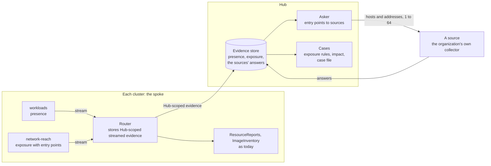

# vexplain — Entry points, and whether the internet reaches them

- **Status:** accepted by the owner on 2026-11-22, as draft 3. The decisions are the owner's, from the reviews of 2026-11-20 to 2026-11-22 (section 1). The calls marked **[call]** are the designer's. Built by [the plan](../plans/2026-11-22-entry-points.md) on 2026-11-23, whose "As built" says where the build differs; the live check is still to come.
- **Date:** 2026-11-22 (draft 1: 2026-11-20, draft 2: 2026-11-21)
- **Author:** Joshua Leuenberger
- **Extends:**
  - the [main design](2026-10-29-vexplain-design.md), 6.4 (exposure);
  - [collectors, evidence and rules](2026-10-31-collectors-evidence-rules.md), 5.5 to 5.7;
  - the [collector model](2026-11-08-collector-model.md), 5.1 and 5.5 to 5.7;
  - [the agent on image cases](2026-11-16-agent-on-cases.md), 5.2, 5.3 and 5.14.

  It answers question 4 of the draft [what the agent is asked](2026-11-20-what-the-agent-is-asked.md): a collector's facts may change a workload's exposure, and so its urgency.
- **Decision records:** [0058](../decisions/0058-streamed-evidence-on-the-hub.md) and [0059](../decisions/0059-exposure-rules-on-the-hub.md).

Statements marked **[call]** are the designer's, not the owner's. They are the first candidates to revisit.

---

## 1. Intent

**`network-reach` can only say what is reachable from outside the cluster** (owner, 2026-11-21). Today every Ingress of a counted class, every LoadBalancer Service, every route, node port and host port makes a workload Open (main design 6.4). Whether "outside" means the internet, or only a locked-down network, depends on what sits in front of the cluster: an organization's DMZ, its reverse proxies, its firewalls. Each platform has its own, and only a collector of the organization's own knows it.

**So the answer comes in layers:**
- `network-reach` reports each workload's entry points: the hosts and addresses through which something outside the cluster reaches it.
- A source, a collector that knows the network in front of the clusters, says for each entry point whether it publishes it. An organization writes its own, and one exists already.
- On the hub, the CVE playbook's rules join presence, exposure and the sources' answers, and decide each workload's exposure.
- A case's urgency, its place in the order and its case file follow. The case file says, in the names of the rules that decided it, where the image runs: reachable only in its namespace, in the cluster, from outside the cluster but not published, or published to the internet.

**The owner's wish:** urgency reflects whether the internet reaches a workload, the agent and the SOC see why, and the organization's existing collector plugs in without a change to its code.

**The owner's answers:**
- *2026-11-20:*
  - Now, on phase 4's branch, without regard for phase 3b's re-cut (0048, 0050).
  - The mapping lives on the hub. The clusters send each workload's entry points, duplicates included, so that rules and playbooks can filter on them.
  - Design as if the sources cover every way in from the internet.
  - Exposure is evidence, and the store keeps streamed records current: "It's what I would expect the exposure to be anyways."
  - The organization's proxies forward only the names they publish.
  - The hub decides, since "only the hub has the big picture".
- *2026-11-21:*
  - No kind for this use case alone: "I am not sure whether a dedicated CRD now is the right fit for this."
  - Other platforms publish their workloads by other means, so their own sources build on top of `network-reach`. The collectors stay apart, and the evidence and the rules are the interface.
  - A source's refresh interval is its schedule, which the `Collector` already replaces (4.7).
  - The organization's existing collector should be usable right away.
- *2026-11-22:*
  - Node ports and host ports report the nodes' addresses, "since that's what's at least known true" (4.5).
  - The evidence's keys follow an industry standard (4.6).
  - The evidence names its workload, so that a workload's exposure can be matched to the images it runs (5.3).
  - No playbook of its own: the CVE playbook aggregates several sources of evidence with CEL, so that its case file says whether an image runs internal only, exposed outside the cluster, and so on, in names the rules give, not in names that vexplain fixes (4.2).
  - No new kind: the collectors feed existing resources.
  - The rules run on the hub, and the hub does the join (4.3).
  - ImageInventory stays out of it: evidence and rules only, with changes to existing evidence where the join needs them (4.4, 5.3).
  - Exposure rules, after seeing them in examples (4.2).
  - The verdict sheets stay as they are for now (4.4).
  - Nothing on the playbook says what a piece of evidence is about: that follows from the rule and the source (5.6).
  - ImageInventory's counts stay where cases learn where an image runs, the simpler way, for now. To be addressed further later (4.4).
  - An entry point names its object and nothing more about it, such as an Ingress's class, until a rule uses it (4.6).

## 2. Goals, non-goals, anti-goals

### Goals
- `network-reach` reports each workload's entry points in its exposure, under Kubernetes' names (5.1).
- Exposure and presence reach the hub as `Hub`-scoped evidence and stay current there (0058). Presence names each workload's subject, so that the two join (5.3).
- The hub asks each source about the entry points, and keeps the answers fresh (5.5).
- Exposure rules, `Rule`s that conclude an exposure, decide each workload's exposure on the hub. The CVE playbook lists them next to its finding rules (5.6, 5.7).
- A case's urgency, its order, an investigation's conditions and the case file follow that exposure (5.8).
- A source that answers about hosts and addresses, as the organization's collector does, plugs in with its type and two rules, without a change to its code (5.12).
- **Fail safe:** a missing, stale or unknown answer, or a way in that nobody can check, never lowers a workload below Unknown, which urgency counts as Open (0024).

### Non-goals (for now)
- **The clusters' reports.** They keep today's exposure until a later step carries the hub's to them (5.9, section 9).
- **Lowering below Controlled.** A workload published only internally is still reached from outside its cluster.
- **Entry points as findings or cases.** Draft 2's playbook of entry points and its verdict sheets are gone.
- **Evidence about workloads that the hub asks for,** such as a runtime collector's. For now, only streamed evidence is about workloads.
- **One type that every source shares.** Each source keeps its own until a second one appears (section 9).
- **Following a published address on to another cluster.**
- **Phase 3b's family collectors** (0048).

### Anti-goals (failure even if it "works")
- **A wrong Controlled:** a workload rated Controlled while the internet reaches it. Every ambiguity resolves to Unknown or Open.
- **Names of an organization's networks in vexplain.** A source's type and rules live with the source.
- **Flapping:** a workload's exposure changes although none of its evidence did, such as after a restart of the manager.
- **Exposure changing a CVE's verdict** (0006). Exposure rules conclude an exposure, never a status.
- **A kind for one use case.**

## 3. Constraints

- **The sources cover every way in from the internet** (owner). "Not published" therefore means "reached only internally". *Revisit when* a way in appears that no source sees.
- **The organization's proxies forward only the names they publish** (owner, 2026-11-20). A proxy that forwards any host to an ingress controller publishes every host behind it, which a lookup by name can't see. *Revisit when* such forwarding stays in place (section 9).
- **A node port is asked about by the nodes' own addresses** (owner, 2026-11-22). A virtual IP in front of the nodes that no Kubernetes object names isn't asked about. *Revisit when* a platform publishes node ports through one (section 9).
- **Exposure changes urgency, never a CVE's verdict** (0006).
- **The hub decides** (0021), and hub and spoke stay separate. The spoke reaches hub state only through the shared interfaces. Hub code never calls spoke code.
- **No kind for one use case** (owner, 2026-11-08, collector model 5.7).
- **Bulky data goes through its storage interface** (0004), with its size caps, and its write rate is measured.
- **Not "reachability":** 0046 keeps that word for code reachability.
- **The repository is public.** Tests use neutral names, such as `app.example`, and addresses from the documentation ranges.
- **The SDK has no tags.** A source outside this repository pins a commit.
- **Tests run on kind,** with a stand-in source.

## 4. Approaches

### 4.1 Where entry points live on the hub: as evidence (owner, 2026-11-20)

| | Approach | Costs |
|---|---|---|
| A | A record per namespace on the hub: the cluster writes the entry points into its spec, and the hub answers each in its status | A kind of its own for a collector's data, which 0032 gives to evidence |
| B | Entry points inside presence | Copies every workload's entry points into each image it runs |
| **C** | **Exposure is `Hub`-scoped evidence, and the store keeps streamed evidence current** | **Every workload's exposure is written to the hub, and updated when it changes; the store's rule of one write per collector version goes** |

0032 already lets each type declare its scope. `network-reach` declares exposure `Spoke`, so it stays in the cluster's memory today. C changes the declaration, and closes two gaps of the store:
- only evidence from asked operations reaches it;
- it writes a record once per collector version, and keeps the old record without a word when a changed event comes from the same version.

Phase 3b's spikes ran into the second gap: replacing evidence by a delete and a create left a gap in 11 of 12 changes (collector model, section 6).

**Precedent:** Red Hat Advanced Cluster Security's Sensor sends every deployment, with the exposure of each port, to Central, where policies filter on it. Kyverno updates its PolicyReports in place as results change.

### 4.2 How the sources' answers reach urgency: exposure rules (owner, 2026-11-22)

| | Approach | Costs |
|---|---|---|
| Draft 1 | The hub looks up every entry point, decides each workload in a fixed table, and writes a sheet kind of its own | A kind and an engine for one use case (owner: no) |
| Draft 2 | Each entry point is a finding of a playbook of its own, its rules judge it into a verdict sheet for any subject, and the clusters render each workload from its entry points' verdicts | A playbook and a kind for one use case, and the CVE playbook can't combine the evidence itself (owner: no) |
| **A (chosen)** | **A `Rule` may conclude an exposure instead of a status. The CVE playbook lists exposure rules next to its finding rules. vexplain ships three that do what the spoke's fixed mapping does today, and each source ships its own** | **`Rule` gets a second kind of outcome** |
| B | The playbook holds a table of named conditions, `spec.exposure`, each with an exposure | Each playbook copies the CEL, and a source can only document a snippet to paste |

The owner chose A after seeing both in examples. It keeps the collectors apart: `network-reach` knows only the cluster, a source knows only its own network, and the evidence and the rules join them. A rule serves any playbook, as a finding rule does, a source ships its rules next to its collector, and adding a rule never lowers a value that another rule concluded, nor a failure's Unknown (5.6).

### 4.3 Where the rules run: on the hub (owner, 2026-11-22)

- **The spoke decides exposure today,** in fixed Go (`exposureValue` in `internal/spoke/exposure.go`). Draft 3's first sketch ran the exposure rules there too, because the hub had nowhere to keep a result for each workload.
- **The owner:** the rules run on the hub, and the hub does the join, as 0021 says.
- **The hub builds its cases on demand** (4.4), so it needs nowhere to keep the result for them.

### 4.4 Where the result goes: cases first (owner, 2026-11-22)

| | Approach | Costs |
|---|---|---|
| ImageInventory | Each workload reference also names its exposure and the rules that decided it | The owner wants ImageInventory left out; it holds 100 workloads per cluster |
| The verdict sheets | Each manifest's sheet lists its workloads' exposure, and the spokes render their reports from it | Each workload's result is copied into the sheet of every manifest it runs, which needs a cap and is rewritten whenever an exposure changes |
| **Cases first (chosen)** | **The hub runs the exposure rules when it computes a case's impact and when it builds its case file, and keeps nothing** | **The clusters' reports keep today's exposure until a later step carries the hub's to them (5.9)** |

**Presence goes to the hub** for the join (5.3), as evidence, rather than through ImageInventory's workload references, which stop at 100 per cluster.

**ImageInventory stays where cases learn where an image runs** (owner, 2026-11-22, for now): its clusters, namespaces and workload counts, and whether the image runs at all, read as today, with nothing added. A cluster's presence may be missing on the hub, such as before its first snapshot arrives after an upgrade, or after a refused write. A case must not then count fewer workloads, or be skipped as not running, since that would lower its urgency. Presence as the only source, with a sign that a cluster's presence has reached the hub, is an option for later (section 9).

### 4.5 Node ports and host ports: the nodes' addresses (owner, 2026-11-22)

- **Draft 2 counted them by their port alone,** so that a source answered "published" when it forwarded anything to that port, on any address.
- **The owner:** report all the nodes' addresses, since that's what's at least known true.
- **A node port** names the InternalIP and ExternalIP of every node, with the node port.
- **A host port** names those of the nodes that the workload's pods run on, with the host port.
- **The cost:** a node that joins or leaves rewrites the exposure of every workload behind a node port, and a virtual IP in front of the nodes isn't asked about (section 3).
- **A pod on its node's network stays unchecked:** it may listen on ports that it never declares.

### 4.6 Names: Kubernetes' own (owner, 2026-11-22)

- **OpenTelemetry's semantic conventions** have stable names for an endpoint (`server.address`, `server.port`, `network.transport`) and for workloads (`k8s.namespace.name`, `k8s.deployment.name`). They have none for an Ingress, a Gateway or a route, `k8s.service.name` is still in development, and `server.address` holds a single address.
- **Kubernetes' own APIs name exactly these things:** EndpointSlice's `addresses`, `port` and `protocol`; Gateway API's `parentRefs`; references named for their purpose with `Ref`, as the audit log's `objectRef`.
- **Chosen: Kubernetes' names,** since admins write the rules' CEL against Kubernetes objects.
- **Only what a rule reads now** (owner, 2026-11-22): an entry point names its object and its route's Gateway, and nothing more about them. An Ingress's class, a Service's labels or a route's GatewayClass come when a rule needs them (section 9).

### 4.7 A source's refresh interval: its schedule (owner, 2026-11-21)

A source declares a schedule, and the `Collector`'s `spec.triggers` replaces its cron expression, named like a CronJob's `spec.schedule`. vexplain checks each collector every 30 seconds, which also tells it whether the collector answers at all. Work follows only a changed source version, which a source changes at most once per refresh. Nothing new is needed.

## 5. Design



### 5.1 Entry points in `exposure`

`external.via` gives way to `external.entryPoints`. An exposure record about `workload/cluster-a/team-a/Deployment.apps/shop`:

```json
{
  "external": {
    "exposed": true,
    "entryPoints": [
      {"addresses": ["shop.app.example"], "port": 443, "protocol": "TCP",
       "objectRef": {"apiGroup": "networking.k8s.io", "kind": "Ingress", "namespace": "team-a", "name": "shop"},
       "subjects": ["host/shop.app.example"]},
      {"addresses": ["192.0.2.10"], "port": 443, "protocol": "TCP",
       "objectRef": {"apiGroup": "", "kind": "Service", "namespace": "team-a", "name": "shop-lb"},
       "subjects": ["address/192.0.2.10:443"]},
      {"addresses": ["198.51.100.11", "198.51.100.12"], "port": 30443, "protocol": "TCP",
       "objectRef": {"apiGroup": "", "kind": "Service", "namespace": "team-a", "name": "shop-lb"},
       "subjects": ["address/198.51.100.11:30443", "address/198.51.100.12:30443"]}
    ],
    "unchecked": []
  },
  "internalReach": "Cluster",
  "indirect": false
}
```

**An entry point's fields:**
- **`addresses`:** host names or IP addresses, as an EndpointSlice's are; 1 to 64 **[call]**.
- **`port` and `protocol`** (`TCP`, `UDP` or `SCTP`), where the way in has a port.
  - An Ingress's host is on 443 when an entry of the Ingress's `tls` names it, a matching wildcard included, and on 80 otherwise, as the Ingress API documents its two ports (owner, 2026-11-22). A controller may answer on the other port too, such as to redirect to HTTPS.
  - An Ingress's status addresses have no port, so that a source answers them for every port **[call]**.
- **`objectRef`:** the object that opens the way in, such as the Ingress, the Service, the route, or the pod of a host port.
- **`parentRef`:** a route's Gateway, in the same form.
- **`subjects`:** what the sources are asked about, one for each address (5.2): an IP address with the entry point's port, and a host by its name alone, since sources look hosts up by name. The SDK computes them.

**What gives an entry point:**

| Way in | Entry point |
|---|---|
| An Ingress rule with a host | The host, on 443 when the Ingress's `tls` names it, else on 80 (owner) |
| An Ingress rule without a host, or a default backend | The Ingress's status addresses, without a port: an IP gives an address, a hostname a host **[call]** |
| An HTTPRoute, GRPCRoute or TLSRoute | Its `hostnames`. Without any: the listener's `hostname`. Without that: the Gateway's status addresses, with the listener's port. `parentRef` names the Gateway. A `NamedAddress` of the Gateway is `NotASubject` **[call]** |
| A route through a parent of a kind that `network-reach` doesn't read, such as a ListenerSet | Its `hostnames`, without a port. Without any: none, and `NoAddress` **[call]** |
| A LoadBalancer Service | Its status's IPs and hostnames, one entry point for each port of the Service **[call]** |
| A Service's external IPs | The addresses, one entry point for each port of the Service **[call]**. A Service without a port, as a headless one may be: none, and `NoAddress` **[call]** |
| A node port, of a NodePort or a LoadBalancer Service | The InternalIP and ExternalIP of every node, with the node port (owner). While a node has neither, `NoAddress` too **[call]** |
| A host port | The InternalIP and ExternalIP of the nodes that the workload's pods run on, with the host port (owner). A pod on a node without either, or that no node runs yet, adds `NoAddress` **[call]** |
| A pod on its node's network | None. It is listed under `unchecked` |

- **What counts stays as it is.** The settings for ingress classes, Gateways, internal load balancers, `nodePorts`, `hostPorts` and `hostNetwork` (6.4, 0048) apply first. A node port that the settings call internal gives no entry point.
- **`exposed` stays** as `network-reach` sets it today. An exposed workload has at least one entry point or one `unchecked` reason **[call]**.
- **`unchecked` lists the reasons why a way in can't be asked about,** at most 8:
  - `HostNetwork`;
  - `NoAddress`, for a way in without an address that the collector can name yet, as when its status has none: a status without an address, a node port while a node has no InternalIP or ExternalIP, a host port of a pod on such a node or not yet scheduled, a Service without a port, and a route through a parent of a kind that `network-reach` doesn't read and without hostnames **[call]**;
  - `NotASubject`, for an address that the SDK refuses (5.2), or a Gateway's `NamedAddress`, which the entry point then leaves out **[call]**;
  - `TooManyAddresses`, for an entry point past 64 addresses, which keeps the first 64 **[call]**;
  - `TooManyEntryPoints`, for a workload past 32 entry points, which keeps the first 32, sorted **[call]**.
- **`network-reach`'s caches keep what it needs:** the Ingresses' hosts and status addresses, the Services' ports, node ports and status, the routes' hostnames, the Gateways' listener hostnames and status addresses, and the nodes' addresses.

### 5.2 Subjects of entry points

- **Two subject kinds of the core:** `host/<name>`, and `address/<ip>` or `address/<ip>:<port>`. The SDK builds and parses them.
- **The SDK normalizes them:**
  - a host in lower case, without a trailing dot, with a leading `*.` kept;
  - an address in its canonical form, an IPv4-mapped one unmapped, an IPv6 one in brackets when a port follows.
- **It refuses** a host of a single label, a host with characters other than letters, digits and hyphens, and an address that doesn't parse. Such an address goes under `unchecked` as `NotASubject` **[call]**: a source refuses a whole call over one point it can't read, and nothing publishes a single-label host by name.
- **A subject is shared across clusters on purpose,** where 0032 asks `Hub` subjects to be unique. A source answers an entry point the same for every cluster, so it is asked once. Private addresses repeat across clusters, and phase 6 revisits them.

### 5.3 Presence names its workloads

- **Each workload in presence gains `subject`,** its workload subject, cluster included. The `workloads` collector knows its cluster from the request's context.

  ```json
  {"subject": "workload/cluster-a/team-a/Deployment.apps/shop",
   "apiGroup": "apps", "kind": "Deployment", "namespace": "team-a", "name": "shop", "uid": "…", "pods": […]}
  ```

- **So presence and exposure join by subject:** presence links an image to the workloads that run it, and exposure is about each of them.
- **The join on the hub:** a case's manifest → the reported digests that reference it, as cases find them today → each digest's presence, one record per cluster → its workloads → each one's exposure → the answers about its entry points.

### 5.4 Hub-scoped, and current (0058)

- **`network-reach` declares exposure, and `workloads` declares presence, with the scope `Hub`.** Exposure's subjects, `workload/<cluster>/…`, are unique across clusters. Presence's, `image/<digest>`, repeat in every cluster that runs the image.
- **The spoke keeps its own use:** both still reach the spoke's memory, which renders reports and ImageInventory as today.
- **The spoke stores every streamed event of a `Hub`-scoped type,** as its executor already stores what an operation returns:
  - a snapshot stores each of its events, and deletes the collector's records of that type from this cluster that the snapshot doesn't hold;
  - a change stores its event;
  - a tombstone deletes its record;
  - `Forget` deletes the collector's records from this cluster;
  - presence and exposure are stored only when their data follows the core's schema, as the spoke's own consumers read them. An event that doesn't deletes its record, as one that the store refuses does, so that the hub never reads an older event as current.
- **The store writes a record in place** whenever its event differs, whether or not the collector's version changed. An equal event writes nothing.
  - Equal means the same data and the same attributes that the store keeps, apart from the event's ID and time **[call]**. A snapshot that delivers every workload again then writes nothing.
  - An answer that the hub asked for is also written when its stored time is older than half its `maxAge`, so that a confirmed answer stays fresh (5.5).
  - A record's subject, type and source never change. The Evidence's CEL rule `self == oldSelf` gives way to one that keeps them fixed.
- **The store's watchers see a change in place.** Today they react only to a new object.
- **A streamed record names its cluster, in its key and in a label** **[call].**
  - Today the store keys a record on its subject, its type and the Collector's name, so two clusters' presence of one image would overwrite each other.
  - Evidence that an operation returns keeps its key. So nothing stored is renamed, and an image's evidence stays shared by the clusters that run it.
  - With the label, a spoke lists its own records of a collector and type after a snapshot, and `Forget` deletes only its own.
- **The hub's other readers of the store skip what isn't theirs.** The image assessor works on manifests.
- **Presence's write rate:** presence changes whenever a pod of an image starts, stops or moves, and each change is a write to the hub's store. The live check measures it against 0004's triggers. If it's too high, presence goes to the hub without its pods (section 9).

### 5.5 Sources

- **A source is a collector whose operation in the hub role takes `hosts`, `addresses` or both,** as the SDK's parameters for entry points define them:
  - `hosts`: host names, a leading `*.` allowed;
  - `addresses`: IP addresses, each with or without a port, such as `192.0.2.10`, `192.0.2.10:443` or `[2001:db8::1]:443`;
  - 1 to 64 points in the two lists together.

  The operation consumes nothing. That's how the hub knows that the source answers about entry points (5.6).
- **It answers each distinct point with one event:**
  - its subject is the point in normal form (5.2), with the port when the point had one;
  - its time is when the source answered, as the SDK's `evidence.New` sets it, never when the source's data was built, since the hub measures `maxAge` from it;
  - "not published" is an answer, not a failure.
- **It fails a whole call** with `InvalidInput` when it can't read a point, and with `NotReady` while its own data is stale or being rebuilt. Its messages carry no values.
- **Its source version,** which `GetInfo` reports, changes when its data does.
- **It produces a type of its own,** of scope `Hub`. The example type `ch.example.dmz.publication.v1alpha1` holds `publishedTo`: `Internet`, `Internal` or `None`.
- **The stand-in source of the end-to-end tests** follows the same contract.
- **The SDK documents the reading that keeps it safe,** since a source that answers more narrowly gives a wrong Controlled that vexplain can't notice:
  - an address is published when the source forwards traffic to it, as to an ingress controller's load balancer, not only when it is a front-end address of the source's own;
  - a host is published when any of the source's entries matches it, its wildcards included;
  - a wildcard entry point is published when any entry overlaps it;
  - an address without a port stands for every port.
- **`maxAge` (0045, 5.10):** the source declares one for its type, or its admin sets one on its `Collector`. Without either, its answers don't expire.
- **Its source version changes when its data does,** so that the hub asks again.
- **Its refresh interval is its schedule** (4.7).
- **It ships two exposure rules** for its type (5.6), as manifests that its admin applies.
- **Its operation stays an agent tool** where a profile allows it (0053).

**How the hub asks:**
- **About what:** every entry point that a cluster's exposure names, for every source whose type the evidence of a Ready playbook names **[call]**. It asks about hosts only an operation that takes `hosts`, and about addresses only one that takes `addresses`.
- **Never about a manifest.** The assessor, which asks the producers of a playbook's evidence about each manifest, skips the sources.
- **When:**
  - for a new entry point;
  - again, at once, when the source's version or the collector's version changes;
  - again when an answer reaches half its `maxAge` **[call]**, as Unbound's `prefetch` refreshes a DNS record before its TTL ends;
  - after a start, for every answer whose source version differs from the source's. The hub stores the source version with each answer **[call]**.
- **In calls of at most 64 points.** A call's subject is its first point's **[call]**, and the source reads the points from the parameters. A call that the source refuses as `InvalidInput` is split in halves and asked again **[call]**.
- **Failures:** the hub keeps each source's last failure in memory, with its reason and message, such as `NotReady` and why. It asks again after a minute, with back-off up to 15 minutes **[call]**. A metric counts them.
- **The answers are evidence,** stored about each entry point, with the source as their source.
  - An answer counts until a new one replaces it, or until its `maxAge` ends it. A change of the source's version doesn't end it **[call]**: that would turn every exposed workload Unknown, and back, at each change of the source's data.
  - A refresh that brings back the same answer writes only its new time, once the stored time is older than half its `maxAge` **[call]**. With 5,000 entry points and a `maxAge` of 24 hours, that is about 0.12 writes a second.
  - An answer about an entry point that no cluster names any more is deleted **[call]**.

### 5.6 Exposure rules

**A `Rule` concludes either a status about a finding, as today, or an exposure about a workload:**

```yaml
apiVersion: config.vexplain.bedag.ch/v1alpha1
kind: Rule
metadata:
  name: exposed-outside-cluster
spec:
  inputs:
  - {name: exposure, type: ch.bedag.vexplain.exposure.v1alpha1}
  condition: exposure.data.external.exposed
  outcome: {exposure: Open}
```

- **`outcome.exposure`** is `Open`, `Controlled` or `Small`, SSVC's system exposure. A rule with it has no `status`, `justification`, `holdAgainst`, `match` or `reason` **[call]**, and the API's validation says so.
- **Its CEL sees its inputs only,** and no `finding`: exposure changes urgency, never a verdict (0006).
- **What an input holds follows from the rule and from the input's producer,** so nothing on the playbook says it (owner, 2026-11-22):
  - for a finding rule, the record about the manifest, as today;
  - for an exposure rule, the record about the workload, such as its exposure;
  - unless the input's type comes from a source (5.5). Then it is a map from each of the workload's entry-point subjects to the source's answer. It is present when every subject has a fresh answer, and empty when the workload has no entry points.
  - Each record has the keys that an input has today: `data`, `coverage`, `time` and `source`.
- **How one workload's exposure is decided:**
  - **The highest value that a rule concludes wins,** in the order Open, Unknown, Controlled, Small: the order in which today's code ranks the workloads of an image.
  - **A rule with a missing input, or whose CEL fails or runs past a bound, counts as Unknown** **[call].** A finding rule with a missing input doesn't apply; an exposure rule can't do the same, since a missing answer must never let a lower rule decide.
  - **A workload that no rule applies to is Unknown.** Urgency counts Unknown as Open (0024).
  - **So adding a rule never lowers a value that another rule concluded, nor a failure's Unknown,** as adding an RBAC rule never takes away what another grants. Only the Unknown of a workload that no rule applies to can become lower. The one exception is a rule whose inputs bring a workload past 4 combinations of producers, below: the workload is then Unknown, which urgency counts as Open. To let a source lower an exposed workload, the admin takes `exposed-outside-cluster` out of the pipeline. Leaving it in keeps exposed workloads Open, the safe side.
  - **Each producer's evidence is evaluated apart, and the highest wins,** as between rules (0043): with two exposure collectors, as the spoke decides today. With more than 4 combinations of producers, the workload is Unknown.
  - **A `Collector` counts as a producer of an input only while its recorded capabilities declare the input's type,** with the scope `Hub` unless it is a source of the type: records that a stream of another scope left behind, as before a downgrade, are nothing that keeps them current. A pinned `Collector` that doesn't count, and an input that a rule takes with another type than the playbook's evidence, are missing, as for finding rules.
  - **The hub notes the rules that concluded the winning value,** and, for Unknown, the inputs that were missing or the rules that failed.
- **The bounds:** a rule's run on one workload takes at most a second, and the exposure rules of all the workloads of one case at most 30 seconds **[call]**. The workloads past the bound are Unknown.
- **A Rule's status** counts workloads where a finding rule's counts findings, in its `Evaluated` condition. A column shows a rule's exposure.

**vexplain ships three exposure rules,** which together do what `exposureValue` does today:

```yaml
kind: Rule
metadata: {name: exposed-outside-cluster}
spec:
  inputs: [{name: exposure, type: ch.bedag.vexplain.exposure.v1alpha1}]
  condition: exposure.data.external.exposed
  outcome: {exposure: Open}
---
kind: Rule
metadata: {name: reachable-in-cluster}
spec:
  inputs: [{name: exposure, type: ch.bedag.vexplain.exposure.v1alpha1}]
  condition: exposure.data.indirect || exposure.data.internalReach != 'Namespace'
  outcome: {exposure: Controlled}
---
kind: Rule
metadata: {name: own-namespace-only}
spec:
  inputs: [{name: exposure, type: ch.bedag.vexplain.exposure.v1alpha1}]
  condition: exposure.data.internalReach == 'Namespace'
  outcome: {exposure: Small}
```

**A source ships two,** about its own type, here the example type `ch.example.dmz.publication.v1alpha1`:

```yaml
kind: Rule
metadata: {name: published-or-unchecked}
spec:
  inputs:
  - {name: exposure, type: ch.bedag.vexplain.exposure.v1alpha1}
  - {name: dmz, type: ch.example.dmz.publication.v1alpha1}
  # Open unless every way in was asked about, and none is published to the internet.
  condition: |
    exposure.data.external.exposed && !(size(exposure.data.external.unchecked) == 0 &&
      size(exposure.data.external.entryPoints) > 0 &&
      exposure.data.external.entryPoints.all(e, e.subjects.all(s,
        dmz[s].data.publishedTo in ['Internal', 'None'])))
  outcome: {exposure: Open}
---
kind: Rule
metadata: {name: exposed-not-published}
spec:
  inputs:
  - {name: exposure, type: ch.bedag.vexplain.exposure.v1alpha1}
  - {name: dmz, type: ch.example.dmz.publication.v1alpha1}
  condition: |
    exposure.data.external.exposed && size(exposure.data.external.unchecked) == 0 &&
      size(exposure.data.external.entryPoints) > 0 &&
      exposure.data.external.entryPoints.all(e, e.subjects.all(s,
        dmz[s].data.publishedTo in ['Internal', 'None']))
  outcome: {exposure: Controlled}
```

- **The two are each other's opposite for an exposed workload,** so exactly one of them applies once every entry point is answered.
- **`published-or-unchecked` errs towards Open:** a value it doesn't know counts as published, and so does a workload exposed without any entry point.

| A workload | Rules that apply | Exposure |
|---|---|---|
| Exposed, an entry point published to the internet | `published-or-unchecked`, maybe `reachable-in-cluster` | Open |
| Exposed, every entry point answered and none published to the internet, reachable across the cluster | `exposed-not-published`, `reachable-in-cluster` | Controlled |
| Exposed, an entry point not answered yet, or its answer past its `maxAge` | both source rules count as Unknown | Unknown |
| Exposed only through the host network | `published-or-unchecked` | Open |
| Not exposed, reachable only in its namespace | `own-namespace-only` (the source's map is empty, and neither source rule applies) | Small |
| No exposure record | every rule counts as Unknown | Unknown |

### 5.7 The CVE playbook

`container-cves` as vexplain ships it:

```yaml
apiVersion: config.vexplain.bedag.ch/v1alpha1
kind: Playbook
metadata:
  name: container-cves
spec:
  subjects: {type: ch.bedag.vexplain.presence.v1alpha1}
  findings: {type: ch.bedag.vexplain.findings.v1alpha1}
  evidence:
  - {name: contents, type: ch.bedag.vexplain.scanner.image-contents.v1alpha1}
  - {name: sbom, type: ch.bedag.vexplain.sbom.v1alpha1}
  - {name: exposure, type: ch.bedag.vexplain.exposure.v1alpha1, requirement: Optional}
  pipeline:
  - rule: known-exploited          # finding rules, as today
  - rule: completeness-guard
  - rule: removed-in-later-layer
  - rule: load-check
  - rule: fix-available
  - rule: exposed-outside-cluster  # exposure rules
  - rule: reachable-in-cluster
  - rule: own-namespace-only
  agent:
    profileRef: {name: default}
    evidence: [contents, sbom]
    matchConditions:
    - name: unsettled
      expression: 'finding.status == "UnderInvestigation"'
```

- **`exposure` is optional** **[call]:** without `network-reach`, the playbook runs, and every workload is Unknown, as it is today without an exposure collector.
- **With a source,** the admin adds its type to the evidence, required by default, and swaps `exposed-outside-cluster` for the source's two rules:

  ```yaml
    evidence:
    - …
    - {name: dmz, type: ch.example.dmz.publication.v1alpha1}
    pipeline:
    - …
    - rule: published-or-unchecked
    - rule: exposed-not-published
    - rule: reachable-in-cluster
    - rule: own-namespace-only
  ```

- **The order of the pipeline doesn't change the result,** for either kind of rule.
- **A playbook without exposure rules** has every workload of its cases Unknown **[call]**.

### 5.8 What the hub does with it

- **The cases package runs the exposure rules** when it computes a case's impact, and when the agent's case file is built:
  - where the case's manifest runs comes from ImageInventory, as today: its clusters, namespaces and workload counts, and whether it runs at all (4.4);
  - presence on the hub names those workloads, on nodes of the manifest's platform, and each named one's exposure comes from the playbook's exposure rules (5.6);
  - a workload that ImageInventory counts and presence doesn't name is Unknown, such as one of a cluster whose presence hasn't reached the hub yet;
  - the case's counts by exposure, its highest exposure, its highest urgency and its urgent workloads follow from them, as today, and no longer from ImageInventory's counts by exposure.
- **An investigation's conditions** read `highestExposure` and `highestUrgency` as today.
- **Nothing is stored.** The hub may cache each workload's result for one pass of an investigation, keyed on the evidence that it read **[call]**.
- **The case file's `runsIn` gains `exposure`:** the workloads grouped by their exposure and the rules that decided it, each group with its count and its first 5 workloads by subject, at most 16 groups **[call]**:

  ```json
  "runsIn": {
    "clusters": ["cluster-a", "cluster-b"],
    "workloads": 4,
    "highestExposure": "Open",
    "highestUrgency": "Immediate",
    "workloadsByExposure": {"Open": 1, "Unknown": 1, "Controlled": 1, "Small": 1},
    "exposure": [
      {"exposure": "Open", "rules": ["published-or-unchecked"], "workloads": 1,
       "first": ["workload/cluster-a/team-b/Deployment.apps/admin"]},
      {"exposure": "Unknown", "missing": ["dmz"], "workloads": 1,
       "first": ["workload/cluster-b/team-c/Deployment.apps/api"]},
      {"exposure": "Controlled", "rules": ["exposed-not-published", "reachable-in-cluster"], "workloads": 1,
       "first": ["workload/cluster-a/team-a/Deployment.apps/shop"]},
      {"exposure": "Small", "rules": ["own-namespace-only"], "workloads": 1,
       "first": ["workload/cluster-b/team-c/StatefulSet.apps/batch"]}
    ]
  }
  ```

  - The rules' names are the explanation: "reachable from outside the cluster but not published" is whatever the admin's rules call it.
  - **`runsIn` lies outside the case's inputs,** so a change of exposure never makes a verdict stale (0052).
- **The agent's evidence stays `contents` and `sbom`** **[call].** Evidence under `agent.evidence` counts in a case's input hash (0052), so exposure there would make verdicts stale at every change of an Ingress or a node. `runsIn` tells the agent where the image runs and why, and a source's operation stays its tool to look up an entry point (0053).
- **Owner values never reach the model** (main design 6.14). The case file names workloads by their subject, never by their labels.

### 5.9 What stays on the spokes for now

- **The spoke keeps its own exposure,** `exposureValue`, for the reports, their urgency, the metrics and ImageInventory's counts. The hub no longer reads those counts for its cases.
- **Without a source in the playbook, the hub and the spokes agree,** since the three shipped rules are today's mapping.
- **With a source, a case can say Controlled where a workload's report still says Open.** The report stays on the safe side.
- **A later step carries the hub's result to the reports** (section 9). It chooses the carrier, likely the verdict sheet, and removes `exposureValue` and ImageInventory's exposure fields.

### 5.10 `maxAge` (0045)

- **Built now,** since a source's type is the first that changes under its subject.
- **A collector declares a default for each type that it produces,** and the admin overrides it on the `Collector`. A type without one doesn't expire.
- **It applies to the evidence that operations return.** The hub can't ask a stream again, and the spoke stores a streamed record only when it changes, so a `maxAge` on presence or exposure would expire records that are current. A type that only a stream delivers declares none, and the `Collector` refuses an override of it as `ProducesInvalid`.
- **An answer past its `maxAge` is missing for the rules:** the source's rules count as Unknown until the hub has asked again.

### 5.11 Security, in short

- **Every workload's exposure and every image's presence reach the hub,** with hosts, addresses, and the labels that owner attribution allows. ImageInventory already carries the namespaces' owner values to the hub. The workloads' labels are new there, where agent design 5.14 kept them on the spokes. A cluster whose data must stay put runs its own hub (collector model 5.7).
- **The hub sends a source entry points only,** never workload names or namespaces.
- **A source's answers are external evidence.** Rules read them in CEL, text is made printable before anything shows it, and the agent gets them as data, never as instructions.
- **No secret values** travel anywhere new.

### 5.12 For a source outside this repository

An organization's own source:
- produces a type of its own, of scope `Hub`, about entry points, with the subjects of 5.2;
- offers an operation in the hub role that consumes nothing and takes `hosts`, `addresses` or both, 1 to 64 points in all;
- answers one event for each point, "not published" included;
- declares a `maxAge`, or its admin sets one on its `Collector`;
- ships two exposure rules for its type.

The organization's collector does the first three today, as its code showed on 2026-11-21 and 2026-11-22: its parameters, its subjects, its events' times, its source version and its failures follow 5.5. Its admin sets its `maxAge` and applies its two rules, with no change to its code.

### 5.13 Metrics

- Entry points by cluster and state: answered, unanswered, unchecked.
- Calls to sources, by source and result, and answers about subjects that the hub didn't ask about.
- Exposure rules that can't be evaluated, in each Rule's `Evaluated` condition.
- The store's write and size metrics (0004) now cover presence, exposure and the answers.

The names are left to the builder.

## 6. Build order [call]

1. **The store:** writes in place, stores streamed `Hub` evidence with its cluster in its key and label, and its watchers see changes in place (0058).
2. **The SDK:**
   - host and address subjects, with their normalization;
   - entry points in exposure, and the subject of each workload in presence;
   - the sources' parameters, with their schema;
   - `maxAge` on produced types, and its override on the `Collector` (0045).
3. **The collectors:** `network-reach` reports entry points, the nodes' addresses included, and both it and `workloads` declare the scope `Hub`.
4. **The API and the engine:** `Rule`'s `outcome.exposure`, its validation and status, and the engine evaluating exposure rules for a workload, with inputs about the workload and its entry points.
5. **The hub:** asking the sources, and the cases' impact and case file from presence, exposure and the exposure rules.
6. **The shipped rules and `container-cves`.**
7. **End to end on kind,** with a stand-in source and its two rules.
8. **A live check** with the owner's source, on a cluster of the owner's choice, as a task of the plan.

## 7. Left to the builder

- Field names beyond the sketches, and the columns, within 0039's rules.
- The protobuf field for `maxAge`, and the `Collector`'s field for its override.
- `holdAgainst`'s default in the API, which must not land on an exposure rule.
- The label names on streamed records.
- How the cases package reads presence and exposure: through the evidence store's interface.
- The metric names.
- The stand-in source for the end-to-end tests.

## 8. To check on a real cluster

- How many Evidence objects presence and exposure add, and their write rate when nothing changes and during a rollout, against 0004's triggers.
- The time from a change of an Ingress to a case's new exposure.
- How many workloads go from Open to Controlled, and why those that stay Open do.
- That nothing changes when the manager restarts.
- The calls to the source after a change of its data, and the write rate of confirmed answers, against the estimate in 5.5.
- How long the exposure rules take for one pass of an investigation.

## 9. Options for later, with their signals

| Option | Signal |
|---|---|
| The clusters' reports take the hub's exposure, through the verdict sheet or another carrier; `exposureValue` and ImageInventory's exposure fields go | The reports should agree with the cases |
| Presence goes to the hub without its pods | The live check finds presence's write rate too high |
| One type that every source shares, with one pair of rules, as scanners share `sbom` (0044) | A second source |
| Evidence about workloads that the hub asks for | A collector that answers per workload, such as a runtime one |
| Sources that stream their answers instead of being asked | A source that can't be asked, such as a firewall's export |
| A published address counts for every host behind it | The organization's proxies forward any host to an ingress controller |
| A node port also asked about by its port alone | A platform publishes node ports through a virtual IP |
| Following an address on to another cluster | A source publishes a cluster through another |
| Exposure documents that the agent can search, outside the case's inputs | The agent needs more than `runsIn` |
| Presence on the hub as the only source of where an image runs, with a sign that a cluster's presence has reached the hub | ImageInventory's counts should go (owner: to be addressed further) |
| More about the object behind an entry point, such as an Ingress's class, a Service's labels or a route's GatewayClass | A rule needs to tell entry points apart by them |

## 10. What this changes

Once accepted, these documents get a note that points here:
- **Main design 6.4:** a workload's exposure is decided on the hub by a playbook's exposure rules, from presence, exposure and the sources' answers; node ports and host ports name the nodes' addresses.
- **0006:** exposure comes from the collectors' evidence, and exposure rules decide it (0059).
- **0021:** the hub decides exposure for its cases; the spokes keep their own for the reports until a later step.
- **0024:** a workload with a missing input is Unknown, which urgency counts as Open.
- **0032:** exposure and presence are `Hub`-scoped; streamed `Hub` evidence reaches the store, with its cluster in its key (0058); host and address subjects are shared across clusters on purpose.
- **0033 and the collector model 5.1:** a rule decides about one finding, or about one workload's exposure.
- **0043:** a playbook's pipeline lists exposure rules, whose inputs come from the workload and its entry points.
- **0045:** `maxAge` is built, with its override on the `Collector`.
- **0048, collector model 5.9 and section 6:** `network-reach` reports entry points before the re-cut, and the store's update in place, which the spikes asked for, is settled here.
- **Agent design 5.14:** presence reaches the hub for each workload, with its allowed labels, and a case's exposure comes from the rules, no longer from ImageInventory's counts.
- **Agent design 5.2 and 0052:** `runsIn` gains the exposure groups, outside the case's inputs.
- **Draft "what the agent is asked", question 4:** answered.
- **The decision index:** rows for 0058 and 0059.

## 11. Change log

### Draft 3 (2026-11-22)

From the owner's review of draft 2:
- No playbook of entry points, no type `entry-point`, no kind `Verdicts`, no CycloneDX justifications. Exposure rules in the CVE playbook decide each workload's exposure (4.2).
- The rules run on the hub, which joins presence, exposure and the answers (4.3). Presence becomes `Hub`-scoped and names each workload (5.3).
- Cases first: nothing is stored, and ImageInventory and the verdict sheets stay as they are. The reports follow later (4.4, 5.9).
- Node ports and host ports name the nodes' addresses, and `port/` subjects are gone (4.5).
- Kubernetes' names: `entryPoints`, `addresses`, `port`, `protocol`, `objectRef`, `parentRef`, `subjects` (4.6).
- Nothing on the playbook says what evidence is about: the rule and the producer say it (5.6).
- The organization's collector was checked against its code again.

After the builder check:
- a source's contract is spelled out: its parameters' forms, its answers' subjects and times, its failures and its source version (5.5);
- the agent's evidence stays `contents` and `sbom`, so that a change of exposure never makes a verdict stale (5.8);
- ImageInventory's counts stay where cases learn where an image runs, and a workload that presence doesn't name is Unknown (owner, 4.4);
- `ingressClassName` is dropped until a rule reads it (owner, 4.6);
- an Ingress's host is on 443 when its `tls` names it, else on 80 (owner, 5.1).

While planning (2026-11-22), in the decisions of [the plan](../plans/2026-11-22-entry-points.md):
- an event counts as equal only with the same collector version too, since the hub asks again while a record's version differs from its Collector's (5.4, 0058);
- the answers store no source version, and the hub asks every entry point again after a start (5.5);
- the hub keeps a view of presence, exposure and the answers in memory, in place of a cache for each pass (5.8);
- the agent's case file takes a case's exposure from its `Assessment`, which the manager writes, since the workers can't read the hub's view (5.8);
- each investigation result names its case's highest exposure;
- a host port names the workload's own object, not the pod, so that its record doesn't change at every rollout (5.1);
- an entry point holds at most 256 addresses, not 64, so that node ports stay checkable in clusters of more than 32 nodes (5.1);
- presence's `subject` is required, and older collectors' events no longer pass, since the API is alpha (owner, 5.3).

While building (2026-11-22), as task 8 of [the plan](../plans/2026-11-22-entry-points.md) found them, so that an exposed workload always has an entry point or a reason (5.1):
- a route through a parent of a kind that `network-reach` doesn't read is reached on its hostnames, without a port, and without hostnames gives `NoAddress`;
- a host port of a pod on a node without an InternalIP or ExternalIP, or that no node runs yet, adds `NoAddress`;
- a node port adds `NoAddress` while a node has no InternalIP or ExternalIP, such as one that its cloud controller hasn't initialised yet;
- a Service that counts but has no port, as a headless one with external IPs may, gives `NoAddress`;
- a Gateway's `NamedAddress` is `NotASubject`;
- `NoAddress` names any way in without an address that the collector can name yet, not only a status without one, as the SDK's description says.

While building (2026-11-23), as task 10 of [the plan](../plans/2026-11-22-entry-points.md) showed:
- adding a rule never lowers a value that another rule concluded, nor a failure's Unknown, where 4.2 and 5.6 said that it can only raise an exposure: a new rule can lower the Unknown of a workload that no rule applies to, and one whose inputs bring a workload past 4 combinations of producers makes it Unknown;
- the status line says that the design is built, and the plan's "As built" says where the build differs.

While fixing the final review of the build (2026-11-23):
- a `Collector` counts as a producer of an exposure rule's input only while it declares the type, with the scope `Hub` unless it is a source of it; a pinned one that doesn't count, and an input that a rule takes with another type, are missing (5.6, 0059).
- the spoke stores presence and exposure only when their data follows the core's schema, and an event that doesn't deletes its record (5.4, 0058).
- a `maxAge` applies to the evidence that operations return, and the `Collector` refuses an override of a type that no operation of it returns (5.10, 0045).

### Draft 2 (2026-11-21)

From the owner's review of draft 1:
- No sheet kind for this use case: `NamespaceExposure` is gone, as are the hub's fixed decision table and the core type `publication`.
- The collectors stay apart: each entry point is a finding, and a playbook's rules judge it with the sources' evidence.
- Node ports and host ports are entry points by their port.
- A source's refresh interval is its schedule.

After the builder check:
- each cluster's report of an entry point is a finding of its own, and a streamed record's key names its cluster;
- a playbook's findings may come from streamed evidence;
- a confirmed answer rewrites its time at half its `maxAge`, and the hub stores the source version with each answer;
- the case file names the exposed workloads in `runsIn`, outside the case's inputs;
- the organization's collector was checked against the reading of 5.4.

### Draft 1 (2026-11-20)

- From the owner's answers of 2026-11-20.
