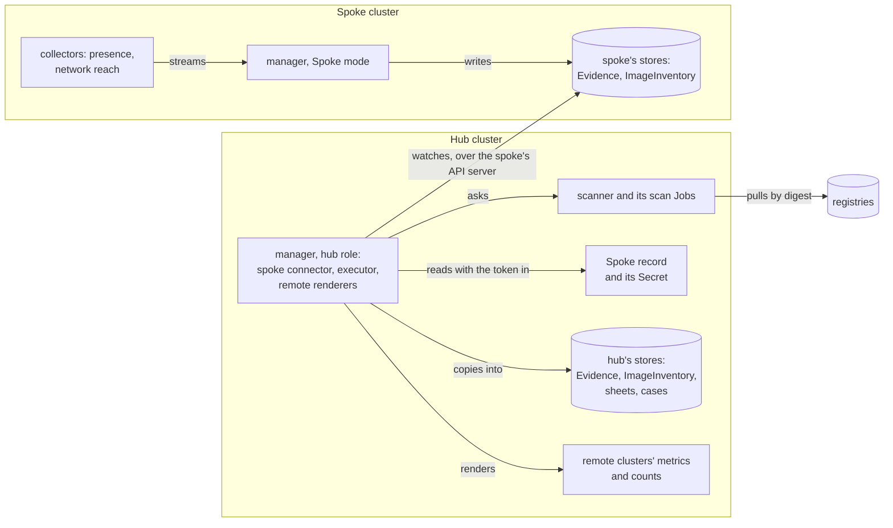

# vexplain — Remote spokes

- **Status:** accepted by the owner on 2026-11-24, as draft 2. The decisions are the owner's, from the brainstorm of
  2026-11-23 and 2026-11-24 (section 4). Draft 2 moves the scans and the remote clusters' reports to the hub (0065,
  0066). The calls marked **[call]** are the designer's, and the owner approved them with the design. Amended on
  2026-11-24 by the owner: a remote cluster gets metrics and counts only, no report objects (4.6, 5.9, 0065). Amended on
  2026-11-25 while it was built: the hub sends its own token only to the server and with the CA bundle that it was
  issued for, a token that the spoke refuses gives way to the admin's, and the check keeps tokens out of what it shows
  and logs (5.4, 0062). Revoking means deleting the ServiceAccount, since deleting only its binding invalidates no token
  (5.4, 0062). A `Spoke` named like the hub's own cluster is refused with `NameInUse`, one that reaches it with
  `OwnCluster`, and no `Spoke` takes away an entry of the hub's own cluster (5.3). An address that two clusters'
  exposure name is the IP, whatever its port (5.10).
- **Date:** 2026-11-23, revised 2026-11-24
- **Author:** Joshua Leuenberger
- **Extends:**
  - the [main design](2026-10-29-vexplain-design.md), 4.3 (storage), 5.1 (roles), 6.12 (the scanner's credentials),
    7 (phase 6) and 8;
  - [collectors, evidence and rules](2026-10-31-collectors-evidence-rules.md), 5.6 (evidence on demand);
  - the [collector model](2026-11-08-collector-model.md), 5.6 (a playbook's cluster match) and 5.9 (the scanner's
    credentials);
  - [entry points](2026-11-20-entry-points.md), 5.2 and 5.4.
- **Decision records:** [0060](../decisions/0060-the-hub-pulls.md) to
  [0066](../decisions/0066-the-hub-scans-every-image.md).

Statements marked **[call]** are the designer's, not the owner's. They are the first candidates to revisit.

## 1. Intent

Phase 6 is the last piece of the core feature set: vexplain on many clusters, with one hub.

- **Any Kubernetes cluster can be a spoke.** Its stage changes nothing in the implementation (owner).
- **The hub still decides once for the fleet** (0021): one record per digest, one scan, one rules pass, and at most
  one investigation per case, however many clusters run the image.
- **The SOC sees the whole fleet on the hub.** That's the reason for remote spokes (owner).
- **Phase 6 builds on today's architecture.** The stores, `tasks.Executor`, `ImageInventory` and `ImageVerdicts`
  stay. The design and architecture session after phase 6 folds its lessons back in. That's where evidence and
  reports may move to an aggregated API with its own database, and where reports may replace `ImageInventory` and
  `ImageVerdicts`.

**What changes from the earlier designs is where the connections start, and where the work runs.** 0021 had every
spoke open a connection to the hub's Kubernetes API, write its records there, read its tasks and the result sheets,
scan its own images and render its own reports. The owner decided otherwise:

- **The hub pulls (0060).** It reads each spoke's records from the spoke's own API server. No spoke holds a
  credential for the hub, and the hub writes nothing into a spoke.
- **The hub scans every image itself (0066),** from its registry, once for the fleet. Spokes don't scan.
- **The hub renders each remote cluster's metrics (0065),** and the playbooks' counts for it, until the reports'
  redesign renders reports for every cluster. It writes no report objects for a remote cluster (owner, 2026-11-24).

The owner's reasons:

- A credential into the hub on every spoke is the bigger risk. Any spoke that is broken into could read the fleet's
  inventory, which maps where every vulnerable image runs and how exposed it is. It could also rewrite the evidence
  that settles findings in every cluster.
- The hub is treated as a critical, production-grade system wherever it runs. It already holds every cluster's data,
  so a narrow credential per spoke adds little to what a break-in on the hub would expose.
- The same image shouldn't be scanned in every cluster that runs it.
- The SOC's view of the fleet is why remote spokes exist, so it can't wait for the reports' redesign.

Of the spokes' three jobs in 0021, a remote spoke keeps one: it is the hub's **eyes**, collecting what runs in its
cluster and how exposed it is. The **hands**, the scans, run in the hub's cluster (0066). The **mouth** waits for
the reports' redesign: until then, the hub renders a remote cluster's metrics (0065).

## 2. Goals, non-goals, anti-goals

### Goals

- The hub holds every spoke's presence, its exposure, its namespace labels and its other streamed evidence, and
  decides cases for the fleet.
- The hub scans each image that runs anywhere in the fleet once, with logins that its admin provides. The workloads'
  pull secrets never leave their cluster (0011).
- The SOC sees the fleet on the hub: the same metrics as a standalone install exports, under each cluster's name, and
  the playbooks' counts per cluster.
- No spoke can read or write anything on the hub, and the hub writes nothing into a spoke.
- A spoke is added with one object and one Secret on the hub, and removed by deleting them.
- The hub's own cluster can run `Hub` only, and an end-to-end test on kind keeps that honest (main design 7).
- The hub's storage and scan load are measured with several spokes, against decision 0004's triggers.
- Live run 6's lessons are folded in (5.12): the results' dip after an upgrade, the deletion of every cluster's
  streamed records with one `Collector`, the sink's scopes in memory, and two flaky tests.

### Non-goals (for now)

- **Report objects for a remote cluster,** in its own namespaces or the hub's. They come with the reports' redesign:
  an output directive per playbook, rendered on the hub and pushed into each cluster (owner, 0065).
- **Scanning on a spoke,** for a registry that only that cluster can reach. It comes later, if a fleet needs it, as
  Red Hat ACS delegates such scans to a secured cluster (owner, 0066).
- **A tunnel for a cluster that the hub can't reach.** Konnectivity can be added later behind the same seam
  (owner, 0061).
- **A database or an aggregated API for the hub's data.** It comes when 0004's triggers fire (owner, 0063).
- **Federated identity** for the hub's access to a spoke, such as cloud workload identity or Kubernetes' structured
  authentication configuration (owner, 0062).
- **A spoke that registers itself**, as kubelets and Open Cluster Management's agents do with a bootstrap token. The
  hub's admin creates the record **[call]**.
- **Urgency tables per cluster.** The hub's own table applies to the fleet **[call]**.
- **A collector for collectors**, meaning a built-in collector per spoke that copies its evidence to the hub and holds
  only that spoke's credential. It comes later, if keeping the credentials in the manager proves too risky (owner).

### Anti-goals (failure even if it "works")

- A spoke that can reach the hub, or a hub that writes into a spoke.
- A cluster's presence that is missing on the hub, read as "doesn't run there any more", lowering an urgency or
  closing a case. A missing input never settles anything.
- A spoke's data changing what the hub believes about another cluster, or about what an image contains.
- A misconfigured connection that copies one cluster's records under another cluster's name.
- A token, a login or another secret value in a log, a spec, a status or the model's context.

## 3. Constraints

- **Today's seams:** the stores are the one door to inventory data (0004), and the hub asks for evidence through
  `tasks.Executor` (0021). Phase 6 puts its transport behind the stores, and runs the executor in the hub's cluster.
- **The hub must reach each spoke's API server directly.** The owner's clusters allow that. A cluster the hub can't
  reach needs the later tunnel.
- **The hub's cluster must reach the registries that the fleet pulls from,** with logins that its admin provides
  (0047). An image from a registry it can't reach fails visibly, and waits for the later scanning on a spoke.
- **Kubernetes RBAC can't narrow a read of a cluster-scoped kind by label.** Whoever may read one `Evidence` of a
  cluster may read all of them.
- **Tests run on kind only, each cluster with its own kubeconfig.** The end-to-end test runs two kind clusters on one
  Docker network, and a local registry that both reach.
- **The repository is public:** no cluster names, hosts or live figures in it.
- **A spoke is installed like any vexplain install,** through whatever path its cluster takes, such as a CI pipeline
  with manual steps. Nothing on the hub deploys into a spoke.

## 4. Approaches (the owner's decisions, 2026-11-23 and 2026-11-24)

### 4.1 Who connects: the hub pulls (0060)

| Option | Who does it this way | Costs |
|---|---|---|
| Spokes connect to the hub, and push | Open Cluster Management, Karmada's pull mode, Argo CD's agent, Red Hat ACS (Sensor to Central) | Every spoke holds a credential for the hub, so the hub needs isolation between spokes: a namespace per spoke, admission rules, and a registration flow |
| **The hub connects to each spoke, and pulls (chosen)** | Argo CD's classic mode, Karmada's push mode, Cluster API, SIG Multicluster's ClusterProfile API with multicluster-runtime | The hub holds a narrow credential per spoke, and must reach each spoke's API server |

The owner chose the hub pulling. The hub is treated as critical anyway, and isolation between spokes on the hub then
needs nothing, since no spoke has access to it. The spoke watches only its own cluster.

### 4.2 How the hub reaches a spoke: directly, behind one seam (0061)

| Option | Who does it this way | Costs |
|---|---|---|
| **Directly, to the spoke's API server (chosen)** | Argo CD, Karmada's push mode, Cluster API | Needs a network path from the hub to each API server |
| A tunnel built into the product's agent and server | Rancher's cluster agent and k3s (remotedialer), Clusternet, GitLab's agent for Kubernetes, Argo CD's agent | A tunnel protocol of our own to secure and maintain |
| Konnectivity's proxy server and agent | Kubernetes control planes, Open Cluster Management's cluster-proxy, Karmada's guide for pull-mode clusters | Two more components, with their own certificates and routing |

The owner chose direct access first. It adds no components and works on kind, and the hub can already reach the
owner's clusters this way. A cluster that the hub can't reach gets Konnectivity later, behind the same seam (5.4).

For other adopters, direct access needs nothing extra. The later Konnectivity option would ship its proxy server
and agent as an optional part of the install. A hub on Open Cluster Management could use the cluster-proxy that
platform already runs. A control plane's own Konnectivity, which only carries its API server's calls, can't be reused.

### 4.3 The hub's credential for a spoke (0062)

| Option | Who does it this way | Costs |
|---|---|---|
| A long-lived token in a Secret | Argo CD, Karmada's push mode | Never expires; Kubernetes no longer creates such tokens by default |
| **A narrow service account whose short-lived token is renewed (chosen)** | Open Cluster Management's managed-serviceaccount add-on | Renewal logic, and a token that expires if the hub is down for too long |
| Federated identity: the spoke's API server trusts the hub's own identity | Cloud workload identity; Kubernetes' structured authentication configuration (stable since 1.34); the ClusterProfile API's credential plugins | Each spoke's API server must be configured to trust the hub, which vexplain can't do itself |

The owner chose the renewed short-lived token. One place in the code gets the token, so federation can replace it
later.

### 4.4 Where images are scanned: on the hub (0066)

| Option | Who does it this way | Costs |
|---|---|---|
| In a cluster that runs the image, which the hub asks (draft 1) | Red Hat ACS delegates scans to a secured cluster for registries Central can't reach | The hub writes requests into spokes. One cluster's answer serves every cluster, so a spoke that is broken into can forge what an image contains for the whole fleet. Answers about different platforms must be merged |
| Each cluster scans its own images | Every standalone install today; Trivy Operator, in each cluster | The same image is scanned in every cluster. The rules evaluate at most 4 combinations of producers, so answers kept per cluster would soon hold every finding open |
| **The hub scans every image from its registry (chosen)** | Red Hat ACS's Central; Harbor and Quay scan each digest once, at the registry | The hub's cluster reaches every registry, with logins of its own, and carries the whole scan load |

The owner chose the hub: the same image shouldn't be scanned in every cluster that runs it. It also removes, from
draft 1, the requests written into spokes, the merging of answers, and every way for a spoke to change what an image
contains.

### 4.5 Where the spokes' records live on the hub: copies (0063)

| Option | Who does it this way | Costs |
|---|---|---|
| **The hub copies each spoke's records into its own stores (chosen)** | Red Hat ACS Central and ACM's search, which copy into PostgreSQL | The hub's etcd holds and writes every cluster's records |
| The hub reads them live, through caches fed by watches | Argo CD's cluster cache, Karmada's search cache | Every reader of `ImageInventory` changes. The agent workers would need the manager's memory through a new internal API. After the hub restarts, a spoke stays unknown until its watch has caught up |

The owner chose the copies:

- They are the smallest step from today: the hub writes what the in-process spoke writes now.
- Tools that make lasting decisions about a fleet keep a durable copy. vexplain's hub makes lasting decisions:
  cases, verdicts, and investigations that cost tokens.
- A spoke that drops out keeps its last data on the hub.

The load on the hub's etcd is measured with several spokes (5.13). Once it grows too large, the data moves to an
aggregated API with its own database (owner).

### 4.6 Reports and metrics of a remote cluster: metrics, rendered on the hub (0065)

| Option | Costs |
|---|---|
| No reports on remote spokes until the reports' redesign (draft 1) | The SOC's board shows only the hub's own cluster, though the fleet view is why remote spokes exist |
| The hub copies the sheets, facts and playbooks into each spoke, so that the spoke renders | Copies of `ImageInventory` and `ImageVerdicts`, the two kinds the owner wants to drop, plus write access on every spoke |
| The hub renders the reports into each spoke's namespaces | The whole of the reports' redesign, plus write access on every spoke |
| The hub renders each remote cluster's reports and metrics into its own namespace | The hub copies each spoke's namespace labels too. Every remote report lands in the hub's etcd, for a demo until the redesign |
| **The hub renders each remote cluster's metrics and counts, without report objects (chosen)** | The hub copies each spoke's namespace labels too, for the playbooks' namespace match. Workloads' owners and `kubectl` see no remote reports until the redesign |

The owner chose rendering on the hub, and on 2026-11-24 narrowed it to the metrics: the remote reports would only serve
a demo before the redesign. Rendering on the hub is the first half of the reports' redesign, which later renders by
each playbook's output directive and pushes the reports into each cluster.

### 4.7 The hub's record of each spoke (0064)

The owner agreed that the hub keeps a record per spoke, which earlier designs had promised for phase 6. It holds the
cluster's labels (collector model 5.6) and its collectors (collectors, evidence and rules 5.6). Its shape is the
designer's **[call]** (5.3).

## 5. Design



```mermaid
sequenceDiagram
  autonumber
  participant SC as Spoke's collectors
  participant S as Spoke (its own API server)
  participant H as Hub
  participant R as Registry
  SC->>S: presence and exposure, stored in the spoke's own store
  H->>S: watch the spoke's records and namespaces
  H->>H: copy them into the hub's stores, keyed with the spoke's cluster
  H->>R: pull digest D, for every platform that runs it in any cluster
  H->>H: scan D once; rules and cases, once per digest
  H->>H: render the spoke's metrics under its name, and the playbooks' counts
```

### 5.1 Roles and modes

- **The modes `Hub`, `Spoke` and `HubAndSpoke`** (0021) become a start-up setting of the manager, a flag set by the
  install **[call]**. `HubAndSpoke` is the default, and is today's behaviour. The mode decides which controllers,
  streams and watches the process starts, and a cluster's role doesn't change while it runs. That's why it's a flag
  and not an `OperatorConfig` field.
- **`Spoke` collects, and stores what it collects in its own cluster:**
  - the collectors that need the cluster: presence and network reach;
  - presence and the store sink, which store presence and exposure for the hub to copy (0058).

  It runs no executor, no scanner, no renderer, no hub controllers, no matcher and no agent workers.
- **`Hub` runs the hub role:**
  - the hub's controllers;
  - the hub's collectors: the matcher, the advisories, the exposure sources, and now the scanner (0066);
  - the executor, which runs the hub's requests with the hub's own collectors (5.6);
  - the agent's workers;
  - the spoke connector (5.4, 5.5), and a renderer for each remote cluster (5.9).

  It runs no presence and no network reach of its own.
- **`HubAndSpoke` runs both:** its own cluster's presence, exposure and reports as today, plus the spoke connector
  and the remote renderers.
- **Each spoke keeps its own `OperatorConfig`.** Its `clusterName`, scope, owner attribution and presence settings
  stay its collection boundary (0043). The hub doesn't read a spoke's `clusterLabels` or urgency settings: the hub's
  record and the hub's own table decide those (5.3, 5.9).

### 5.2 One new kind

| Kind | Group, scope | Lives in | Written by | Read by |
|---|---|---|---|---|
| `Spoke` | `config`, cluster-scoped | the hub | the hub's admin (spec), the hub (status) | the hub |

It gets print columns and categories (0039), and status for kstatus (0036).

### 5.3 The `Spoke` record (0064)

A `Spoke` describes one remote cluster. Its name is the cluster's name, as the spoke's `OperatorConfig` names it
and as its records carry it.

- **`spec.labels`:** the cluster's labels, for a playbook's cluster match (5.8).
  - They are set on the hub, never reported by the spoke, so that a spoke can't choose the lenient playbook
    (collector model 5.6).
  - They move here from `OperatorConfig`, as the collector model planned. The hub's own cluster keeps its labels in
    its `OperatorConfig`, and has no `Spoke` **[call]**. That avoids a breaking change.
- **`spec.credentialsSecretRef`:** a Secret in the operator's namespace on the hub, which the admin creates, holding:
  - the address of the spoke's API server;
  - its CA bundle;
  - the bootstrap token (5.4).

  The hub never writes it. The renewed tokens go into a Secret of the hub's own, which the `Spoke` owns **[call]**.
  So a pipeline that applies the admin's Secret again doesn't bring back an expired token. The `Spoke` itself holds
  no secret, as SIG Multicluster's ClusterProfile asks of a cluster record.
- **`status.clusterID`:** the UID of the spoke's `kube-system` namespace, recorded at the first contact. A contact that
  later finds another UID stops copying, with `Connected` set to False and the reason `IdentityChanged`, until an
  admin clears the field **[call]**. So a Secret that points at another cluster never copies that cluster's records
  under this name.
- **`status.collectors`:** for each `Collector` on the spoke, as the hub last read it:
  - its name and version;
  - the types it produces, each with its scope;
  - its operations with their roles;
  - whether it is Ready.

  This is the report that collectors, evidence and rules 5.6 asked each spoke to give. The hub reads it itself.
- **`status.conditions`:**
  - `Connected`: the last call to the spoke worked;
  - `Synced`: the copy has caught up since the hub started;
  - `Ready`: both.
  - *Amended on 2026-11-25 (build):* a `Spoke` that has the name of the hub's own cluster, as the hub's `OperatorConfig`
    names it, is refused: `Connected` False with the reason `NameInUse`, and Stalled. The hub contacts its spoke not at
    all, copies nothing under the name, and deletes nothing when the `Spoke` is deleted **[call]**. The hub's own
    records and entries carry that name, so the copies would overwrite them, and their deletion delete them, with the
    facts of an image that ran nowhere else. Every install names its cluster `local` unless its `OperatorConfig` says
    otherwise, so a hub and a spoke both left at the default meet there. A change of the `OperatorConfig` brings a
    check of every `Spoke`, so a rename onto a `Spoke`'s name stops its copy at once. After a rename away from a name,
    the hub's own entries keep it until the hub next reconciles each image: neither the copy of a `Spoke` of that name
    nor its deletion takes away an entry that has the hub's own cluster ID **[call]**. A `Spoke` whose Secret reaches
    the hub's own cluster under another name is refused too: `Connected` False with the reason `OwnCluster`, and
    Stalled. Its copies would carry the hub's own cluster ID, so they and the hub's own entries would replace each
    other. The hub copies nothing from it, renews no token there, and records no `clusterID`, so that the Secret, once
    it names the right spoke, makes a first contact and not `IdentityChanged` **[call]**. Its deletion deletes the
    copies under its name, as any `Spoke`'s does, which hold nothing of the hub's own.
- **`status.lastSyncTime`** and **`status.tokenExpirationTime`.**
- **Deleting a `Spoke`** waits on a finalizer. The hub deletes its copies of that cluster's records (5.5), and that
  cluster's counts and series (5.9). The hub's token Secret goes with the `Spoke`, which owns it.

Precedents: Open Cluster Management's `ManagedCluster`, Karmada's `Cluster`, and SIG Multicluster's `ClusterProfile`,
whose properties and conditions this record mirrors.

### 5.4 Connecting to a spoke (0061, 0062)

- **The seam:** one function builds the client for a spoke from its `Spoke` and Secret: the server's address, the CA,
  and a source of tokens. Phase 6 connects directly. A Konnectivity dialer fits in here later, as does a federated
  token source.
- **TLS is always verified,** against the Secret's CA bundle. There is no option to skip it.
- **The hub's account on a spoke:** the spoke's install creates a ServiceAccount for the hub in the operator's
  namespace. Its role grants exactly this:
  - get, list and watch on vexplain's `Evidence`, `ImageInventory`, `Collector` and `OperatorConfig`;
  - get, list and watch on namespaces: their labels, which the hub copies for that cluster's metrics (5.5), and
    `kube-system` for the cluster's identity;
  - create on `serviceaccounts/token` for its own ServiceAccount only, to renew its token.

  Nothing else: no Secrets, no workloads, and no writes to any record. RBAC can't narrow the reads by label (section
  3), so the hub may read all of the spoke's vexplain records. That's what it needs anyway.
- **The token:**
  - An admin creates the first token for that ServiceAccount on the spoke, with a short lifetime, and puts it into the
    admin's Secret with the address and the CA.
  - The hub asks the spoke's TokenRequest API for a new token at half the current token's lifetime, and writes it
    into its own Secret (5.3).
  - *Amended on 2026-11-25 (build):* the hub sends its own token only while that token is valid, the spoke doesn't
    refuse it, and it was issued for the server and the CA bundle that the admin's Secret names. Otherwise it sends the
    admin's token **[call]**. This replaces "It uses the admin's token only while its own Secret holds no valid one".
  - *Amended on 2026-11-25 (build):* a token that the spoke refuses isn't valid, whatever its expiry says. The hub then
    tries the admin's, and renews from it at once **[call]**.
  - *Amended on 2026-11-25 (build):* the hub's own Secret keeps, next to the token, the server and a SHA-256 of the CA
    bundle that the token was issued for **[call]**. So a mistake, or a pipeline that writes the admin's Secret, can't
    send the hub's self-renewing token to another server, or to one that a swapped CA lets through.
  - *Amended on 2026-11-25 (build):* a moved API server, or a rotated CA, needs a new bootstrap token **[call]**.
  - The token lives 24 hours **[call]**.
  - A token that expires before the hub could renew it, for example after a day-long outage of the hub, sets
    `Connected` to False with the reason `TokenExpired`. The admin then puts a new bootstrap token into the admin's
    Secret.
- *Amended on 2026-11-25 (build):* **no token in what the hub shows.** A spoke's text can carry what the hub sent. So
  the check withholds each token that it sent, and each part of one, from the `Spoke`'s conditions, and logs none of
  the spoke's warnings **[call]**.
- **Revoking access:** delete the ServiceAccount, or its binding, on the spoke.
  - *Amended on 2026-11-25 (build):* deleting only the binding stops the access while it is gone, and invalidates
    no token, so the hub's own token, and a stolen copy, work again once the binding comes back, within the
    token's lifetime. Deleting the ServiceAccount invalidates every token issued for it, so that is the way to
    revoke **[call]**.
- **A known limit:** whoever steals the token can renew it until it is revoked, as with any credential that renews
  itself. Each renewal shows in the spoke's audit log.

### 5.5 Copying a spoke's records (0063)

- **Per `Spoke`, the hub watches** the spoke's `Evidence`, `ImageInventory`, `Collector`s and namespaces through
  caches fed by watches. It writes what changes into its own stores, through the interfaces that the in-process
  spoke uses today:
  - **Streamed records of `Hub` scope**, keyed with the spoke's cluster (0058): `evidence.Store.Put` with
    `InCluster`, and their deletions. After each sync of the caches, the hub takes the spoke's records as a snapshot
    per source and type: `DeleteStreamed` keeps only what the spoke holds. They include each image's presence,
    which `workloads` declares `Hub` since 0058, with every workload that runs the image, its pods and its
    containers. The remote renderer reads what runs from them (5.9).
  - **Presence entries:** each `ImageInventory` entry of the spoke's cluster goes through `inventory.Store.Observe`,
    and an entry that disappears through `Forget`.
  - **Namespace labels:** the labels of each of the spoke's namespaces, into records of the hub's own, keyed with the
    cluster **[call]**. The remote renderer reads them for the playbooks' namespace match, so that it reads only
    copies (5.9).
  - **Collectors:** into the `Spoke`'s status (5.3).
- **Only what the spoke declares now:** the hub copies a streamed record only while the spoke's `Collector` declares
  its type with the scope `Hub` in its status. So a downgraded collector's leftover records stay out of the hub (run
  6's lesson about the sink's memory). The hub's copy of such a type is deleted.
- **Checks before each copy:** a record's cluster must be the `Spoke`'s name, and a presence entry's cluster ID must be
  the `Spoke`'s `status.clusterID`. Anything else is refused, logged without its data, and counted. Each record
  then passes the store's own validation, as the spoke's sink does.
- **The copy belongs to the hub.** A spoke changes it only by changing its own records, which the hub then reads.
- **A spoke that drops out keeps its copies** on the hub, unchanged, and its conditions say since when. Its cases and
  its series keep using them, so a cluster that can't be reached never reads as "doesn't run it any more" (section
  2). Only deleting the `Spoke` deletes them.
- **After the hub restarts,** its stores still hold the copies from before. Each `Spoke` turns `Synced` once its
  caches have synced and the first round of copying is done. Records that changed while the hub was down are caught
  up by that round.
- **A write happens only on a change.** The store writes a record in place only when its event differs (0058), so a
  sync of unchanged records writes nothing.
- **Deleting a `Collector` on the hub's own cluster** deletes its streamed records of that cluster only **[call]**.
  Run 6 showed that `DeleteBySource` deletes every cluster's records.

Precedent: Red Hat ACS's Central and ACM's search keep a durable, central copy of each cluster's state.

### 5.6 Scanning every image on the hub (0066)

- **The hub's cluster scans every image that runs in the fleet** (owner). The executor runs with the hub, in `Hub`
  and `HubAndSpoke`, and asks the hub's own collectors, as today's in-process executor asks the local ones. It asks
  no spoke for anything.
- **A scan names the platforms to scan:** those that run the image in any cluster, from the copies of presence. It
  pulls from the repositories that any cluster pulled the image from, which today's request already gathers across
  clusters. The scanner reads the image's files and runs none of them, so the hub's nodes don't need those
  platforms.
- **Logins:** the hub's scanner pulls with the logins that its admin provides (`AdminProvided`, 0047). Where the image
  also runs in the hub's own cluster, the logins of a local pod's pull secrets come first, as today
  (`CopyFromWorkload`). The pull secrets of a remote cluster's workloads never leave that cluster.
- **Once for the fleet,** as today for one cluster:
  - The facts say which manifests the last scan found for each platform, and the evidence says at which scanner
    version.
  - The hub asks again only for what's missing or stale. A platform that starts running in any cluster has the image
    asked for again, and that scan covers every platform that runs, so its answer replaces the facts' list, as today.
  - Ten clusters that run one image cost one scan.
- **The scanner's change:** a scan takes the platforms to scan, with or without pods. Without pods, it uses the
  admin's logins only. Its checks stay: each manifest of a result must be of a platform that the scan asked for.
- **A registry that the hub can't reach** fails visibly, in the image's facts, with the registry named (0047): for
  example `NotPullable` or `Unauthorized`. Scanning on a spoke for such a registry comes later (section 2).
- **Spokes never send scan results.** So no spoke can change what an image contains, for any cluster (section 2).
- **The scan load lands on the hub's cluster.** There are fewer scans in total, one per image for the fleet, but all
  in one place. The scanner's concurrency setting bounds them, and the measurement (5.13) includes them.

Precedents: Red Hat ACS's Central scans the images of every secured cluster from their registries. Harbor and Quay
scan each digest once, at the registry.

### 5.7 Producers, freshness and health across clusters **[call]**

- **Image evidence comes from the hub's own collectors:** the scanner, and any other collector that the hub's cluster
  runs. The playbook check reads the hub's own `Collector`s for it, as today. So no image ever waits for a collector
  that can't reach it.
- **Workload evidence comes from the collectors of the workload's own cluster:** for a workload of a spoke, those that
  its `Spoke` lists. A source, which answers about entry points (0059), counts for every workload, as today.
  - The exposure rules read, for each workload, only the producers of its own cluster. So a collector that runs in
    one cluster neither holds up nor multiplies the inputs of another cluster's workloads.
  - Missing workload evidence counts as Unknown, as today. Nothing waits for it.
- **A pin names a collector,** and matches the collector of that name in the workload's cluster.
- **Freshness:** a streamed record is stale when its version differs from the version of its collector in its
  cluster. Image evidence is fresh as today, by the hub's own collectors.
- **Health:** a remote collector's health shows on its `Spoke`. The hub asks remote collectors nothing, so health
  decides no request.
- **A playbook is Ready** when the hub's cluster has a producer of each image type that it needs, and some cluster has
  a producer of each workload type that it needs (0043).

### 5.8 A playbook's cluster match, per cluster **[call]**

- **Today the hub tests a playbook's `match.clusters` against the one cluster's labels** (`judges`, in the assessor
  and the janitor). With spokes, each cluster has its own labels: the hub's own cluster in its `OperatorConfig`, each
  spoke's in its `Spoke`.
- **A playbook judges an image when at least one cluster that runs it matches.**
- **Its cases count only the workloads of matching clusters.**
- *Amended on 2026-11-25 (build):* **A case that several playbooks select is queued with the union of their matching
  clusters, and the most urgent of their views** **[call]**. 0043 has several playbooks' results add up, and the most
  cautious outcome win:
  - no list, which counts every cluster, goes in when one of them has no cluster selector, and the agent's workers and
    `agent-replay` select with what the queue holds;
  - the case's place in the queue and where it runs come from the most urgent view, by the queue's tiers;
  - each investigation that hands the case over combines the views of the playbooks that its `Assessment` names
    (`status.playbooks`) and that still select it, each from its own sheet, matching clusters and exposure rules. So a
    playbook that stops selecting the case stops shaping its entry, and nothing freezes it;
  - a playbook's own investigation still selects by its own matching clusters.
- **The janitor keeps a sheet** while any matching cluster runs the image.
- **A cluster's reports and series hold only the playbooks that match that cluster** (5.9).

Precedent: Open Cluster Management's Placement selects clusters by their labels.

### 5.9 Reports, cases, the agent and the SOC

- **Cases read `ImageInventory` as today.** It now holds every cluster's presence, as copies. A case's impact
  already names each cluster (`Place`).
- **The agent's workers read the hub's stores as today** (0057).
- **The agent's budget is the hub's,** so it is global by construction: the "global budget" of main design 7.
- **Urgency uses the hub's own table for every cluster** **[call]**. A table per cluster comes later, if a fleet needs
  it (phase 4's plan, "For phase 6").
- **The hub renders each remote cluster's metrics** (owner, 0065). Per `Spoke`, it renders what the cluster's reports
  would say, as a standalone install's renderer does, reading only copies (5.5) and the hub's own state:
  - what runs in each workload, from the copies of that cluster's presence records, and its exposure and reach from
    the copies of its exposure;
  - the facts, the sheets and the playbooks from the hub's stores, as today;
  - the copies of that cluster's namespace labels, for the playbooks' namespace match;
  - the `Spoke`'s labels for the playbooks' cluster match (5.8), and the hub's urgency table.
- **It writes no report objects for a remote cluster** (owner, 2026-11-24). The remote reports would only serve a demo
  until the reports' redesign, so the hub keeps what they would say only as metrics.
- **It renders at once after the hub starts,** whether or not the spoke can be reached, since the copies survive the
  restart **[call]**. So a spoke that can't be reached keeps its series on the board.
- **It exports today's report metrics under that cluster's name:** `vexplain_open_case`, `vexplain_findings`,
  `vexplain_funnel` and `vexplain_namespace_owner_info`. So the board covers the fleet without changes. The hub also
  exports each remote collector's readiness from its `Spoke`, and the images running in each cluster from the copies
  **[call]**.
- **It writes each playbook's counts for that cluster** (`PlaybookClusterStatus`), so the playbooks' fleet picture
  covers it too.
- **An image whose presence record is missing,** as when the spoke's store refuses one as too large (0058), is missing
  from that cluster's series, though its cases still count its workloads from `ImageInventory`. The hub counts such
  images per cluster **[call]**, and the measurement checks the largest presence record against the store's cap
  (5.13).
- **The renderer stays spoke code, wired per `Spoke`** **[call]**. It reaches the hub's state only through the stores,
  and no hub controller calls it, so 0021's separation holds.
- **The hub's own cluster keeps its reports in its own namespaces,** as today.
- **A remote cluster's workload owners see no reports** until the reports' redesign renders them for every cluster
  (section 2).
- **The SOC works from the hub,** where the investigations, the cases and every metric cover the fleet.

### 5.10 Entry points across clusters

- **Exposure's subjects are unique per cluster** (`workload/<cluster>/…`), and presence's repeat per image (entry
  points 5.4). Copies keep their cluster, so nothing collides.
- **Entry-point subjects stay shared across clusters** **[call]**: `host/<name>` and `address/<ip>[:<port>]` (entry
  points 5.2). A source answers about an address, not a cluster, so it is asked once.
- **An address that two clusters' exposure names is ambiguous** **[call]**.
  - Clusters on separate networks can reuse private ranges. A source's answer about one cluster's address, such as
    "internal only", must not lower the urgency of another cluster's workload at the same address.
  - So the hub uses no source's answer about such an address. The exposure rules get no answer for it, as for any
    missing input, so it can't lower an urgency. The hub counts such addresses per cluster.
  - *Amended on 2026-11-25 (build):* the address is the IP, whatever its port **[call]**. Every subject of an IP that
    two clusters' exposure names is ambiguous, also when one names it with a port (a node port) and the other with
    another port or none, since the reused range is the reason.
  - In the owner's fleet, no address repeats (owner, 2026-11-24). There the rule only catches a mistake, and its
    count shows one.
  - Host names stay shared, since a DNS name means the same for every cluster.
  - Per-network subjects, which a source answers per network, come later if a fleet needs them.
- **The asker (0059) asks the sources about the entry points of every cluster's exposure.** Nothing else changes.

### 5.11 Adding and removing a spoke

1. **Install vexplain on the spoke in `Spoke` mode,** through the cluster's usual path. The install includes its
   `OperatorConfig` (cluster name, scope, owner attribution), its presence and network-reach collectors, and the hub's
   ServiceAccount and role (5.4).
2. **On the spoke, create a short-lived token** for the hub's ServiceAccount.
3. **On the hub, create the Secret** (address, CA, token) and the `Spoke` (the spoke's cluster name, and its labels).
   If the spoke's images come from a registry that the hub's scanner has no login for yet, add one (0047).
4. **The hub connects:** it records the cluster's identity, renews the token, and starts copying. The `Spoke` turns
   Ready. The hub scans the images of that cluster that it hasn't scanned yet, and renders the cluster's metrics.

**Removing a spoke:** delete the `Spoke` on the hub, which removes its copies, its counts and its series. Then
uninstall vexplain on the spoke.

**Reinstalling a spoke** while its `Spoke` exists, meaning an uninstall that deletes vexplain's records on the spoke,
then a new install **[call]**:

- The hub follows the uninstall, and drops that cluster's copies as the spoke deletes its records.
- It copies them again once the new install's collectors run. In between, that cluster is missing from the cases and
  the metrics.
- An upgrade in place doesn't do this, since the spoke's records stay and its collectors' recorded capabilities are
  only ever replaced.

**Turning a standalone install into a spoke** **[call]**. A standalone install runs `HubAndSpoke`, with its own
scanner, reports and reviews. To make its cluster a spoke:

1. Uninstall it.
2. Install vexplain in `Spoke` mode.
3. Add the cluster on the hub, as above.

Switching the mode in place would leave the old install's records behind, such as reports in the workloads'
namespaces that show old verdicts. From then on, the hub renders that cluster's metrics. The
uninstall also removes its reviews (`VexStatement`s). Reviews live on the hub only, and the standalone installs that
become spokes hold none worth keeping (the owner, 2026-11-23).

vexplain itself has no registration flow in phase 6 **[call]**. In Open Cluster Management, an agent joins with a
bootstrap token and a certificate signing request, as a kubelet does. Here, the admin's three objects stand in for
that.

### 5.12 Upgrades, and live run 6's lessons

- **The results' dip after an upgrade.**
  - After the upgrade of run 6, the results fell for several minutes, until the hub had rewritten the sheets.
  - The likely cause: the new build skips the cases of the sheets that the old build wrote, until it rewrites them.
  - Phase 6 reproduces the upgrade on kind, from the old build to the new, finds the skip, and fixes it. A hub's
    upgrade would otherwise dip every cluster's results at once.
  - *Found while building, 2026-11-25:* the cause was version skew in presence, not the sheets. The new collector's
    field failed the old manager's presence schema, presence forgot every image, and the images' facts went with
    them. Presence and exposure now tolerate fields they don't know, and presence never forgets what it can't read
    (0067).
- **Mixed versions:**
  - The hub reads a spoke's records with its own Go types, so fields it doesn't know are dropped, and fields it
    expects but the spoke lacks stay empty.
  - Spokes are upgraded after the hub **[call]**.
  - A record that fails the store's validation is refused and counted, as in 5.5.
  - Presence and exposure accept fields they don't know, presence never forgets what it can't read, and a new field
    of a core type starts optional (0067). So the hub, its spokes and their collectors can be upgraded in any order.
- **Deleting a `Collector`** deletes only its own cluster's streamed records (5.5).
- **The sink's scopes in memory** no longer leak to the hub: the hub reads each spoke's declared scopes (5.5).
- **Two flaky tests are fixed first:**
  - an update conflict in `internal/controller/config/collector_api_test.go`;
  - the cost limit against the 1-second run bound in `internal/rules/engine/exposure_test.go`.

### 5.13 Measuring the hub's storage and load (0004)

- **The measurement:** a hub with several spokes on kind, at least three clusters **[call]**. It measures:
  - the `Evidence` objects and their bytes, with the presence records apart, and the largest presence record against
    the evidence store's cap;
  - the largest `ImageInventory`;
  - the hub's write rate, which includes every cluster's presence changes, since presence changes whenever a pod
    starts, stops or moves (0058);
  - the series of the report metrics on the hub;
  - the scans: how many, how long, and what their Jobs use;
  - the time to `Synced` after a restart.

  Each is measured against 0004's triggers. The operator already exports sizes and write rates (main design 4.3).
- **The first limits expected:**
  - one `ImageInventory` holds every cluster's entry for its image, and each entry lists up to 1000 namespaces. A
    widely used image across many clusters reaches 0004's 512 KiB first;
- **If a trigger fires,** the data moves to an aggregated API with its own database (owner, 4.5).

### 5.14 Security

- **Spokes hold nothing for the hub.** The hub holds one narrow, short-lived token per spoke, which it renews, in a
  Secret in its own namespace.
- **The hub writes nothing into a spoke.** Its role there reads vexplain's records and the namespaces, and renews its
  own token (5.4).
- **A spoke can only misreport itself.**
  - Every copied record carries the spoke's cluster and identity, and is checked (5.5).
  - Spokes send no scan results, so a spoke that is broken into can't change what an image contains, for any
    cluster.
  - It can misreport what runs in it and how exposed it is, which changes only its own cluster's cases and reports.
  - Precedent: Kubernetes' NodeRestriction lets a kubelet change only its own Node and its own pods.
- **A spoke names the repositories that the hub pulls from.** A spoke that is broken into could name a host of its
  own. The digest still binds what the hub scans, and the hub's logins go only to the hosts they are for (0047). It
  could also report many digests, and the scanner's concurrency bounds the load.
- **The hub's scan Jobs parse images that anyone who can deploy on any spoke chooses.** They stay isolated as today:
  no host access, no rights in the API, and a namespace of their own. On the hub that isolation matters more, so the
  install documents how to keep their network to the registries (section 8).
- **What a break-in on the hub adds:** every spoke's vexplain records and namespace labels, which the hub holds
  anyway, and its scanner's registry logins. It gives no write access to any spoke, and no access to the spokes'
  workloads, Secrets or nodes.
- **No secret value goes into a log, a spec, a status or the model's context.** A spoke's tokens live only in the
  admin's Secret and the hub's own (5.3), and the scanner's logins only in theirs (0047).
- **The hub verifies each spoke's API server certificate** and its identity (5.3, 5.4).

## 6. Testing

- **Unit tests:**
  - the copier's checks, and its snapshots;
  - a scan's platforms, gathered across clusters;
  - the producers of a workload's evidence, by its cluster;
  - an address that two clusters name, which gets no source's answer;
  - the cluster match per cluster;
  - the remote renderer: what runs per workload from copied presence, a cluster's series and counts, and rendering
    from copies while the spoke can't be reached;
  - the token's renewal into the hub's own Secret, and its expiry.
- **End to end, on kind:** two clusters on one Docker network, and a local registry that both reach. The hub runs
  `Hub`, the spoke runs `Spoke`, and the hub reaches the spoke's API server directly. The test checks that:
  - a workload on the spoke gets a case on the hub;
  - the hub scans the workload's image from the registry, with a login that the test provides, though no pod on the
    hub runs it;
  - the report metrics on the hub carry the spoke's workload, under the spoke's cluster;
  - a spoke that becomes unreachable keeps its copies, its cases and its series, also across a restart of the hub;
  - deleting the `Spoke` removes its copies and its series;
  - the token renews;
  - the hub's role on the spoke can't write anything.
- **`Hub`-only mode** is the end-to-end setup above (main design 7).
- **The upgrade on kind** (5.12), and **the measurement** (5.13).

## 7. What changes in earlier designs and records

- **0021:** the hub connects to its spokes, and spokes hold no credential for it (0060). A remote spoke is the hub's
  eyes. The hands, the scans, run in the hub's cluster (0066). The mouth waits for the reports' redesign; until
  then the hub renders a remote cluster's metrics (0065).
- **Main design:**
  - 4.3: spokes no longer use the hub's API;
  - 5.1: who connects to whom, and where the scans and the remote reports run;
  - 6.12: the hub pulls the images of remote clusters with the admin's logins;
  - 7: phase 6's content;
  - 8: the transport, now decided.
- **0004:** the hub's copies are measured against its triggers (0063).
- **0011 and 0022:** the scan of an image that runs only in a remote cluster gets no copy of its workloads'
  credentials, only the admin's logins (0066).
- **0043, and the collector model 5.6:** a remote cluster's labels live on its `Spoke` (0064).
- **0047, and the collector model 5.9:** `AdminProvided` is how the hub pulls the images of remote clusters (0066).
- **Collectors, evidence and rules 5.6:** the hub reads each spoke's collectors into its `Spoke` (0064). Evidence on
  demand comes only from the hub's own collectors (0066).
- **0058:** a remote cluster's streamed records reach the hub through the hub's copy, not through the spoke's sink
  (0063). The presence records it sends to the hub also feed the remote reports (0065).
- **The scanner:** a scan takes the platforms to scan, and needs no pod (0066).
- **Entry points 5.2, and 0059:** the subjects stay shared across clusters, and an address that two clusters name
  gets no source's answer (5.10).
- **Phase 3a's fixes, 2.6:** a namespace per cluster on the hub is no longer needed, since no spoke writes to the hub.

## 8. Left to the builder

- The exact fields and names of `Spoke`, within 5.3.
- The token's lifetime, as a default.
- How the copier groups its writes after a sync.
- The flag's name, and how the install sets it.
- Which collectors each mode's install deploys, now that the scanner runs with the hub.
- How the renderer reads what runs: from the spoke's own presence, or from the copied presence records of a remote
  cluster, turned from images into workloads.
- The form of the hub's copies of a spoke's namespace labels, within 5.5.
- The name of the hub's own token Secret.
- Where the executor's code lives, once it serves the hub's cluster in every mode.
- How a copied presence entry keeps a `workloadCount` above the 100 workloads it lists.
- Which other fields of a `Collector`'s status the `Spoke` keeps, such as each type's `maxAge`.
- How one image's `ImageInventory` stays below etcd's limit on an object's size, if the measurement (5.13) shows it
  must.
- How the install documents keeping the hub's scan Jobs' network to the registries, such as with a NetworkPolicy.
